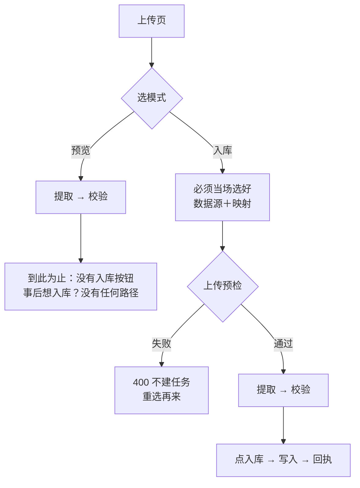
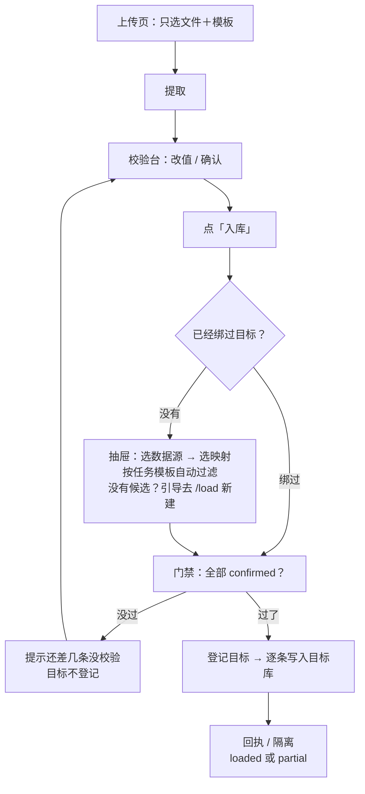

# P2c：让提取就是提取，入库时再选目标

日期：2026-11-21 · 前置：P2 / P2b · 状态：**已批准并实施**（删列迁移已执行，备份 pre_p2c_20261121_222705.sql；验收记录见 progress-handoff §〇.15）

> 本文分两半：**上半部分给人看**（大白话＋流程图＋例子），
> **下半部分给实施用**（技术契约，批准后才动）。消化只需看上半部分。

---

# 上半部分 · 看懂这个方案

## 30 秒版本

**现在**：上传文件时就要选「预览模式」还是「入库模式」。选了预览，这批数据
以后就**永远不能入库**；选了入库，还没见到数据就得先选好写进哪个库哪张表。

**改成**：上传就是上传，所有文件一律先提取、先校验。等你看完数据、点「入库」
的那一刻，再弹窗选写进哪里。**入库从"上传时的预测"变成"校验后的决定"。**

打个比方：现在像仓库收货时就必须声明"这批货上哪个货架"，没声明的货永远堆在
收货区上不了架。改成：货先收进来、先验货，验完决定上架时再选货架。

## 现在长什么样（问题在哪）



三个问题，按严重程度排：

1. **单向门（最实际）**：预览任务没有入库按钮，事后想入库没有任何改绑路径。
   入口的一次选择锁死了整批数据的命运。
2. **决策时机反了**：还没看到提取出来的数据，就要决定它去哪。往往是验完数据
   才知道该不该入库、入哪张表。
3. **认知负担**：提取→校验的代码对两种模式**完全一样**，"模式"其实只是
   "要不要预先登记目标"这一个次要选项，却被包装成入口处的两条路。

顺带说明：当初选"上传时预登记"买到过一个好处——坏目标在上传时就报错，不浪费
一次提取。但入库时本来就有第二次预检（那次才是权威，因为表结构在上传后也可能
变），所以这个好处只是锦上添花，扔掉不可惜。

## 改后长什么样



上传页控件对比：

```
现在： [文件] [模板] (○预览 ○入库) [数据源▾] [映射▾] [参数]
改后： [文件] [模板] [参数]
```

**走一遍具体例子**：上传一份招行流水 PDF。

1. 上传页只选文件和模板，点上传。提取完进校验台——和现在预览模式一模一样。
2. 验完数据，觉得可以入库，点「入库」。
3. 弹出抽屉：左边选数据源（比如"产品库"），右边选映射——列表已经按这份任务
   用的模板过滤好，通常只有一两个候选（映射＝"哪个库×哪张表×哪个模板"的
   绑定，在 /load 页管理，本轮不动）。
4. 点抽屉里的「入库」：系统先查门禁——还有 3 条没确认？提示"还差 3 条"，
   **刚才选的目标不作数**，回校验台处理完再来，届时可以选同一个或别的目标。
5. 全确认后提交：目标这一刻才登记到任务上，开始逐条写入，出回执。
6. 万一写到一半目标库断了→partial（部分入库）。点「重新入库」沿用原目标，
   已写过的凭回执跳过——这段和现在完全一样。

## 三个关键决定，说清楚为什么

### 决定一：目标什么时候"登记"？——入库真正启动的那一刻

```
点入库 → 校验目标 → 门禁检查 → 【这里才登记目标】 → 开始写入
             ↓失败        ↓失败
           400/404       409
          什么都没登记   什么都没登记
          下次可另选     下次可另选
```

好处：**不需要专门的"改绑"功能**。没启动过＝没登记＝下次随便选；
门禁没过、目标表不存在……都不留痕迹，修好了重来就是。

### 决定二：登记之后还能换吗？——不能

一旦写入开始，回执就是按"那个库×那张表"记的账。中途换目标，账就对不上了。
所以登记后目标锁定（再带新目标来→409），partial 重试也只能沿用原目标。
这和现有的两条审计规则是同一个道理：映射被任务引用→只读；数据源被映射
引用→换库锁定。**审计平台，账目一致性优先于灵活性。**

### 决定三：任务表里的 mode 字段——删掉

"模式"这个概念退役了，数据库里那一列也就没用了。已经只读查过：现在 11 个
任务全是预览、没有任何入库绑定和回执——**删这一列不伤任何现有数据**。
删列要动真实库，走老规矩：先查状态→整库备份→再删→核对数据一条不少。
（实施到这一步会再单独跟你确认。）

## 各页面有什么变化（用户视角）

| 页面 | 变化 |
|---|---|
| 上传页 | 少了模式单选＋数据源/映射两个下拉，只剩文件＋模板＋参数 |
| 任务页 | 「模式」列改「入库目标」列（没绑定显示 —）；「全部模式」筛选删掉（状态筛选已够用）；详情里未绑定任务点「入库…」弹抽屉，已绑定直接入库 |
| 校验台 | 「入库」按钮对提取完成的任务都可见；未绑定弹同一个抽屉，已绑定直接入库 |
| /load 管理页 | **零变化**（数据源/映射照旧管理） |
| 对照报告 | **零变化** |

## 什么完全不变（放心清单）

- 提取引擎、校验台改值/确认/拒绝、血缘回溯
- 门禁规则：只有全部 confirmed 才能入库
- 写入引擎：回执、隔离、transform、断点重试、错误分类
- /load 页的数据源/映射管理、两条审计锁定规则
- 你的 11 个任务、5 个文件、135 条记录等全部现有数据

## 代价（诚实摆出）

- 坏目标到入库时才报错（上传时不再提前拦）。兜底：抽屉里先显示门禁计数，
  服务端入库预检是权威校验。提取出来的数据本身仍可校验，不算白跑。
- 浏览器缓存了旧上传页的话，提交会收到一句明确报错"请在任务入库时选择目标"，
  刷新页面即愈（不会静默出错）。

---

# 下半部分 · 技术契约（实施用，消化可跳过）

## T1. 裁决点汇总

1. 上传不再有 mode。upload/tasks_create 请求体携带
   mode/load_datasource_id/load_table_id → **400**「上传不再携带入库目标，
   请在任务入库时选择」（边界校验防旧缓存，非兼容 shim）。
2. 绑定只随一次成功的入库启动落库：校验归属/模板匹配/预检/门禁全过才
   set_task_load＋起线程；门禁 409/预检 400 不落绑定。无独立改绑端点。
3. 已绑定任务带 target 键 → 409「已绑定入库目标，不可改」；partial 重试沿用
   原绑定（回执键 ds×table 不变）；loaded/loading/failed 状态守卫沿用。
4. extract_task.mode 列删除（零成本窗口已核 2026-11-21：11 任务全 preview、
   绑定 0、回执 0）；迁移协议见 T5。
5. 任务列表「模式」列→「入库目标」（target_table·write_mode 或 —）；
   fmode 筛选删除。

## T2. 后端契约

### app.py
- `_load_preflight` 删除（逻辑移入 service.launch_load，单一接缝）。
- upload / tasks_create：删 mode 解析＋load_ctx；加退役键 400 守卫；
  `service.launch(paths, params, warns, ctx, tpl)`。
- `POST /api/tasks/{id}/load`：解析可选 body {load_datasource_id, load_table_id}
  （int 化，非法→400），传 `service.launch_load(task_id, target)`。

### service.py
- STATE 默认值/launch/task_ctx 去 'mode' 键（stage='load' 已表达入库阶段；
  实施时核 status 消费方——两套套件对 status 形状的断言）。
- `launch(paths, params, warns, ctx, tpl=None)`；create_task 去 mode 参。
- `launch_load(task_id, target=None)` 顺序：
  1. STATE.running 守卫 / task 存在 / 状态守卫（沿用）
  2. 已绑定：target 键存在→409；否则沿用现流程（lt/ds→tpl fields→
     preflight→records→gate→起线程）
  3. 未绑定：target 缺失→400「请选择入库数据源与映射」；归属
     （lt.datasource_id==ds_id）/模板匹配（lt.template_id==task 模板）/
     透传模板 400/lt·ds 存在 404/preflight（原 _load_preflight 全部规则）
     →records→gate→set_task_load→起线程
  4. run_load 零改动。

### store/catalog
- tasks.py：`create_task(template_version_id, params)`；_task_doc 去
  r.mode/'mode' 键（load 块沿用，NULL→None）。
- load.py：set_task_load / task-ref 守卫零改动。

### DDL
- 001_baseline.sql：extract_task 删 mode 列；load_datasource_id/load_table_id
  注释改「入库时绑定，未绑定为空」。其余 12 表零改动；schema_version 仍 [1]。

## T3. 前端（web/）

- upload.html/js：删 mode 单选（html:27-28）＋dssel/mapsel＋label；js 删
  modeVal/refreshMapSel/loadFields/数据源拉取（106-153/467/571）。
- tasks.html/js：fmode 删；列表列＋详情头改「入库目标」；按钮：previewed
  未绑定→「入库…」开抽屉；previewed 已绑定/partial→直接 doLoad；
  loaded/partial→回执（沿用）；gateinfo 对 previewed 恒显。
- staging.js：updateLoadButtons 同形改造；未绑定开抽屉，已绑定 POST {}；
  轮询/只读 banner 沿用。
- shell.js 新增共享 `openLoadTargetDrawer(taskId, templateId, onDone)`
  （与 openReceiptDrawer 同构）：数据源 select→映射 select（ds＋templateId
  双过滤，显示 target_table·write_mode）→门禁计数→提交 POST load {target}；
  0 候选→「去新建映射」链接 /load；400/409 内联；选择内存保留（门禁失败
  修完重开不必重选）。
- /load 页零改动（映射 badge 锁定时机从上传变为入库启动，语义不变）。

## T4. 验收改写（两套顺序重跑——后端变更轮铁律）

- accept_records_db.py item7：
  - up_load 预检 400×3 → 绑定时 400×3（普通上传后 POST load：缺 target/
    模板不匹配/目标表不存在）；
  - 「preview 任务入库 400」→「未选目标入库 400」；
  - 新增：门禁 409 后 task.load 仍 None；已绑定带 target 409；门禁失败后
    换目标再试成功；
  - Leg A：上传去 mode→全确认→POST load {ds,lt}→loaded（其余断言沿用）；
  - Leg B syn_load_task：create_task(vid,…)＋set_task_load 直绑；
  - 227/552 行 'mode':'preview' 键删除。
- accept_artifacts_db.py：141/444 行 mode 键删除；status 形状断言核对。
- test_load_rules / test_collect_selectors 零改动→36 单测照跑。
- 浏览器金路径（8799）：上传页无 mode 控件→普通上传→详情「入库…」抽屉
  （双过滤/0 候选引导）→门禁 409 内联→全确认→loaded 回执；staging 同抽屉；
  已绑定直接 doLoad；/load badge 锁定；控制台零错。合成 child-first 清净＋
  基线守恒（datasources=2 含产品库2，勿动）。

## T5. 迁移协议（真实库，实施时单独确认）

1. 只读复查库状态（mode 分布/绑定/回执）；
2. 整库逻辑备份（Python pymysql dump，无 mysqldump）→ data/backup/；
3. 001 重写＋raw pymysql `ALTER TABLE extract_task DROP COLUMN mode`；
4. 基线守恒核对（135/1867/1867＋98/14870953＋5 files＋11 tasks＋12 tf＋
   templates/versions 1＋datasources 2＋load 三表/log/quarantine 0）；
5. 脚本用完即删。

## T6. 风险与盲点

- 失去上传时早失败（入库 preflight 兜底；提取产物仍有校验价值）。
- 旧浏览器缓存→400 明确文案，刷新即愈。
- DROP COLUMN 不可逆→备份兜底；零成本窗口已核。
- 绑定原子性：set_task_load 在 gate 后、线程启动前；启动后失败→
  partial/failed 带绑定（锁定，无脏窗口）。
- STATE['mode'] 退役：实施时 grep 套件＋前端 status 消费方。
- 产品库2 来源仍待用户答复，本轮不碰。

## T7. 不做（边界）

独立预登记/改绑端点；loaded 回滚/换目标重灌；/load 管理页、loader 引擎、
回执/隔离/transform 改动；reviewer 身份（B 轮另立项）。

## T8. 实施顺序（批准后）

1. 001 重写＋迁移（T5，先备份）＋catalog 适配
2. service/app 契约改造
3. 前端：upload 简化＋tasks/staging 按钮＋shell 目标抽屉
4. 套件改写＋36 单测＋两套顺序跑＋浏览器＋清理守恒
5. 文档（handoff §〇.15/feature-map/README）＋记忆＋简报（8765 重启累计＋P2c）