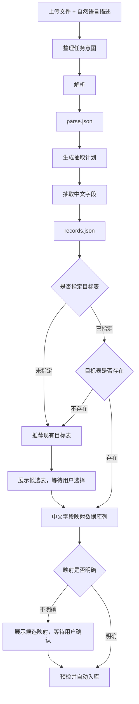

# 自然语言驱动的自动结构化处理方案

> 状态：实施中。更新日期：2026-11-27。
> 目标：上传一个附件，用自然语言说明附件特征、信息位置、抽取内容和目标表意图，系统自动完成解析、抽取、表推荐、字段映射；仅在目标表存在且映射明确时自动入库。
> 本文替代旧版中以“只生成抽取规则草稿”为目标的实施范围。

---

## 第一部分：先看明白

### 1. 一句话方案

把自然语言需求变成一份可执行计划，解析、抽取、入库三个相对独立的阶段按计划依次执行：

```text
上传文件 + 自然语言描述
  → 解析附件
  → 抽取中文业务字段
  → 推荐目标表 / 解析指定目标表
  → 中文字段映射数据库列
  → 目标表存在且映射明确时自动入库
```

### 2. 三个重要产品决策

1. **抽取结果使用中文业务字段**
   - 例如：设备编号、巡检日期、异常描述。
   - 抽取阶段不读取数据库，不生成物理列名。
   - 同一份抽取结果可以用于多个目标表。

2. **目标表推荐属于入库阶段**
   - 未指定目标表时，系统推荐最匹配的现有表。
   - 推荐结果仅供用户选择，不自动写入。
   - 指定了但目标表不存在时，也不自动写入，更不会自动建表。

3. **自动建表不在产品规划内**
   - 平台只向已存在的目标表写入。
   - 目标表必须满足现有溯源列和字段映射约束。

### 3. 自动化边界

| 情况 | 系统行为 |
|---|---|
| 未指定目标表 | 完成解析、抽取、表推荐，停在“待选择目标表” |
| 指定目标表但不存在 | 完成解析、抽取，推荐候选表，停在“目标表不存在” |
| 目标表存在且字段映射明确 | 自动生成映射、预检并入库 |
| 目标表存在但映射有歧义 | 展示候选映射，停在“待确认字段映射” |
| 用户明确要求只抽取 | 只完成解析和抽取 |

“跳过校验”指跳过业务内容校验，不跳过结构契约、目标表/列存在性、类型兼容和 SQL 安全预检。

---

## 4. 总体流程



### 5. 一个具体例子

用户输入：

> 这是设备巡检表，PDF 三页。主表在第二页下方，包含设备编号、设备名称、巡检日期、异常描述；右上角有单据编号。优先写入 equipment_inspection，如果不存在就推荐最接近的表。

系统执行：

1. 从描述中整理文档特征、重点区域和业务字段。
2. 解析 PDF，得到页码、文字块、表格和坐标。
3. 生成抽取规则，输出中文记录：

```json
{
  "单据编号": "XC-20261127-001",
  "设备编号": "EQ-001",
  "设备名称": "1号泵",
  "巡检日期": "2026-11-27",
  "异常描述": "轴承温度偏高"
}
```

4. 检查 `equipment_inspection` 是否存在。
5. 若存在，读取列注释、类型、索引，生成：

```json
{
  "target_table": "equipment_inspection",
  "field_map": {
    "单据编号": "document_no",
    "设备编号": "equipment_code",
    "设备名称": "equipment_name",
    "巡检日期": "inspection_date",
    "异常描述": "abnormal_desc"
  },
  "business_key": ["equipment_code", "inspection_date"],
  "write_mode": "upsert"
}
```

6. 映射明确则自动入库；若表不存在，则推荐 `equipment_patrol` 等候选表并停止写入。

---

## 第二部分：技术实施契约

### 6. 阶段边界

三个阶段通过显式输入输出通信，不互相读取数据库或内部状态。

```python
parse(file_ref, parse_request) -> ParseArtifact

extract(parse_artifact, extraction_plan) -> RecordSet

recommend_tables(record_set, table_intent, schema_catalog) -> TableRecommendation

map_fields(record_set, table_schema, load_intent) -> LoadPlan

load(record_set, load_plan, target_port) -> LoadResult
```

职责划分：

- **阶段核心**：只做本阶段计算，不依赖 FastAPI、全局运行状态或数据库连接。
- **阶段适配器**：负责文件系统、Paddle 模型、平台库、目标业务库。
- **规划器**：把自然语言转换为解析、抽取、推荐和映射计划。
- **编排器**：负责计划持久化、状态推进、重试和日志。

相对独立不要求拆成三个微服务；当前采用同进程模块 + 清晰契约即可。

### 7. 数据契约

#### 7.1 解析产物

继续使用现有 `c1-structure/1`：

- 页码和页面尺寸；
- 文本行及 bbox；
- 版面块及角色；
- 表格、表头、行、单元格及 bbox；
- 跨页续表；
- 坐标空间。

不为本次方案立即引入 `c1-structure/2`。规划器使用由 `parse.json` 生成的“文档地图”投影，不把投影当新事实源。

#### 7.2 抽取产物

继续使用现有 `c1-structure-records/1`，但字段名固定为中文业务语义：

```json
{
  "schema": "c1-structure-records/1",
  "files": [{
    "records": [{
      "index": 0,
      "values": {
        "设备编号": "EQ-001",
        "巡检日期": "2026-11-27"
      },
      "original": {
        "设备编号": "EQ-001",
        "巡检日期": "2026/11/27"
      },
      "lineage": {
        "设备编号": [{"page": 2, "table_index": 0, "cell_bbox": [10, 20, 80, 40]}],
        "巡检日期": [{"page": 2, "table_index": 0, "cell_bbox": [90, 20, 160, 40]}]
      },
      "review": {"state": "pending", "at": null}
    }]
  }]
}
```

约束：

- 不生成物理列名；
- 不读取目标库；
- 保留原值、转换值和血缘；
- 一条记录的业务含义由自然语言和记录策略决定。

#### 7.3 任务意图

上传时持久化原始自然语言和结构化意图：

```json
{
  "prompt": "设备巡检表，主表在第二页下方……",
  "document": {
    "type_hint": "设备巡检表",
    "features": ["PDF", "三页", "扫描件"],
    "regions": [{"description": "第二页下方主表"}]
  },
  "extraction": {
    "fields": ["单据编号", "设备编号", "设备名称", "巡检日期", "异常描述"],
    "record_grain": "每台设备一条"
  },
  "load": {
    "table": "equipment_inspection",
    "datasource_id": null,
    "write_mode": null,
    "business_key": null
  }
}
```

`table=null` 表示用户未指定目标表，必须走推荐分支。

#### 7.4 目标表推荐

```json
{
  "candidates": [{
    "datasource_id": 1,
    "table": "equipment_inspection",
    "score": 0.92,
    "matched_fields": ["设备编号", "巡检日期", "异常描述"],
    "missing_fields": ["处理结论"],
    "reasons": ["表注释匹配", "列注释匹配", "字段覆盖率高"]
  }]
}
```

推荐评分来源：

1. 表名、表注释与业务描述；
2. 列名、列注释与中文字段；
3. 字段覆盖率；
4. 数据类型兼容度；
5. 主键/唯一索引是否可支持去重；
6. 已保存映射的使用历史。

首期使用确定性检索和评分；LLM 只对候选做重排和解释，不凭空编造表名。

#### 7.5 入库计划

```json
{
  "datasource_id": 1,
  "target_table": "equipment_inspection",
  "field_map": {
    "设备编号": "equipment_code",
    "巡检日期": "inspection_date"
  },
  "unmapped_fields": ["处理结论"],
  "business_key": ["equipment_code", "inspection_date"],
  "write_mode": "upsert",
  "review_policy": "skip",
  "auto_run": true
}
```

规则：

- `business_key` 优先取自然语言明确值，其次取已保存映射，再次取表结构可唯一确定的候选。
- 无法确定写入方式时默认 `insert`，不静默使用 `upsert`。
- 自动任务使用 `review_policy=skip`，不调用 `approve-all` 伪装人工确认。
- 普通人工流程继续使用现有 `confirmed` 门禁。

### 8. 解析阶段提升

已实现文档地图投影：`agent/context.py` 从 `parse.json` 确定性生成页面、块、表格、文字、归一化坐标和上下左右相邻关系，并接入规则生成提示词。表格样例按首/中/尾行采样；所有投影共享字符预算，长文档明确标记省略页数和表数。投影不写回 `parse.json`，也不改变 `c1-structure/1` 契约。

区域选择也已实现：`tables[].region` 可限定候选表，`block`、`kv` 支持区域过滤，新增 `region_text` 按归一化区域提取文字并保留逐项锚点。`region` 使用 `{page, rect, space}`，坐标均取文档地图中的归一化值；逐页策略默认只处理当前页。

后续增强：

1. 自然语言生成解析提示：文档类型、重点页、重点区域、是否扫描件。
2. 仅在确定性质量信号异常时触发重解析，不默认多次跑模型。

### 9. 抽取阶段提升

1. 优先复用已有版本化规则。
2. LLM 将自然语言编译为 v2 可执行规则，不直接写最终值。
3. 中文字段作为唯一输出字段，物理列映射全部后置。
4. 生成规则后在参考文档上干跑，得到记录数、空字段和锚点覆盖诊断。
5. v3 智能抽取只作为受限兜底；当前每次一条记录的能力不适合流水表主通道。

### 10. 入库阶段提升

1. 扩展只读表结构元数据：列注释、可空、默认值、主键、唯一索引、表注释。
2. 根据中文字段和值样例推荐现有目标表。
3. 用户指定或选定表后，生成中文字段到物理列的映射。
4. 映射和推荐使用同一份表结构快照，避免预览与执行不一致。
5. 预检和正式执行共用分类逻辑。
6. 目标表不存在时禁止自动建表，也禁止自动改写其他表。

### 11. 持久化策略

首期优先复用现有存储，不新增业务主表：

- 原始自然语言和结构化意图保存为资料附件 `auto-intent.json`。
- 入库规划（含推荐、映射和状态）保存为 `auto-load-plan.json`。
- 解析产物、records、规则版本和入库回执继续使用现有事实源。

`c1_doc_file.state` 继续表达粗粒度状态（解析/抽取后为 `to_review`，入库后为 `loaded`）；
自动处理的细分阶段保存在 `auto-load-plan.json.status` 与进程内 `STATE.stage` 中，
进程内状态只作为进度投影，不作为唯一事实源。

当实际出现并发任务或重启恢复需求时，再增加任务/阶段历史表，不提前建设。

### 12. 自动编排状态

```text
registered
  → parsing
  → planning_extract
  → extracting
  → recommending_table / mapping_fields
  → waiting_target / target_missing / target_ambiguous / mapping_incomplete
  → loading
  → loaded
  → failed
```

状态推进原则：

- 产物先落库，再推进状态；
- 每个阶段只依赖上一阶段已持久化产物；
- 自动入库只允许从“目标表存在且 LoadPlan 明确”进入；
- 重抽后旧回执不得误用于新记录（当前实现已在重抽前清理旧回执）；
- 同一 records 快照的入库重试保持幂等。

### 13. 独立测试策略

| 阶段 | 固定输入 | 不依赖 | 主要指标 |
|---|---|---|---|
| 解析 | 文件 + 解析参数 | DB、LLM | 文字召回、表格结构、区域命中 |
| 抽取 | parse.json + 规则 | OCR、DB、网络 | 字段准确率、记录数、血缘覆盖 |
| 表推荐 | records + 模拟表结构 | 解析器、目标库写入 | 推荐排序、字段覆盖、缺失字段 |
| 字段映射 | records + 模拟表结构 | 解析器、LLM | 列映射、类型兼容、未映射字段 |
| 入库 | records + LoadPlan | 解析器、LLM | 写入、幂等、回滚、回执 |
| 全流程 | 合成附件 + 假规划器 + 临时库 | 常驻服务 | 无人工介入完成率 |

最低自动化回归集：

- 未指定目标表：必须停在推荐，不写库；
- 指定表不存在：必须停止，不改写其他表；
- 表存在且映射明确：自动入库；
- 映射有歧义：停止并给出候选；
- 重复执行同一 LoadPlan：不重复插入；
- 重抽产生新 records：不得复用旧回执。

### 14. 实施顺序

#### 第一阶段：入库语义映射基础（已实现）

- 扩展表结构元数据读取；
- 实现纯函数表推荐评分；
- 实现纯函数中文字段映射；
- 增加推荐和映射单测。

#### 第二阶段：自动处理编排（已实现）

- 上传接口接收自然语言和目标表意图；
- 持久化 intent/plan；
- 解析后自动生成、保存并应用抽取规则；
- 执行抽取；
- 指定表存在时生成 LoadPlan；
- 未指定表或表不存在时输出推荐并停止；
- 映射明确时通过自动放行策略入库。

对应入口：

- `POST /api/auto/process`：上传并自动处理；
- `GET /api/sources/{file_id}/load-plan`：读取最近一次规划；
- `POST /api/sources/{file_id}/load-plan`：按新的目标意图重新规划；
- `POST /api/sources/{file_id}/load-plan/apply`：确认目标表/映射后执行入库。

#### 第三阶段：文档地图（已实现）

- 从既有解析信封生成纯函数文档地图投影；
- 保留页面、块、表格、文字及 source/rectified 坐标空间；
- 表格增加归一化位置和上下左右相邻区域；
- 表格样例改为首/中/尾代表性采样；
- 投影与文本共用预算，输出省略页数和表数；
- 接入自然语言规则生成，不修改解析和记录契约。

#### 第四阶段：区域定位与选择（已实现）

- 表格选择器支持页码和归一化区域过滤；
- `block`、`kv` 支持在同一区域内查找，避免跨区域串值；
- 新增 `region_text`，按阅读顺序提取区域内文字并保留逐项血缘；
- 区域坐标校验和规则静态校验；
- source/rectified 表格分别使用对应页面尺寸；
- 跨页表按指定页过滤，逐页策略不跨页取值。

#### 第五阶段：聊天式处理入口（已实现）

- 新增独立 `/chat` 页面与工作台导航入口；
- 聊天中上传附件并提交自然语言需求；
- 复用自动解析、规则生成、抽取、表推荐和字段映射接口；
- 以结构化方案卡展示中文字段、样例、目标表、推荐表、映射置信度和停止原因；
- 聊天请求携带 `intent.auto_load=false`，规划就绪后停止，不自动写库；
- 用户选择推荐表或修订映射后可重新规划；
- 用户点击“确认并写入数据库”并再次确认后，才调用入库执行接口；
- 入库执行仍受服务端确认策略约束，不能只靠前端按钮放行；
- 传统规则、预览、处理和入库页面继续保留，用于高级检查。

页面验收路径：打开 `/chat` → 添加附件 → 填写或选择示例需求 → 发送 → 查看方案卡 → 选择推荐表或修订映射 → 确认入库 → 查看完成结果与预览链接。

#### 第六阶段：后续智能化增强

规则复用（已实现）：

- 从现有规则当前版本中筛选候选，不引入向量数据库；
- 自然语言描述完全一致或词项相似度达到 0.86 才进入干跑；
- 候选规则必须通过静态校验，并在当前文档上有记录、无全空字段、锚点覆盖率达到 0.95；
- 复用成功时绑定原版本，不创建重复规则；失败时回退自然语言生成新版本；
- 复用和回退均写入任务日志，聊天进度可见。

推荐结果重排（已实现）：

- 在字段覆盖率、映射置信度、意图相关性和歧义惩罚基础上进行确定性重排；
- 需求中明确提到的表名增加排名权重，英文表名按完整词匹配，避免子串误判；
- 可完整映射字段的表增加排名权重；
- 推荐原因同步输出“明确提到目标表名”“字段可完整映射”，便于用户判断。

后续待实施：

- v3 逐行/逐区域兜底；
- 根据真实失败样本增加有限自修复。

#### 暂不实施

- 自动建表/改表；
- 无目标表时自动选择表并写库；
- 向量数据库；
- 通用无界 Agent；
- 三个独立微服务；
- 大规模任务队列。

### 15. 当前必须同步修正的正确性问题

1. 统一“未传规则版本”的语义，避免资料列表显示已配置规则却实际走原始透传（待处理）。
2. 重抽覆盖 records 时，清理或失效旧入库回执，防止新记录被旧回执跳过（已处理：重抽前清理旧回执）。
3. 配置接口与正式入库入口共用目标表预检，避免绕过门禁（待处理）。
4. 入库预览与正式执行共用分类逻辑（待处理）。
5. 清理请求废弃 task API、依赖旧目录或已删除模块的文档与验收脚本（已完成审计；归档/删除操作受本地安全策略阻断，待授权后执行）。
