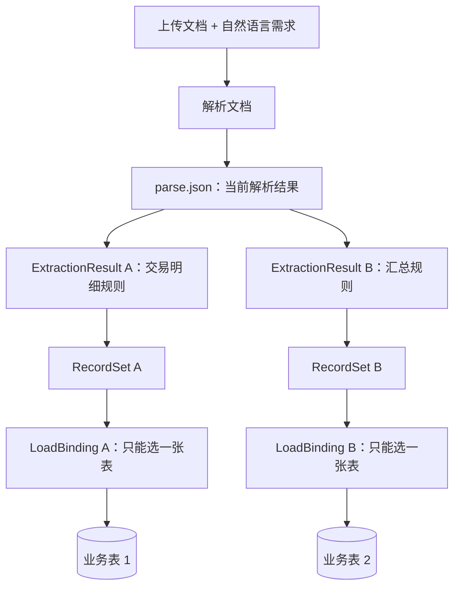
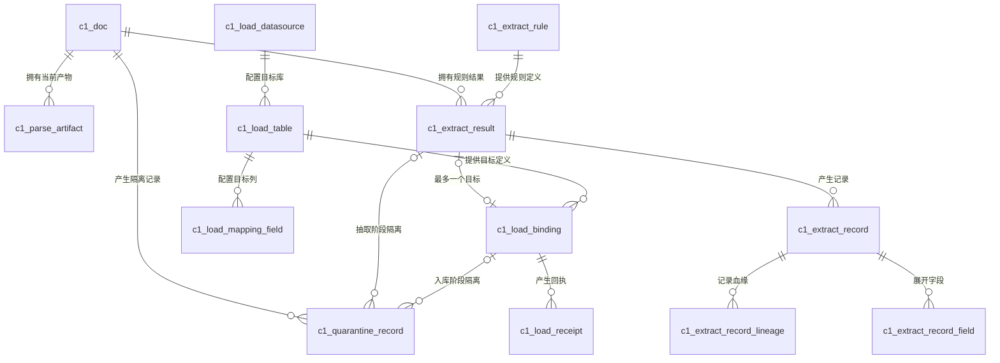
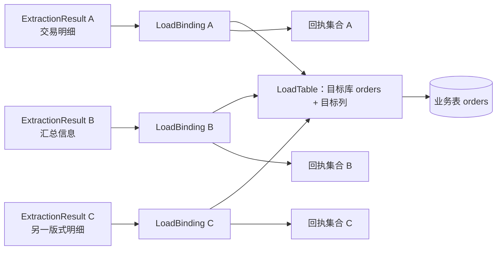
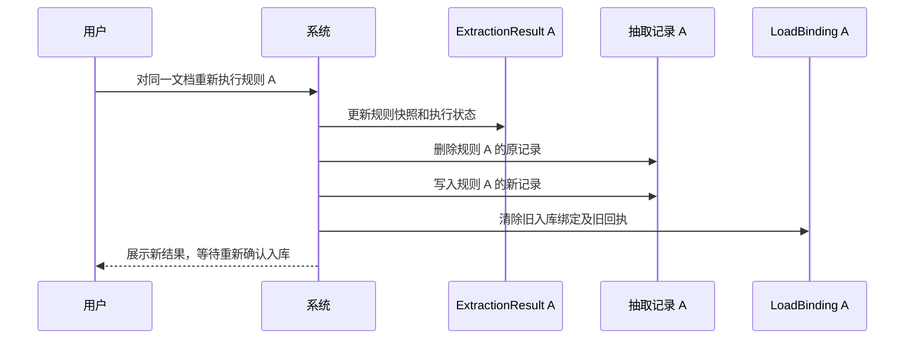
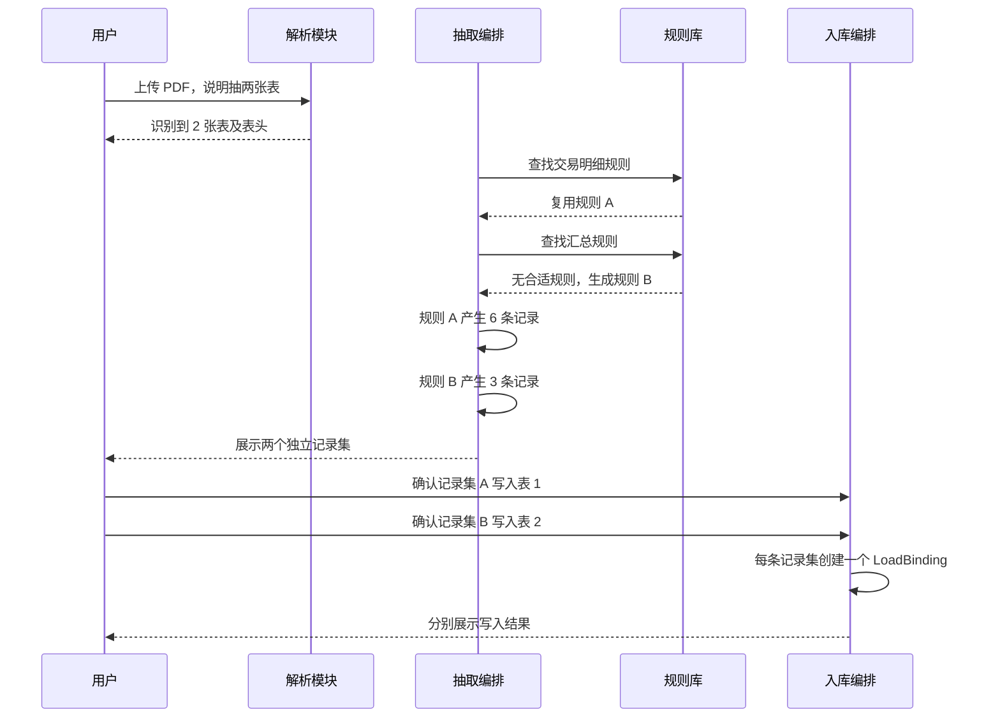
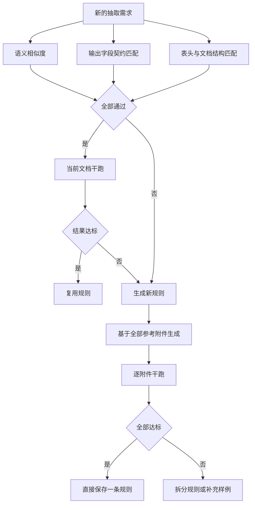

# 抽取规则与入库配置解耦设计（探索阶段简化版）

> 状态：待确认，尚未实施。更新日期：2026-11-28。
> 本文是 [自然语言驱动的自动结构化处理方案](design-agentic-extraction.md) 的延伸设计。
> 本版按探索阶段简化：不保留规则版本表，不增加解析运行表，每个抽取结果最多写入一张表，同一文档重复执行直接覆盖原结果。

---

## 第一部分：先用大白话说明最终设计

### 1. 本次确定的三个简化

1. **抽取规则只有一个版本**
   - 不建立 `c1_extract_rule_version`。
   - `c1_extract_rule` 一行就是一条完整规则。
   - 规则修改时直接更新这一行。
   - 文档执行时仍然复制一份规则快照，避免规则后来被修改后，历史结果对不上。

2. **一个抽取结果只能写入一张表**
   - 每条 `c1_extract_result` 最多对应一个 `c1_load_binding`。
   - 不存在一个抽取结果同时写入多张表的设计。
   - 但同一张业务表可以接收来自不同抽取规则的结果。

3. **不增加 `c1_parse_run`**
   - 解析结果继续使用现有 `c1_parse_artifact`。
   - 同一文档重新解析时，直接覆盖 `parse.json`。
   - 重新解析会清空该文档原有的抽取结果，因为输入事实源已经变化。

### 2. 一句话方案

> 文档解析结果作为当前事实源；每条抽取规则产生一个独立记录集；每个记录集最多选择一个目标表；同一张表可以汇总多条规则的结果；重复执行直接覆盖当前结果。

### 3. 目标结构总览



关键约束：

- `c1_extract_result` 是“文档 × 抽取规则”的当前结果，不保留多次执行历史。
- `c1_extract_result` 与 `c1_load_binding` 是 **0 或 1** 的关系。
- `c1_load_binding` 与目标业务表是 **1 对 1** 的关系。
- 同一目标表可以有多个 `c1_load_binding`，它们来自不同的抽取结果。

### 4. 明确不做的抽象

为了避免探索阶段过度设计，本方案不增加：

- `c1_extract_rule_version`：规则版本表；
- `c1_parse_run`：解析运行表；
- `c1_record_set`：独立记录集表；
- `c1_extract_plan`：独立抽取计划表；
- 一个抽取结果对多个入库目标的绑定；
- 通用工作流引擎。

### 命名约定（本文统一使用）

目标结构不再使用含义模糊的“运行 Run”，而是按对象本身命名：

| 概念 | 目标表名 | 含义 |
|---|---|---|
| 文档 | `c1_doc` | 一份上传的文档 |
| 抽取规则 | `c1_extract_rule` | 一条可复用的抽取规则 |
| 抽取结果 | `c1_extract_result` | 某文档使用某规则得到的当前结果 |
| 抽取记录 | `c1_extract_record` | 抽取结果中的一条记录 |
| 入库表配置 | `c1_load_table` | 平台侧目标库、目标表和目标字段定义，不是业务表本身 |
| 入库绑定 | `c1_load_binding` | 一个抽取结果与一个目标表的当前绑定 |
| 入库回执 | `c1_load_receipt` | 一条记录写入目标库的结果 |
| 隔离记录 | `c1_quarantine_record` | 抽取或入库过程中的问题记录 |

旧名称到新名称的对应关系：

| 旧名称 | 新名称 | 原因 |
|---|---|---|
| `c1_doc_file` | `c1_doc` | 明确表示文档主表，而不是“文件运行” |
| `c1_extract_run` | `c1_extract_result` | 重复执行会覆盖，本质是当前结果 |
| `c1_staging_record` | `c1_extract_record` | 明确是抽取记录，不再强调暂存 |
| `c1_staging_field` | `c1_extract_record_field` | 明确是抽取记录的字段投影 |
| `c1_staging_lineage` | `c1_extract_record_lineage` | 明确是抽取记录的血缘 |
| `c1_load_table_field` | `c1_load_mapping_field` | 明确是目标字段元数据，不是来源字段映射 |
| `c1_load_run` | `c1_load_binding` | 记录单个抽取结果的字段映射、写入方式和业务键 |
| `c1_load_log` | `c1_load_receipt` | 明确是入库回执，不是普通日志 |
| `c1_load_quarantine` | `c1_quarantine_record` | 抽取和入库阶段都可能产生问题 |

`c1_load_table` 保留表名，但语义调整为平台侧的“目标表配置”，不是业务库中的实际表；关联外键仍统一使用 `load_table_id`。

字段命名也同步统一：

| 旧字段 | 新字段 | 含义 |
|---|---|---|
| `file_id` | `doc_id` | 所属文档 |
| `extract_run_id` | `extract_result_id` | 所属抽取结果 |
| `load_run_id` | `load_binding_id` | 所属入库绑定 |
| `target_column` | `field_name` | 目标表字段名 |
| `rule_field` | 删除 | 来源字段映射移入 `c1_load_binding.field_map_json` |
| `schema_json` | `output_schema_json` | 抽取输出字段契约 |
| `mapping_json` | `extraction_spec_json` | 抽取规则定义 |
| `transform_json` | 删除 | 探索阶段不设计入库转换 |
| `source_refs_json` | `reference_doc_ids_json` | 规则总结所参考的文档 ID |
| `source_snapshot_json` | 删除 | 入库表配置不描述抽取来源 |

---

## 第二部分：当前表结构的变更方向

### 5. 当前结构与目标结构对比

| 当前结构 | 目标结构 | 原因 |
|---|---|---|
| `c1_extract_rule_version` 保存规则版本 | 删除版本表，规则直接存在 `c1_extract_rule` | 探索阶段不需要规则版本管理 |
| `c1_doc_file.rule_version_id` 只能绑定一条规则 | 文档通过 `c1_extract_result` 绑定多条规则 | 支持一份文档使用多条规则 |
| `c1_staging_record` 唯一键是 `(file_id, record_index)` | 改为 `(extract_result_id, record_index)` | 不同规则的记录编号互不冲突 |
| `c1_load_table` 引用 `rule_id/rule_version_id` | 移除规则引用，只保存目标库、目标表和目标字段 | 入库表配置不拥有抽取规则 |
| `c1_doc_file.load_table_id` 只能指定一个目标 | 每条抽取结果最多一个 `c1_load_binding` | 支持不同规则写不同表或同一张表 |
| `c1_load_log` 唯一键按文档记录编号 | 改为 `(load_binding_id, record_index)` | 不同规则写同一张表时回执不冲突 |
| 重新解析没有独立运行概念 | 直接覆盖 `parse.json` 并清空抽取结果 | 探索阶段不保留解析历史 |

### 6. 为什么仍然需要 `c1_extract_result`

虽然重复执行会覆盖，但仍然需要一张“文档 × 规则”的关联表，因为：

- 一个文档要使用多条规则；
- 每条规则要有独立状态、记录数、规则快照；
- 每条规则的结果要独立覆盖；
- 同一张表要知道每条记录来自哪个抽取结果。

它在探索阶段的实际含义是：

> `c1_extract_result` 保存“某文档使用某抽取规则得到的当前结果”，不是历史执行日志。

---

## 第三部分：最新表关系

### 7. 逻辑实体与物理表

| 逻辑实体 | 物理表 | 作用 |
|---|---|---|
| 文档 Doc | `c1_doc` | 原件、文档信息、汇总状态 |
| 解析产物 ParseArtifact | `c1_parse_artifact` | 当前 `parse.json`、图片、报告等 BLOB |
| 抽取规则 Rule | `c1_extract_rule` | 一条规则，只有一个当前定义 |
| 抽取结果 ExtractionResult | `c1_extract_result` | 文档使用某条规则得到的当前结果 |
| 记录集 RecordSet | `c1_extract_result` + `c1_extract_record` | 结果头信息 + 实际记录 |
| 入库表配置 LoadTable | `c1_load_table` + `c1_load_mapping_field` | 目标库、目标表、目标列定义 |
| 入库绑定 LoadBinding | `c1_load_binding` | 某条抽取结果写入某张表 |
| 入库回执 LoadLog | `c1_load_receipt` | 每条记录写入目标库的结果 |

### 8. 最新 ER 图



### 9. 关系基数说明

| 关系 | 基数 | 含义 |
|---|---:|---|
| 文档 → 抽取结果 | 1:N | 一份文档可以使用多条规则 |
| 抽取规则 → 抽取结果 | 1:N | 同一条规则可以用于多份文档 |
| 同一文档内：抽取结果 ↔ 抽取规则 | 1:1 | 同一文档的同一条规则只保留一个当前结果 |
| 抽取结果 → 抽取记录 | 1:N | 一条规则结果包含多条记录 |
| 抽取结果 → 入库绑定 | 1:0..1 | 一条规则结果最多写入一张表 |
| 入库表配置 → 入库绑定 | 1:N | 同一目标表配置可以被多条规则结果复用 |
| 入库绑定 → 入库回执 | 1:N | 一次入库产生每条记录的回执 |

### 10. 同一张表接收不同规则的结果



说明：

- 三条规则写同一张表时，只需要一个 `LoadTable`。
- 每个 `LoadBinding` 保存自己的 `field_map_json`，所以不同规则可以使用不同的来源字段映射。
- 三个 `LoadBinding` 独立，回执不会互相覆盖。
- 如果使用 `upsert` 且业务键相同，后写入的绑定可能更新先写入的行，界面必须显示实际动作。

---

## 第四部分：逐表结构变更

### 11. 变更总览

| 表 | 变更类型 | 核心变化 |
|---|---|---|
| `c1_doc` | 修改 | 移除单规则、单入库目标字段；状态改为汇总状态 |
| `c1_extract_rule` | 修改 | 吸收规则版本内容，一行一条规则 |
| `c1_extract_rule_version` | 废弃 | 目标结构中不存在 |
| `c1_parse_artifact` | 修改 | 保留当前产物，移除 `sha256`，不增加解析运行表 |
| `c1_extract_result` | 新增 | 文档与规则的当前结果及规则快照 |
| `c1_extract_record` | 修改 | 增加 `extract_result_id`，调整唯一键 |
| `c1_extract_record_field` | 保留 | 仍通过 `record_id` 关联 |
| `c1_extract_record_lineage` | 保留 | 仍通过 `record_id` 关联 |
| `c1_load_datasource` | 保留 | 数据源配置不变 |
| `c1_load_table` | 修改 | 只保存目标库、目标表和目标列，不保存规则与来源字段 |
| `c1_load_mapping_field` | 修改 | 只保存目标列元数据，来源字段映射移入 `c1_load_binding` |
| `c1_load_binding` | 新增 | 每条抽取结果最多一个入库绑定 |
| `c1_load_receipt` | 修改 | 增加 `load_binding_id`，调整唯一键 |
| `c1_quarantine_record` | 修改 | 增加抽取结果、入库绑定引用 |

### 12. 修改表：`c1_extract_rule`

目标结构：

| 字段 | 类型 | 说明 |
|---|---|---|
| `id` | bigint | 规则 ID |
| `name` | varchar(128) | 规则名，唯一 |
| `description` | varchar(512) | 规则说明 |
| `output_schema_json` | json | 输出字段契约和记录粒度 |
| `extraction_spec_json` | json | 表选择、字段抽取、抽取归一化逻辑 |
| `reference_doc_ids_json` | json | 总结规则时使用的参考文档 ID |
| `validation_report_json` | json | 各参考附件的校验和干跑结果 |
| `created_at` | datetime | 创建时间 |
| `updated_at` | datetime | 最后修改时间 |

规则约束：

- 一行就是一条完整规则，不存在版本号；删除旧的 `current_version`。
- 修改规则时直接更新这一行。
- 规则中不得出现数据源、目标表、数据库列。
- 规则中的 `date/number` 等抽取归一化保留在 `extraction_spec_json` pipeline 中。
- 入库转换不放在规则中。

### 13. 废弃表：`c1_extract_rule_version`

目标结构中不再使用。

迁移时需要：

1. 取每条规则当前生效版本；
2. 将当前版本的 `schema_json/mapping_json` 合并为 `c1_extract_rule.output_schema_json/extraction_spec_json`；
3. 将来源附件和验证报告写入规则表；
4. 文档历史结果使用的规则定义复制到 `c1_extract_result.rule_snapshot_json`；
5. 确认没有代码读取版本表后，再删除 `c1_extract_rule_version`。

### 14. 新增表：`c1_extract_result`

| 字段 | 类型 | 约束 | 说明 |
|---|---|---|---|
| `id` | bigint | PK | 抽取结果 ID，同时作为 RecordSet ID |
| `doc_id` | bigint | NOT NULL | 所属文档 |
| `rule_id` | bigint | NOT NULL | 使用的抽取规则 |
| `rule_snapshot_json` | json | NOT NULL | 本次执行使用的完整规则快照 |
| `status` | varchar(16) | NOT NULL | `pending/running/ready/failed` |
| `record_count` | int | NOT NULL DEFAULT 0 | 当前记录数 |
| `error` | text | NULL | 失败原因 |
| `created_at` | datetime | NOT NULL | 首次创建时间 |
| `updated_at` | datetime | NOT NULL | 最近一次覆盖执行时间 |

索引与唯一键：

- `UNIQUE KEY uk_doc_rule (doc_id, rule_id)`
- `KEY idx_extract_rule (rule_id)`

覆盖语义：

- 同一文档、同一规则再次执行时，更新这一行。
- 删除该抽取结果原来的抽取记录后重新写入。
- 不保留上一次抽取历史。
- 其他规则的抽取结果不受影响。

`rule_snapshot_json` 示例：

```json
{
  "output_schema": {
    "fields": [
      {"name": "项目", "type": "text"},
      {"name": "笔数", "type": "number"},
      {"name": "金额", "type": "number"},
      {"name": "状态", "type": "text"}
    ],
    "grain": "每个汇总项目一条"
  },
  "extraction_spec": {
    "spec_version": 2,
    "tables": [
      {
        "ref": "main",
        "role": "record_source",
        "header_contains": "项目 笔数 金额 状态"
      }
    ],
    "records": {
      "strategy": "row",
      "source_ref": "main"
    },
    "fields": [
      {
        "target": "项目",
        "pipeline": [{"op": "cell", "source": "main", "column": {"name": "项目"}}]
      },
      {
        "target": "笔数",
        "pipeline": [{"op": "cell", "source": "main", "column": {"name": "笔数"}}]
      },
      {
        "target": "金额",
        "pipeline": [{"op": "cell", "source": "main", "column": {"name": "金额"}}]
      },
      {
        "target": "状态",
        "pipeline": [{"op": "cell", "source": "main", "column": {"name": "状态"}}]
      }
    ]
  }
}
```

### 15. 修改表：`c1_extract_record`

| 字段 | 变更 | 说明 |
|---|---|---|
| `extract_result_id` | 新增，NOT NULL | 记录所属抽取结果 |
| `doc_id` | 保留 | 方便按文档查询 |
| `record_index` | 保留 | 抽取结果内的记录下标 |
| `uk_file_idx` | 删除 | 原唯一键不再适用 |
| `uk_extract_result_record` | 新增 | `(extract_result_id, record_index)` |

新增索引：

- `KEY idx_record_doc_result (doc_id, extract_result_id)`

`c1_extract_record_field` 和 `c1_extract_record_lineage` 保持通过 `record_id` 关联，不需要增加结果字段。

### 16. 修改表：`c1_load_table`

`c1_load_table` 只描述“目标表是什么”，不描述“抽取结果怎么写入”。

完整目标结构：

| 字段 | 类型 | 说明 |
|---|---|---|
| `id` | bigint | 入库表配置 ID |
| `datasource_id` | bigint | 目标数据源 |
| `target_table` | varchar(128) | 目标业务表 |
| `created_at` | datetime | 创建时间 |
| `updated_at` | datetime | 最后更新时间 |

相对当前结构的调整：
|---|---|---|
| `rule_id` | 删除 | 入库表配置不拥有抽取规则 |
| `rule_version_id` | 删除 | 入库表配置不拥有规则版本 |
| `source_snapshot_json` | 删除 | 入库表配置不描述抽取来源 |
| `load_transform_json` | 不增加 | 探索阶段不设计入库转换 |
| `write_mode` | 移动到 `c1_load_binding` | 写入方式由具体绑定决定 |
| `datasource_id` | 保留 | 目标数据源 |
| `target_table` | 保留 | 目标业务表 |
| `created_at` | 保留 | 创建时间 |
| `updated_at` | 新增 | 最后更新时间 |

职责边界：

- `c1_load_table` 只记录数据库、数据表和目标列。
- 中文字段映射到目标列、写入方式、业务键都由 `c1_load_binding` 记录。
- 同一目标表可以被多个抽取结果绑定。
- 修改目标表结构时，只需要刷新 `c1_load_mapping_field`。
- `UNIQUE KEY uk_load_table_target (datasource_id, target_table)`，避免同一目标表重复建档。

### 17. 修改表：`c1_load_mapping_field`

该表只描述目标表的字段，不再保存来源字段。

| 字段 | 类型 | 说明 |
|---|---|---|
| `id` | bigint | 主键 |
| `load_table_id` | bigint | 所属入库表配置 |
| `field_name` | varchar(128) | 目标数据库列名 |
| `data_type` | varchar(64) | 目标列类型 |
| `is_primary` | tinyint | 是否主键 |
| `has_default` | tinyint | 是否有默认值 |
| `sort_order` | int | 展示顺序 |

唯一键：

- `(load_table_id, field_name)`

该表不包含：

- `source_field`；
- `is_business_key`；
- 字段转换规则；
- 抽取规则信息。

### 18. 新增表：`c1_load_binding`

`c1_load_binding` 描述“一个抽取结果如何写入指定的目标表”。

| 字段 | 类型 | 约束 | 说明 |
|---|---|---|---|
| `id` | bigint | PK | 入库绑定 ID |
| `doc_id` | bigint | NOT NULL | 所属文档 |
| `extract_result_id` | bigint | NOT NULL，UNIQUE | 输入抽取结果；保证最多一个目标 |
| `load_table_id` | bigint | NOT NULL | 目标库、目标表和目标列定义 |
| `field_map_json` | json | NOT NULL | 中文字段到目标列的映射 |
| `write_mode` | varchar(16) | NOT NULL | `insert/upsert/update` |
| `business_keys_json` | json | NULL | upsert/update 的业务键 |
| `status` | varchar(16) | NOT NULL | `pending/confirmed/running/ready/failed` |
| `confirmed_at` | datetime | NULL | 用户确认时间 |
| `error` | text | NULL | 失败原因 |
| `created_at` | datetime | NOT NULL | 创建时间 |
| `updated_at` | datetime | NOT NULL | 更新时间 |

关键约束：

```sql
UNIQUE KEY uk_extract_result_binding (extract_result_id)
```

这从数据库层面保证：

> 一条抽取结果只能绑定一个目标表。

绑定校验规则：

- `field_map_json` 的键必须存在于抽取结果；
- `field_map_json` 的值必须存在于 `c1_load_mapping_field`；
- 抽取结果中的额外字段不写入；
- 业务键必须出现在 `field_map_json` 的目标列中；
- 校验由上游绑定逻辑完成，`c1_load_table` 不关心抽取结果。

`field_map_json` 示例：

```json
{
  "项目": "item_name",
  "笔数": "item_count",
  "金额": "amount",
  "状态": "status"
}
```

`business_keys_json` 示例：

```json
["item_name"]
```

### 19. 修改表：`c1_load_receipt`

| 字段 | 变更 | 说明 |
|---|---|---|
| `load_binding_id` | 新增，NOT NULL | 所属入库绑定 |
| `doc_id` | 保留 | 方便按文档查询 |
| `record_index` | 保留 | 入库绑定内的记录下标 |
| `datasource_id` | 保留 | 目标数据源 |
| `target_table` | 保留 | 目标表 |
| `uk_load_receipt` | 删除 | 原唯一键不再适用 |
| `uk_load_binding_record` | 新增 | `(load_binding_id, record_index)` |

### 20. 修改表：`c1_quarantine_record`

| 字段 | 变更 | 说明 |
|---|---|---|
| `extract_result_id` | 新增，可空 | 抽取阶段问题所属抽取结果 |
| `load_binding_id` | 新增，可空 | 入库阶段问题所属入库绑定 |
| `doc_id` | 保留 | 所属文档 |
| `record_index` | 保留 | 对应抽取结果或入库绑定内的记录下标 |

### 21. 修改表：`c1_doc`

| 字段 | 变更 | 说明 |
|---|---|---|
| `rule_version_id` | 删除 | 由 `c1_extract_result` 取代 |
| `load_datasource_id` | 删除 | 由 `c1_load_binding` 取代 |
| `load_table_id` | 删除 | 由 `c1_load_binding` 取代 |
| `state` | 调整语义 | 字段名不变，改为文档级汇总状态 |

文档汇总状态建议：

| 状态 | 含义 |
|---|---|
| `parsing` | 正在解析 |
| `ready` | 解析完成，尚无抽取结果 |
| `extracting` | 至少一条规则正在抽取 |
| `extract_failed` | 所有规则抽取失败 |
| `partial_failed` | 部分规则成功，部分失败 |
| `awaiting_load_confirmation` | 已有记录集，等待确认入库 |
| `loading` | 至少一个入库绑定进行中 |
| `loaded` | 当前已确认入库全部成功 |
| `partial_loaded` | 部分入库成功，部分失败 |

---

## 第五部分：重复执行与覆盖语义

### 22. 重新抽取同一条规则



规则 B 的结果不受影响。

### 23. 重新解析同一文档

重新解析是文档级覆盖：

1. 覆盖当前 `parse.json`；
2. 清空该文档所有 `c1_extract_result`；
3. 删除对应抽取记录；
4. 清除这些抽取结果关联的 `c1_load_binding` 和回执；
5. 文档回到“已解析、待抽取”状态。

原因是解析事实源已经变化，旧抽取结果不能继续视为有效。

### 24. 修改规则库中的规则

- 修改 `c1_extract_rule` 不会自动改变已经生成的文档结果；
- 文档结果继续使用 `c1_extract_result.rule_snapshot_json` 中的快照；
- 用户重新执行该文档的这条规则时，使用规则库中的最新定义并覆盖快照和结果。

这样既没有版本表，也能保证当前结果与执行时规则一致。

### 25. 已写入业务库的数据不会自动回滚

平台侧覆盖结果时，不会自动撤销之前已经写入业务库的数据。

因此重新入库必须：

- 重新展示映射；
- 重新获得用户确认；
- 明确使用 `insert/upsert/update` 中哪种方式；
- 对重复业务键风险给出提示。

---

## 第六部分：用双表 PDF 走一遍简化后的结构

### 26. 文档情况

文件：`21_two_tables_1page.pdf`

- 表 0：交易明细，6 行；
- 表 1：汇总信息，3 行；
- 两张表使用不同规则。

### 27. 执行过程



### 28. 数据库结果

| 表 | 结果 |
|---|---|
| `c1_parse_artifact` | 当前 `parse.json` 包含两张表 |
| `c1_extract_rule` | 规则 A、规则 B 各一行 |
| `c1_extract_result` | 2 行，分别绑定规则 A、规则 B |
| `c1_extract_record` | 9 行，6 行属于抽取结果 A，3 行属于抽取结果 B |
| `c1_load_table` | 2 条目标表配置，分别指向表 1、表 2 |
| `c1_load_binding` | 2 行，每个抽取结果一行 |
| `c1_load_receipt` | 按实际写入记录数产生 |

如果两条规则写同一张表：

- `c1_load_table` 可以只有 1 条目标表配置；
- `c1_load_binding` 仍然有 2 行；
- 两条抽取结果各自拥有独立回执集合。

---

## 第七部分：规则复用与多附件总结

### 29. 规则复用流程



### 30. 多附件生成规则

输入使用 `doc_ids[]`，但输出仍然只有一条规则定义：

- 所有附件参与上下文；
- 每个附件分别干跑；
- 任一附件错表、字段全空或锚点不足，都不能直接保存；
- `reference_doc_ids_json` 记录全部参考附件；
- `validation_report_json` 记录每个附件的验证结果；
- 版式差异过大时拆成多条规则，不生成超级规则。

---

## 第八部分：迁移步骤

### 31. 增量迁移顺序


### 32. 历史数据处理

| 现有数据 | 处理方式 |
|---|---|
| 规则当前版本 | 合并到 `c1_extract_rule` |
| 文档绑定的规则版本 | 创建一条 `c1_extract_result`，并复制版本快照 |
| 当前暂存记录（旧表） | 补 `extract_result_id` |
| `c1_load_table` | 按 `(datasource_id, target_table)` 去重，保留目标库和目标表；规则引用不再使用 |
| `c1_load_table_field.target_column` | 去重后写入 `c1_load_mapping_field.field_name`，作为目标字段元数据 |
| `c1_load_table_field.rule_field` | 与 `target_column` 组成来源到目标映射，写入对应 `c1_load_binding.field_map_json` |
| `c1_load_table_field.is_business_key` | 汇总为目标字段列表，写入对应 `c1_load_binding.business_keys_json` |
| `c1_load_table.write_mode` | 迁移到对应 `c1_load_binding.write_mode` |
| 文档当前入库表配置 | 创建一条 `c1_load_binding`，引用合并后的目标表配置 |
| 当前入库回执 | 补 `load_binding_id` |
| 当前隔离记录 | 按阶段补抽取结果 ID 或入库绑定 ID |
| `c1_doc` 的旧标量字段 | 回填完成后删除 |

迁移期间旧字段只读，不再写入。确认单规则旧流程和多规则新流程都通过后，再删除 `c1_extract_rule_version`。

---

## 第九部分：设计确认清单

### 33. 简化后的关键约束

- [ ] 不存在 `c1_extract_rule_version`，一条规则一行。
- [ ] 不存在 `c1_parse_run`，解析直接覆盖当前 `parse.json`。
- [ ] 一个文档可以有多条抽取规则。
- [ ] 每条抽取规则产生一个独立记录集。
- [ ] 每条抽取结果最多一个入库绑定。
- [ ] 每条抽取结果只能写入一张表。
- [ ] 同一张表可以接收不同抽取规则的结果。
- [ ] 入库表配置不引用规则 ID，可以跨规则复用。
- [ ] 同一文档、同一规则重复执行时覆盖原结果。
- [ ] 重新解析时清空该文档全部抽取结果。
- [ ] 文档保存执行时的规则快照。
- [ ] 记录、回执、隔离区按抽取结果和入库绑定隔离。
- [ ] 聊天写库仍然需要用户明确确认。
- [ ] 不自动建表，不引入业务校验。

### 34. 当前设计对主方案的影响

主方案的阶段边界不变：

```python
parse(file_ref, parse_request) -> ParseArtifact
extract(parse_artifact, rule_snapshot) -> RecordSet
recommend_tables(record_set, table_intent, schema_catalog) -> TableRecommendation
map_fields(record_set, table_schema, load_intent) -> LoadPlan
load(record_set, load_plan, target_port) -> LoadResult
```

变化只在编排层：

- `extract()` 以“文档 + 规则”为单位执行，重复执行覆盖；
- `map_fields()` 面向单个记录集；
- `load()` 只接受一个记录集和一个目标表；
- 文档级编排负责组合多条规则，但不允许一条规则结果拆分到多个目标表。
