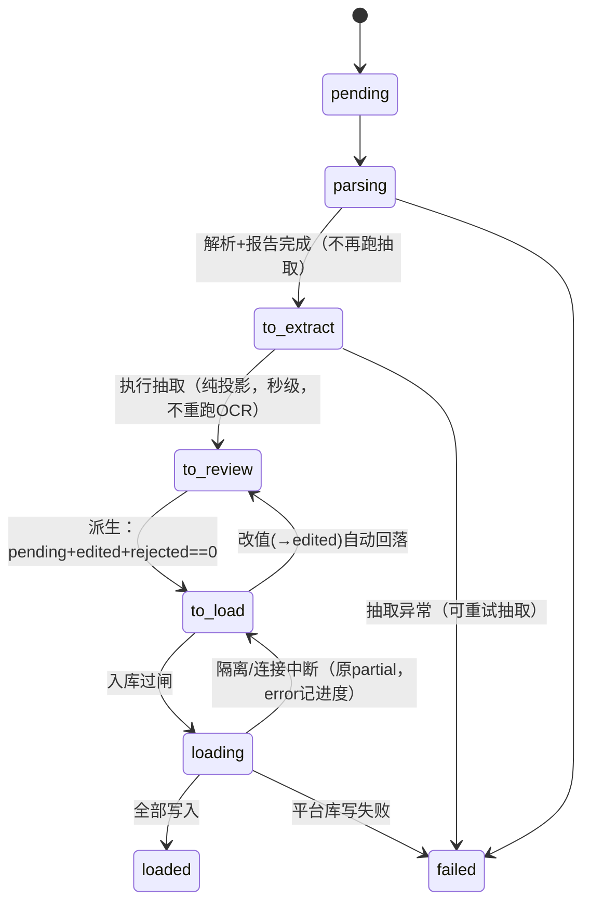

# 任务状态机重构设计稿（解析/抽取解耦）

> 状态：**已落地**（2026-11-23）。B 期迁移已执行（备份 `data/backup/c1_dev_pre003_20261123_135019.sql`，守恒校验通过）；两套验收顺序全绿（records 7/7、artifacts 6/6）。文内旧枚举名均为改名溯源说明，非现存代码状态。

日期：2026-11-23 ｜ 状态：**待批准** ｜ 前提裁决（已定）：抽取与解析解耦、设「待抽取」；去「已预览 / 部分入库 / 已校验」；改代码枚举值并迁移 DB；无兼容别名。

## 1. 新状态集

| 值 | 界面文案 | 性质 | 说明 |
|---|---|---|---|
| pending | 待处理 | 瞬态 | 建任务登记（不变） |
| parsing | 解析中 | 瞬态 | 原 `extracting` 改名（旧名是「提取」时代遗留） |
| to_extract | 待抽取 | 停留 | **新**：解析完成、报告已生成、未跑抽取投影 |
| to_review | 待校验 | 停留 | 原 `previewed` 语义正名：暂存记录已生成、未全部确认 |
| to_load | 待入库 | 停留 | **新（派生）**：该任务全部记录已确认 |
| loading | 入库中 | 瞬态 | 不变 |
| loaded | 已入库 | 终态 | 不变 |
| failed | 失败 | 终态 | 解析/抽取/入库整体异常，error 说明 |

删除：`previewed`、`partial`、`reviewed`（后者本就是死代码）。

任务态 = 其文件态取最落后者（rollup 新函数 `catalog.rollup_task_state`）；任一文件 failed → 任务 failed。

## 2. 解耦的关键事实（已核实）

- 抽取输入天然可独立获得：解析时 `adapter.adapt` 结果已存进 parse.json BLOB，「执行抽取」= `get_extract → collect.build → save_records`，**无模型、无 OCR**，单文件毫秒~秒级。
- `content_db.save_records` 本就按 task_file 先删后插——重复抽取/换规则重抽 = 覆盖暂存（旧确认/编辑随覆盖清零，界面须提示）。
- 「待入库」的门禁逻辑已存在（`launch_load` 要求 pending+edited+rejected 全 0），本方案只是把它物化成状态。

## 3. 改动面

**后端**
- `service.py` 管线：删「同轮 collect+save_records」段，文件完成后置 `to_extract`（先确保 parse.json 已入库）；任务收尾 `to_extract`。
- 新 `service.run_extract()` + `POST /api/tasks/{id}/extract`（同步；可选重选规则；逐文件事务；to_extract 之外须显式确认重抽）。
- 派生触发：校验批量确认/单条确认 PATCH 后按文件重算 → `to_load`↔`to_review` 升降（拒绝 rejected 计数阻止升）。
- 入库闸门：仅 `to_load` 放行；隔离/中断 → 回 `to_load` + error 文案（partial 消失，进度信息进回执/隔离区/日志）；只读守卫集改 `loading/loaded`。
- `store/catalog/tasks.py` 新增 rollup；`content_db.gate_counts` 支持文件级计数。

**前端（8 处状态键 + 词表）**
- `shell.js` STATE_LABEL 换表；`tasks.html` 筛选下拉七项；`tasks.js` 详情按钮（to_extract→「执行抽取」，to_load→「入库」）；`home.js/home.html` 卡片与深链；`review.js` 横幅/闸门按钮；`parse.js/extract.js` 文件过滤集合。
- 抽取页新增「执行抽取」面板（列待抽取任务的文件、可多选、一键执行）。

**DB 迁移（c1_structure_dev，人工执行 003_state_machine.sql，独占窗口）**
1. 只读盘点：各 state 行数；每个 `previewed` 文件是否有暂存记录（决定分流 to_extract / to_review）。
2. 备份后按盘点结果 UPDATE（task 与 task_file 两张表 + 混合任务用 rollup 脚本精修 + 僵尸 `extracting` 行单独报告、人工定夺）。
3. ALTER 列注释换新枚举；同步更新 001_baseline 注释。
4. 守恒校验：总数不变、无旧枚举残留、to_review 集合==有暂存集合。

**验收套件**：`accept_records_db.py` / `accept_artifacts_db.py` 断言链改写（upload→to_extract→extract→to_review→确认→to_load→load→loaded；隔离断言从 partial 改 to_load+error），两套顺序执行。

## 4. 风险排序

| 高 | 管线切分时序（parse.json 先入库才能标 to_extract，错序=抽取 409）；真实用户数据的迁移分流；两套件改写假通过 |
| 中 | 端点/守卫/派生态口径一致性（漏触发点会出现 to_load 与计数不符）；rollup 混合态边界；前端 8 处状态键遗漏 |
| 低 | 纯静态词表/下拉（漏改表现为列表筛选空，grep 终验兜底） |

## 5. 分期与验证

A 后端内核（冒烟全链，临时 8799）→ B 迁移（盘点→备份→执行→守恒）→ C 前端+抽取面板（browser DOM 断言；/static 即时生效）→ D 套件改写（顺序两套全绿）→ E 审计（grep 旧串清零、progress-handoff 更新）。每期间请你确认后再进下一期；8765 由你自选时机重启加载新 py 代码。

## 6. 待你复核的三个口味点

1. 「拒绝(rejected)」记录会阻止任务升到「待入库」（与现门禁口径一致）——拒绝后需改值重新确认才能放行。OK？
2. 重抽覆盖清零确认状态——在抽取页/to_review 重抽时弹二次确认。OK？
3. 隔离/中断不再叫「部分入库」，表现=状态回到「待入库」+页头黄条显示错误原因，可反复点「入库」幂等重试。OK？
