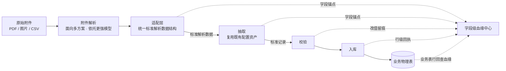
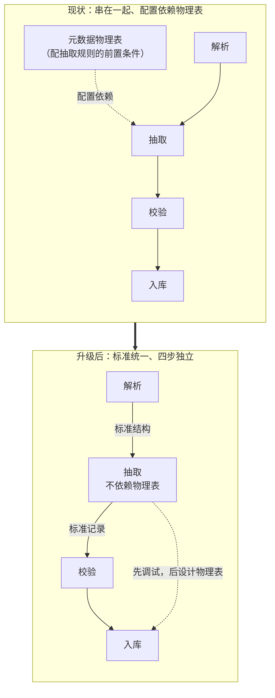
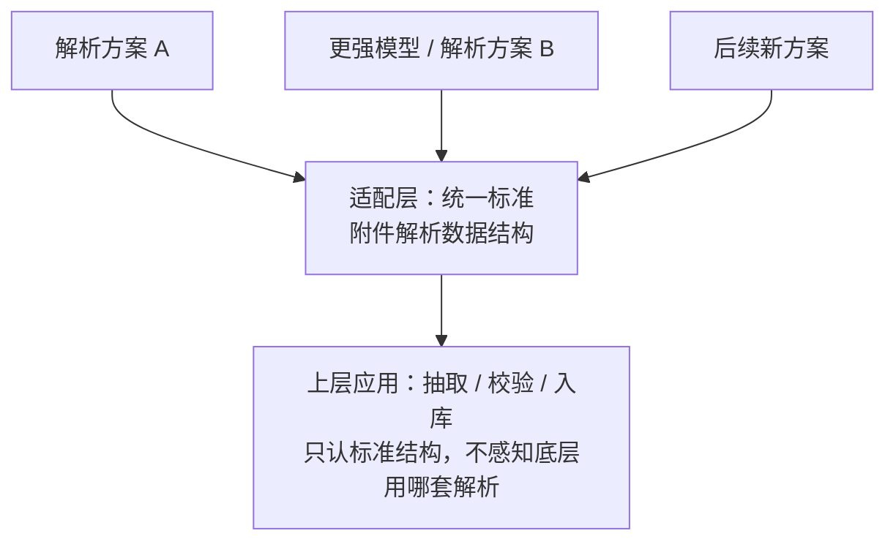
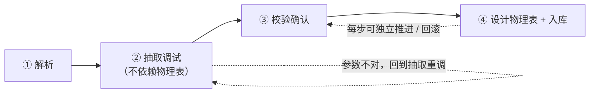
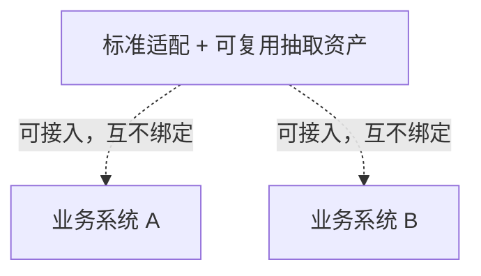
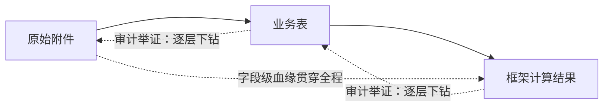
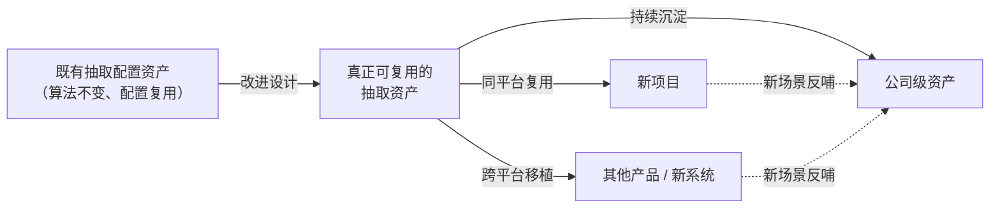

# C1-结构化产品升级 · 向领导汇报 PPT 思路草稿

> 文档性质：思路草稿（叙事与结构已按用户裁决定稿，据此制作 PPT）。日期 2026-11-24。
> 用途：把升级设计组织成一套业务型领导听得懂、能在用户端看到价值、能拍板的汇报逻辑。
> 定位口径：**升级，不是推倒重来**——在 C1 已有能力上做设计改进，抽取算法没变、既有配置资产全部保留复用；本次本质是设计改进，不宣称技术能力更新。
> 受众口径：**仅业务型领导，不做技术评审**——技术名词一律配业务翻译，价值用用户能感受到的话讲。
> 规模口径：**务实起步，不铺"全公司"大摊子**——团队小、异地团队可能已有更大更全的提取工具；但升级后确实做到"与接入的业务系统无关"，此点要提（P9），不与外部比大比全。
> 配图口径：**只用流程图，不采用系统截图**；不填效率/准确率数字。

---

## 0. 一句话结论（汇报的灵魂，全篇围绕它展开）

> **把 C1 已经验证好用的结构化能力做一次产品化升级：让结果全程可追溯、审计可信，让长期积累的抽取配置变成真正可复用、可沉淀的资产，让解析面向多方案、底层进步持续为上层所用。**

三句话说清升级本质（消解"推倒重来"与"步子太大"两种疑虑）：

1. **能力是升级，不是重做**：抽取算法没变，跑通的和积累的全部保留；本次本质是设计改进，不宣称技术能力更新。
2. **资产是复用，不是重写**：复用的是大量既有抽取配置；改进设计让这批资产第一次真正具备可复用性、可沉淀性。
3. **受益是 C1 先行，外延是业务系统无关**：先把 C1 这套做扎实；标准适配 + 资产可复用后，天然做到与接入的业务系统无关，但不主张统一全公司。

**四大价值支柱（按用户指定顺序：审计可信 → 资产沉淀 → 四步独立 → 标准适配；PPT 页序同此）：**

| 顺序 | 价值支柱 | 领导/用户视角的一句话 | 对应诉求 |
|---|---|---|---|
| ① | **全程可追溯，审计可信（主打）** | 字段级双向血缘，从附件到业务表到框架计算结果，点一下看全链路 | 4、5 |
| ② | **沉淀资产，越用越值钱** | 抽取算法没变、复用既有配置；改进设计让资产可复用、易沉淀 | 6、7 |
| ③ | **四步独立，上手更快** | 解析、抽取、校验、入库各自独立、不互相阻塞，新人也能快速上手 | 2、3 |
| ④ | **标准统一，面向多方案** | 用统一的附件解析数据结构做适配，解析层面向多方案、依托更强的模型持续进步；配置与建表分开 | 1、2、6 |

---

## 1. 汇报主线：五段式叙事

```
为什么升级（现状痛点） → 升级成什么（新设计） → 四大价值（按指定顺序：审计→资产→四步→标准）
→ 延展一句话（与业务系统无关） → 演进路线 → 收益与拍板
```

- **审计可信打头**：这是唯一能直接翻译成"用户价值/信任"的点，作为主打第一个讲。
- **先讲痛点再讲价值**：业务领导对"分层/适配层"无感，但对"对数要人工翻原件""配置换项目就要重来""新人上手慢"有强烈共鸣。
- **价值用对照讲**：每个价值点都用「以前怎样 / 升级后怎样」，不用功能罗列。
- **延展只讲一句**：P9 只点"与接入的业务系统无关"，不铺开、不主张统一。
- **守住本质口径**：全篇讲设计改进带来的价值，不宣称技术能力更新、不填效率数字。

---

## 2. 诉求 → PPT 页 覆盖对照表（防止漏项）

| 用户诉求 | 归并到哪个价值 | 落在第几页 |
|---|---|---|
| 1 底层可移植、解析层面向多方案、面向不同产品接入更友好 | ④ 标准统一 + P9 延展 | P8、P9 |
| 2 过程清晰、步骤简单、每层输入输出明确单一、整合公司技术能力 | ③ 四步独立 + ④ 标准统一 | P7、P8 |
| 3 四步独立、下一步不阻塞上一步、上手门槛低 | ③ 四步独立 | P7 |
| 4 血缘双向、字段级、附件到业务表完整可追溯 | ① 审计可信 | P4 |
| 5 依托数据准备计算能力，附件→业务表→框架计算结果全链路，审计可信价值 | ① 审计可信 | P4、P5 |
| 6 配置执行与物理表解耦，先解析抽取调试再设计物理表 | ② 资产沉淀 + ④ 标准统一 | P6、P8 |
| 7 复用沉淀的提取规则资产，切换平台系统无缝移植 | ② 资产沉淀 + P9 延展 | P6、P9 |

---

## 3. PPT 结构（11 页，按此页序制作）

### P1 封面
- 标题：**C1-结构化产品升级**（不用"新一代设计/重构"）
- 副标题：审计可信 · 资产复用 · 简单易用 · 标准适配
- 配图：分层流水线示意图（图 1 简化版）。

### P2 汇报摘要（30 秒电梯演讲）
- 一句话结论 + 三句升级本质（第 0 节）。
- 四个价值支柱（按审计→资产→四步→标准排序，审计可信标注"主打"）。
- 架构总览图（图 1）。

### P3 现状痛点与为什么要升级
- 四条痛点，落到"用户/业务损失"：
  1. **结构化能力吃不到模型进步的红利**：解析若绑定单一技术栈，就难以依托不断进步的更强模型、难以面向多方案择优，结构化效果提升受限。
  2. **资产没沉淀**：抽取配置散在各项目里，换个项目就要重配，经验留不下来。
  3. **上手慢**：解析、抽取、校验、入库串在一起，一步卡住全线停；新人要懂全链路才能干活；**配置抽取规则时还得先有元数据物理表**。
  4. **追溯断链**：抽出来的值对不上原始附件、业务表的数说不清来源，审计对数靠人工翻原件。
- 配图：图 2 现状 vs 升级后对照（现状侧须体现"配抽取规则依赖物理表元数据"）。

### P4 价值一｜全程可追溯，审计可信【主打】（对应诉求 4）
- 一句话：**字段级、双向、从附件到业务表完整可追溯。**
- 三个"级"：粒度到字段级/逐格级（每个值带原文位置）；方向双向（数值回溯到附件单元格、附件正查被哪些表引用）；链路完整（附件→标准解析数据→抽取记录→暂存→业务表，不断链）。
- 业务话术：**"对数不用再翻原件，点一下看到这个数从哪来、用到了哪去。"**
- 配图：图 6 字段级双向血缘链（含业务物理表回指血缘中心）。

### P5 价值一（续）｜延伸到框架计算结果，升维"审计可信"（对应诉求 5）
- 升维：**依托现有数据准备的计算能力/数据图谱，把血缘从"业务表"再延伸到"框架计算结果"。**
- 完整链路：**附件 → 业务表 → 框架计算结果，一条链打到底。**
- 价值：审计可信（结果可逐层下钻到原始凭证、可复核可举证）；用户价值（点一下看全链路，降低质疑成本）；合规风控（结果可追溯=过程可审计）。
- 配图：图 7 全链路图。

### P6 价值二｜沉淀资产，越用越值钱（对应诉求 6、7）
- 口径：**抽取算法没变**，用的是原来那套、复用已积累的大量配置；**这批配置是结构化产品的核心资产**；**改进的是设计**，让资产真正可复用、跨平台可移植、易沉淀为公司资产。
- 业务话术：**"以前换个项目配置要重来，现在配一次、多处受益，经验沉淀下来越来越值钱。"**
- 配图：图 8 老资产→可复用→公司资产沉淀与移植。

### P7 价值三｜四步独立，上手更快（对应诉求 2、3）
- 解析、抽取、校验、入库各自独立、下一步不阻塞上一步；可单独上手、可并行、可回滚；每步输入输出清晰单一。
- 业务话术：**"过程清楚、步骤简单，新人也能快速上手；一处卡住不影响其它步骤。"**
- 配图：图 4 四步独立泳道图。

### P8 价值四｜标准统一，面向多方案（对应诉求 1、2、6）
- 口径：**有适配层，把附件解析成统一标准的数据结构**；不是"换 OCR 模型"。解析层面向多方案、依托不断进步的更强模型，底层变化经适配层统一，上层业务不受影响。
- 抽取只面对标准解析数据，解析与抽取互不影响；**配置抽取不再依赖物理表**：先解析、先抽取、先调参数，验证通过再设计物理表。
- 业务话术：**"模型更强了、方案更多了，结构化效果跟着涨，但业务不用跟着改；调试的主动权交还给用户。"**
- 配图：图 3 适配层统一标准数据结构 + 图 4b 先验证后建表片段。

### P9 延展一句话｜与接入的业务系统无关（不单列支柱、不铺开）
- 一句话：**"因为做了标准适配、抽取能力成了可复用资产，升级后的结构化做到了与接入的业务系统无关——业务系统怎么变，结构化能力不用跟着改。"**
- 讲述提示：点到为止，不与外部比大比全、不主张统一全公司；领导追问再展开。
- 配图：图 5 简化版（弱化，标题不出现"全公司底座"）。

### P10 演进路线
- 四支柱回扣：**审计可信 / 资产沉淀 / 四步独立 / 标准适配。**
- 三段式（每阶段独立见效）：① 打底座（标准适配 + 抽取能力，抽取层已验证真实附件解析结果→记录、血缘不退化）；② 强可信（字段级双向血缘 + 框架计算结果延伸，审计可信闭环）；③ 促沉淀（老资产沉淀复用、跨平台可移植，外延业务系统无关视需要推进）。
- 强调务实起步、各阶段不相互阻塞。

### P11 收益总结 + 需要领导拍板的事项
- 收益四句话（价值支柱回扣，用户价值口吻，不填数字、不宣称技术突破）。
- 待拍板：①资源与优先级；②审计可信作为对外主打是否认可；③分期节奏。
- 配图：无，留白收口。

---

## 4. 关键流程图（Mermaid 源码，制作 PPT 时据此绘制）

### 图 1｜升级后架构总览（核心图）


### 图 2｜现状 vs 升级后对照（P3 用，现状侧须体现"配抽取依赖物理表元数据"）


### 图 3｜适配层统一标准数据结构（P8 用，替代"换 OCR 模型"表述）


### 图 4｜四步独立 + 先验证后建表（P7 用，P8 借用后半段）


### 图 5｜与接入的业务系统无关（仅 P9 备选用，弱化）


### 图 6｜字段级双向血缘（P4 用）


### 图 7｜全链路延伸到框架计算结果（P5 用，审计可信主打图）


### 图 8｜老资产 → 可复用 → 公司资产沉淀与移植（P6 用）


---

## 5. 配图方案（本轮定案）

- **只用流程图**（第 4 节 8 张图），不采用系统截图。
- 不填效率/准确率数字——本次改动技术能力本质没有更新，收益来自设计改进，不宣称技术突破。

---

## 6. 措辞注意事项（面向业务型领导，务必守住）

1. **命名**：用"**C1-结构化产品升级**"；禁"新一代设计/重构/推倒重来"。
2. **本质**：抽取算法没变、技术能力本质没更新；讲的是设计改进带来的价值，禁"新算法/技术突破/效率提升 X%"。
3. **解析**：说"**适配层 + 统一标准解析数据结构**""**解析层面向多方案、依托更强模型**"；禁"换 OCR 模型/上新 OCR"；痛点讲"吃不到模型进步红利"，不讲"底层一变全都要动"。
4. **抽取**：复用既有大量配置、是核心资产；只说设计改进让资产可复用、易沉淀。
5. **规模**：不主张统一全公司、不与外部比大比全；但 P9 必须提"与接入的业务系统无关"（升级后确实做到）。
6. **业务话术**：不兼顾技术评审；技术名词配业务翻译，多用用户感受（对数不用翻原件、配一次多处受益、新人上手快、不用先建表）。
7. **血缘**：框架计算结果链路用"依托现有能力延伸"，不夸大未验证细节。
8. **不外泄**工程细节（环境、端口、回滚、常服）。

---

## 7. 本轮已确认口径（用户裁决，供核对）

1. 四支柱顺序：审计可信 → 资产沉淀 → 四步独立 → 标准适配，PPT 页序同此。
2. 受众：仅业务型领导，不兼顾技术评审。
3. 审计可信作为主打。
4. P9 延展不删，要提"与接入的业务系统无关"。
5. 页数：11 页。
6. 配图：只走流程图，不用系统截图；不填效率/准确率数字（技术能力本质没更新）。

> 草稿已定稿，据此制作 11 页 PPT 初版供用户过目。
