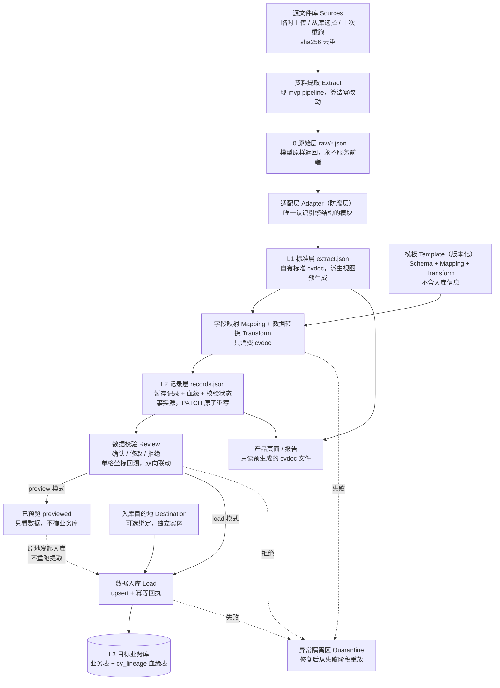
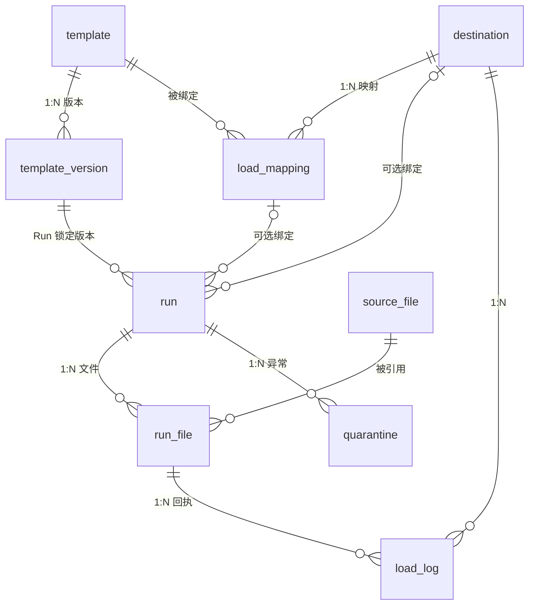
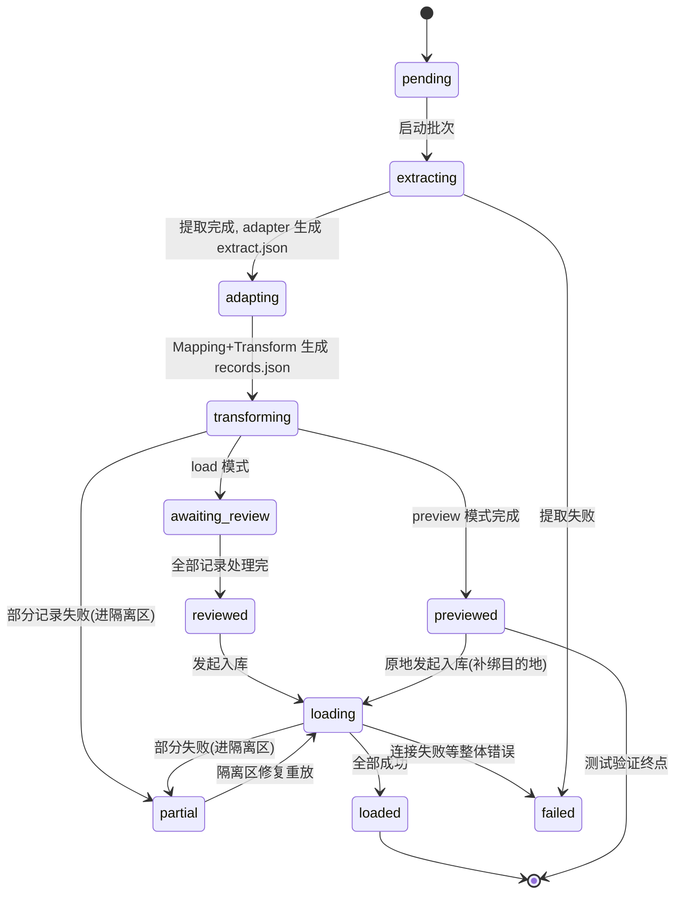
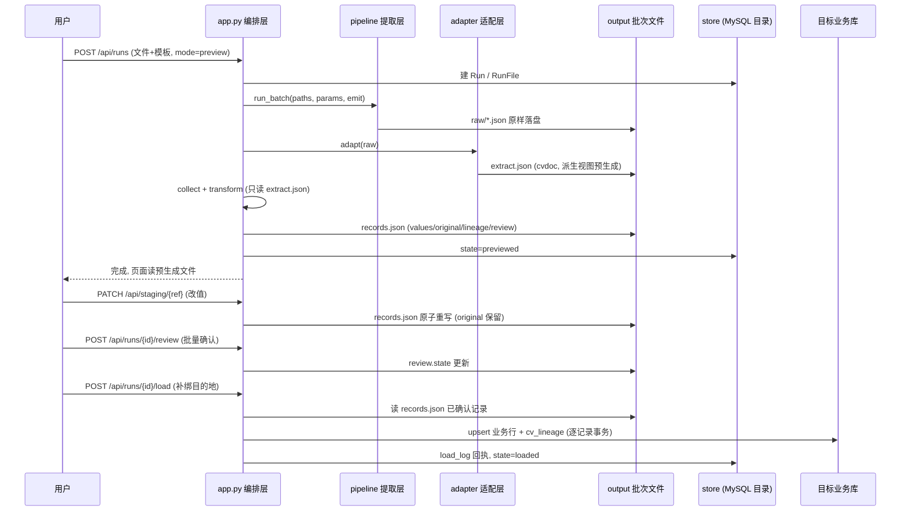
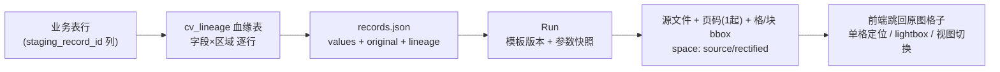
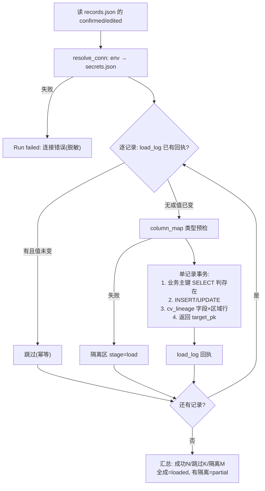
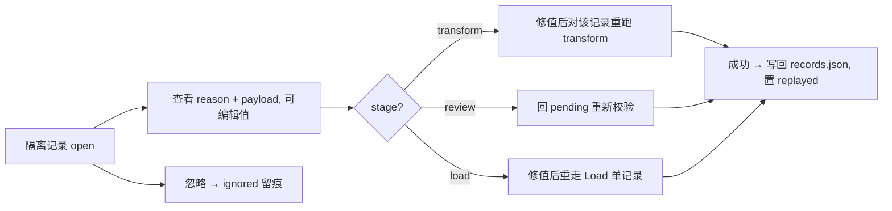

# 详细设计：文档 ETL 数据链路（Sources → Extract → Adapter → Staging → Review → Load）

> 状态：**详细设计稿 v3（待批准）**，2026-11-20。本文件是唯一设计源。
> v3变更：数据分层 + 自有标准 cvdoc + 适配层（防腐层）；页面数据全部预生成落盘；raw 与前端隔离；
> records.json 为记录事实源（取消 DB staging_record 表）；MySQL 只管目录元数据。
> 前置准备已完成：requirements 锁 PyMySQL==1.2.4 + cryptography==50.0.2；测试库凭据入 data/secrets.json（git 排除）；
> 10.0.6.161:3306 连通验证通过（MySQL 8.0.36，测试 schema co_dev）。业务代码未动。
> 范围：产品主干六步 + 人工校验 / 血缘追溯 / 异常隔离区；数据分层、模块设计、页面布局与交互、API、分期执行计划。
> 选型：数据库 **MySQL**（平台目录库与目标业务库统一 MySQL、同实例分 schema；实现层驱动无关）；
> 文件存储 **本地目录 + 相对路径**（DATA_ROOT 可整体迁移）。
> 实现方式：**在 mvp/ 上增量实现**，git 分支开发；提取算法零改动；旧功能降级隔离（§9）。
> 原则：模板与目的地解耦；Preview 一等公民；**页面只见自有标准，引擎结构不出适配层**。
> 配套图：`data-pipeline.drawio`；本文内嵌 mermaid。目录名同步用户重构：report/ 已改名 extract_report/。

---

## 1. 链路总览与命名

### 1.1 链路图



- **Preview 模式**：Run 算到 records.json 即停，页面直接看模板处理后的数据。测试默认路径：`选文件 → 选模板 → Preview`。
- **Load 模式**：校验确认后，同一份 records.json 直接入库，不重跑提取。
- Load 只放行「已确认 / 已修改」记录；失败 / 拒绝进隔离区，不丢弃、不阻塞整批。
- **页面消费的全部是预生成文件**（extract.json / records.json / 页图），无渲染期现算内容数据。

### 1.2 命名总表（中英对照，取业内通用词）

| 概念 | 英文名 | 中文名 | 说明 |
|---|---|---|---|
| 源文件库 | Sources | 资料文件（页面名沿用） | 待提取文件统一管理，哈希去重 |
| 提取 | Extract | 资料提取 | 现 mvp 能力 |
| 原始层 | Raw | 原始返回 | 引擎原样输出，逐引擎分文件 |
| 适配层 | Adapter（Anti-Corruption Layer） | 适配层 / 防腐层 | 引擎结构 → 自有标准，唯一翻译点 |
| 自有标准 | cvdoc（Canonical Document Model） | 文档标准格式 | 页面与下游唯一消费契约 |
| 模板 | Template | 模板 | 按文档类型复用，含版本 |
| 字段定义 | Schema | 字段定义 | 目标记录有哪些字段、什么类型 |
| 字段映射 | Mapping | 字段映射（原「数据收集」） | 从 cvdoc 哪张表 / 哪个块 / 哪列取值 |
| 转换规则 | Transform | 数据转换 | 值级清洗 |
| 暂存数据 | Staging Records | 暂存数据 | records.json，Mapping + Transform 产物 |
| 人工校验 | Review | 数据校验 | 对照原图核对 / 修改暂存数据 |
| 目的地 | Destination | 入库目的地 | 独立实体，可选；连接 + 入库映射 |
| 入库 | Load | 数据入库（执行动作） | 只入已校验数据 |
| 运行 | Run | 运行记录 | 一次流水线执行实例 |
| 血缘 | Lineage | 血缘追溯 | 库内记录 → 源文件页格坐标 |
| 隔离区 | Quarantine | 异常隔离区 | 失败 / 拒绝记录，可修复重放 |
| 预览 / 入库模式 | Preview / Load | 预览模式 / 入库模式 | Run 的两种模式 |

参照系：DDD Anti-Corruption Layer、EIP Canonical Data Model、MLflow backend-store/artifact-store 分离、
Kettle（任意步骤 Preview）、dbt（model 与 materialization 分离）、Rossum（Schema 与 Export 分离）、Airbyte（Source/Destination 独立）。

---

## 2. 数据分层与自有标准 cvdoc（v3 核心）

### 2.1 四层模型与批次内文件布局

```
output/<批次戳_名>/
├── raw/                      # L0 原始层：引擎原样返回，按路线分文件
│   ├── paddle.json           #   ppstruct 路线：官方 JSON 原样（现 result.json 的 parsing 等）
│   ├── pdfplumber.json       #   文本层路线：find_tables/words 原始快照
│   └── plain.json            #   CSV/TXT 路线：直读原始行
├── extract.json              # L1 标准层：cvdoc 自有标准（adapter 产物，派生视图全部预生成）
├── records.json              # L2 记录层：暂存记录 + 血缘 + 校验状态（事实源）
├── pages/                    # 页图（现有）：p1.png… / rectified.png
├── boxes.png                 # 现有带框图
├── table_*.csv               # 现有表格 CSV（改从 cvdoc 生成）
├── index.html                # 自包含报告（内联 cvdoc 数据，不再内联官方结构）
└── run.json                  # 本批次运行快照（参数/模板版本/状态时间线，自包含留档）
```

分层规则：

1. **逐层独立落盘，不合并不覆盖**：raw 是引擎原样（审计/复算基准）；extract 是适配产物；records 是加工产物。
   运维定位逐层比对：raw↔extract 差异 = 适配问题；extract↔records 差异 = 收集/转换问题；records↔业务表差异 = 入库问题。
2. **页面只读 L1/L2**：报告与产品页面的内容数据全部来自预生成文件；`viewmodel.hydrate()` 渲染期派生退役，
   派生视图（texts/scores/boxes/layout/统计）由 adapter 一次算好写进 extract.json。
3. **raw 永不服务前端**：静态服务白名单（§5.1），raw/ 请求 403；JSON tab 展示 extract.json（自有标准）。
   引擎数据结构不出适配层——页面与导出物中看不到 Paddle 字段名。
4. **批次自包含加强**：raw + extract + records + 页图 + 报告同目录，整目录拷走即可离线复核对账。
5. 重跑 = 新批次目录，旧批次不动（现有约定）。

### 2.2 cvdoc 标准草案（extract.json）

简洁、引擎无关、带版本号。坐标一律 `[x0,y0,x1,y1]` 像素（页图空间），页码 1 起。

```json
{
  "schema": "cvdoc/1",
  "file": {"name": "103_real_xxx.pdf", "kind": "pdf", "page_count": 3},
  "params": { "…提取参数快照…" },
  "pages": [{
    "index": 1,
    "size": [910, 1287],
    "space": "source",
    "image": "pages/p1.png",
    "rectified_image": "pages/rectified.png",
    "texts": [{"text": "…", "score": 0.99, "box": [x0,y0,x1,y1]}],
    "blocks": [{"role": "title|text|table|figure", "bbox": […], "text": "…"}],
    "tables": [{
      "bbox": […],
      "headers": ["交易日期", "金额", "…"],
      "rows": [["20221209", "1,234.56", "…"]],
      "cells": [[{"text": "…", "bbox": […], "page": 1}]],
      "title": "…", "header_recovered": false
    }],
    "stats": {"lines": 120, "avg_score": 0.97, "low_score_lines": 2}
  }],
  "stitched_tables": [ { "…跨页合并表，cells 逐格带 page…" } ]
}
```

- 领域资产语义保留（表头切分/续页拼接/单格坐标/coord.space），只是字段名与结构自有化；
- `schema` 版本字段保证标准自身可演进；消费端认版本不认引擎。

### 2.3 records.json 标准草案（L2 事实源）

```json
{
  "schema": "cvdoc-records/1",
  "run_id": 12, "template": {"name": "银行流水", "version": 3},
  "files": [{
    "run_file_id": 34, "source_file_id": 5, "name": "103_real_xxx.pdf",
    "records": [{
      "index": 0,
      "values":   {"txn_date": "2022-12-09", "amount": 1234.56},
      "original": {"txn_date": "2022-12-09", "amount": 1234.56},
      "lineage":  {"amount": [{"page":1,"table_index":0,"cell_bbox":[…],"space":"source","raw_text":"1,234.56","score":0.99}]},
      "review":   {"state": "pending", "at": null}
    }]
  }]
}
```

- **记录引用键 = (run_file_id, index)**，隔离区 / 入库回执均用此键（DB 不再存记录内容）。
- lineage 为**引用数组**（1:N 锚点：单元格 / 段落 / 多段落统一，§4.4）。
- 校验修改 = PATCH 后**原子重写** records.json（tmp + os.replace；--workers 1 单写者，无并发竞争）；
  original 永不覆盖。
- **保存方式接缝**：records/extract 的读写全部经过 content repo 接口（§5.5），当前实现 = 文件；
  将来改 DB / 对象存储 = 换实现，页面与 API 不动（用户诉求「改个保存方式就行」）。

### 2.4 适配层接口（防腐层）

```
mvp/adapter/
├── base.py       # cvdoc schema 常量 + 适配接口：adapt(raw, route_meta) -> cvdoc
├── paddle.py     # PPStructureV3 官方 JSON → cvdoc（全仓唯一认识 Paddle 结构的模块）
├── pdfplumber.py # 文本层路线原始快照 → cvdoc
└── plain.py      # CSV/TXT → cvdoc
```

- 换引擎（MinerU / 其他平台）= 新增一个 adapter 实现 + 引擎路线接入，**collect / transform / 报告 / 页面零改动**；
- adapter 是纯函数（raw dict → cvdoc dict），可单测；派生视图（原 hydrate 逻辑）在此预生成；
- `viewmodel.py` 迁移完成后**删除，不留 shim**（彻底清理约定）。

---

## 3. 对象模型（目录元数据在 DB，内容在文件）

### 3.1 关系图



记录内容（staging）不在 DB：records.json 是事实源，quarantine / load_log 用 (run_file_id, record_index) 引用。

### 3.2 SourceFile 源文件

| 字段 | 类型 | 说明 |
|---|---|---|
| id | int PK | |
| name | str | 原始文件名（不改名） |
| sha256 | str UNIQUE | 内容哈希，**去重键** |
| kind | enum | pdf / image / text |
| size_bytes | int | |
| rel_path | str | sources/ 规范副本相对路径 |
| tags / note | str | 可空 |
| created_at | datetime | UTC |

### 3.3 Template / TemplateVersion

Template：`id, name UNIQUE, description, current_version, created_at, updated_at`。
TemplateVersion（**修改 = 新版本**）：`id, template_id FK, version, schema_json, mapping_json, transform_json, created_at`，UNIQUE(template_id, version)。

- schema_json：`[{field, label, type: string/number/date/bool, required, note}]`
- mapping_json：选择器（§6.2），整体为空 = passthrough
- transform_json：规则链（§6.3）
- 模板不含入库信息；Run 锁定版本；种子模板「原始透传」。

### 3.4 Destination / LoadMapping

Destination：`id, name UNIQUE, db_type, conn_ref, created_at`。**conn_ref 是引用名不是密码**（§5.6）。
LoadMapping：`id, destination_id FK, template_id FK, target_table, column_map_json([{field,column,col_type}]), write_mode(append/upsert), business_key_json`，UNIQUE(destination_id, template_id, target_table)。

### 3.5 Run / RunFile

Run：`id, batch_tag, mode(preview/load), template_version_id FK, destination_id/load_mapping_id 可空 FK, params_json, state, error, created_at, updated_at`。
RunFile：`id, run_id FK, source_file_id FK, state, output_rel_dir`，UNIQUE(run_id, source_file_id)。
批次目录内另有 run.json 快照（自包含留档，DB 为运营事实源）。

### 3.6 Quarantine / LoadLog

Quarantine：`id, run_id FK, run_file_id 可空, record_index 可空, stage(transform/review/load), reason, payload_json, state(open/replayed/ignored), created_at, resolved_at`。
LoadLog：`id, run_id FK, run_file_id, record_index, destination_id FK, target_table, target_pk, action(insert/update), loaded_at`，UNIQUE(run_file_id, record_index, destination_id, target_table)。

---

## 4. Run 状态机与核心语义

### 4.1 状态机



### 4.2 Preview → Review → Load 时序



### 4.3 语义约定

| 主题 | 约定 |
|---|---|
| 幂等 | 源文件 sha256 去重；Load upsert（业务主键）；LoadLog 回执防重复 |
| 事实源 | raw = 引擎事实源；extract = 标准投影；records = 记录事实源；DB = 目录事实源。四层各司其职，不双写 |
| 校验边界 | Load 只放行 confirmed / edited；pending / rejected 不入业务库 |
| 错误策略 | 部分成功合法；失败进隔离区；从失败阶段重放 |
| 阶段解耦 | collect/transform/报告/页面只认 cvdoc，引擎结构不出 adapter |
| 模板版本 | Run 锁定版本；历史可复现 |
| 内容 vs 状态 | 内容数据全部预生成文件；运行时状态（进度/日志）天然动态，走 API，不属于「临时内容」 |

### 4.4 血缘追溯（Lineage，1:N 锚点）



- **一字段多源区域**（业内标准：Google textSegments/pageRefs、Azure boundingRegions 均为数组）：
  lineage 每字段 → 引用数组；单元格=单元素，段落/多段落=多元素（块锚点 block_index + bbox + 文本区间）。
- 粒度阶梯：表格→单元格；段落→版面块；文本层精确到字→字符区间（pdfplumber chars，P3 按需）。
- cv_lineage 同一 (record, field) 写 N 行、region_seq 保序；业务表只加一列 `staging_record_id`（存记录引用键）。
- UI：点字段 → 全部源区域高亮，跨页沿用页签圆点 + 循环跳转；**反向**（点图格→亮字段）用 lineage 反向索引（P1 校验台）。

目标库血缘表 DDL 见 §5.3 末。

---

## 5. 存储设计

### 5.1 文件存储：DATA_ROOT + 相对路径 + 服务白名单

```
DATA_ROOT（默认 = mvp/ 根；CV_MVP_DATA_ROOT 可覆盖）
├── sources/     # 源文件库规范副本 <sha8>_<名>（哈希一份，永不随批次清理）
├── input/       # 批次工作副本（现机制不变）
├── output/      # 批次产物：raw/ + extract.json + records.json + 页图 + 报告（§2.1）
├── logs/        # 运行日志
└── data/        # secrets.json（凭据引用；数据库在 MySQL 服务中）
```

规则：

1. DB 与 JSON 只存相对路径，正斜杠；config `to_abs/to_rel` 唯一换算点。
2. 现有 INPUT/OUTPUT/LOG_DIR 改 DATA_ROOT 派生，默认值不变，现有批次零迁移。
3. **静态服务白名单**：output 挂载只放行 extract.json / records.json / run.json / pages/*.png / boxes.png /
   table_*.csv / index.html；**raw/ 一律 403**（引擎结构隔离）。input 挂载（源文件预览）不变。
4. 服务器部署：DATA_ROOT 整体拷贝 + 设环境变量，代码零改动；DB 走 mysqldump。

### 5.2 数据库选型：MySQL（平台目录 + 业务目标统一，已裁决）

- 平台目录库（测试 co_dev）与业务库同实例分 schema；一套 DDL / 迁移 / 备份。
- **实现层数据库无关**：所有 SQL 收敛 store/；store 与 loader 共用薄驱动接口（JDBC 式），
  首个实现 PyMySQL==1.2.4（锁版本）；换库 = 新增驱动实现 + 迁移方言，业务代码零改动。
- MySQL 8 认证需 cryptography==50.0.2（已锁，环境已有）。
- 迁移：编号脚本 + schema_version 表；首次调用自动建库跑迁移；库名跟随连接串。
- 代价：P0 起本地需 MySQL 常驻；未起时降级（§6.7）：提取照常，平台功能不可用。
- **DB 只管目录元数据**（sources/templates/destinations/runs/quarantine/load_log），记录内容在 records.json。

### 5.3 表结构（MySQL DDL，001_init.sql，平台目录库）

MySQL 8.x / InnoDB / utf8mb4；JSON 原生类型（默认值应用层给）；时间 DATETIME（应用层 UTC）。

```sql
CREATE TABLE source_file (
  id          BIGINT AUTO_INCREMENT PRIMARY KEY,
  name        VARCHAR(255) NOT NULL,
  sha256      CHAR(64)     NOT NULL,
  kind        VARCHAR(16)  NOT NULL,
  size_bytes  BIGINT       NOT NULL,
  rel_path    VARCHAR(512) NOT NULL,
  tags        VARCHAR(512),
  note        TEXT,
  created_at  DATETIME NOT NULL DEFAULT CURRENT_TIMESTAMP,
  UNIQUE KEY uk_source_sha (sha256)
) ENGINE=InnoDB DEFAULT CHARSET=utf8mb4;

CREATE TABLE template (
  id              BIGINT AUTO_INCREMENT PRIMARY KEY,
  name            VARCHAR(128) NOT NULL,
  description     VARCHAR(512),
  current_version INT NOT NULL DEFAULT 1,
  created_at      DATETIME NOT NULL DEFAULT CURRENT_TIMESTAMP,
  updated_at      DATETIME NOT NULL DEFAULT CURRENT_TIMESTAMP ON UPDATE CURRENT_TIMESTAMP,
  UNIQUE KEY uk_template_name (name)
) ENGINE=InnoDB DEFAULT CHARSET=utf8mb4;

CREATE TABLE template_version (
  id             BIGINT AUTO_INCREMENT PRIMARY KEY,
  template_id    BIGINT NOT NULL,
  version        INT NOT NULL,
  schema_json    JSON,
  mapping_json   JSON,
  transform_json JSON,
  created_at     DATETIME NOT NULL DEFAULT CURRENT_TIMESTAMP,
  UNIQUE KEY uk_tpl_ver (template_id, version),
  CONSTRAINT fk_tv_template FOREIGN KEY (template_id) REFERENCES template(id)
) ENGINE=InnoDB DEFAULT CHARSET=utf8mb4;

CREATE TABLE destination (
  id         BIGINT AUTO_INCREMENT PRIMARY KEY,
  name       VARCHAR(128) NOT NULL,
  db_type    VARCHAR(32)  NOT NULL,
  conn_ref   VARCHAR(128) NOT NULL,
  created_at DATETIME NOT NULL DEFAULT CURRENT_TIMESTAMP,
  UNIQUE KEY uk_dest_name (name)
) ENGINE=InnoDB DEFAULT CHARSET=utf8mb4;

CREATE TABLE load_mapping (
  id                BIGINT AUTO_INCREMENT PRIMARY KEY,
  destination_id    BIGINT NOT NULL,
  template_id       BIGINT NOT NULL,
  target_table      VARCHAR(128) NOT NULL,
  column_map_json   JSON NOT NULL,
  write_mode        VARCHAR(16) NOT NULL DEFAULT 'upsert',
  business_key_json JSON,
  UNIQUE KEY uk_dest_tpl_table (destination_id, template_id, target_table),
  CONSTRAINT fk_lm_dest FOREIGN KEY (destination_id) REFERENCES destination(id),
  CONSTRAINT fk_lm_tpl  FOREIGN KEY (template_id) REFERENCES template(id)
) ENGINE=InnoDB DEFAULT CHARSET=utf8mb4;

CREATE TABLE run (
  id                  BIGINT AUTO_INCREMENT PRIMARY KEY,
  batch_tag           VARCHAR(32) NOT NULL,
  mode                VARCHAR(16) NOT NULL,
  template_version_id BIGINT NOT NULL,
  destination_id      BIGINT,
  load_mapping_id     BIGINT,
  params_json         JSON,
  state               VARCHAR(24) NOT NULL DEFAULT 'pending',
  error               TEXT,
  created_at          DATETIME NOT NULL DEFAULT CURRENT_TIMESTAMP,
  updated_at          DATETIME NOT NULL DEFAULT CURRENT_TIMESTAMP ON UPDATE CURRENT_TIMESTAMP,
  KEY idx_run_state (state),
  CONSTRAINT fk_run_tv   FOREIGN KEY (template_version_id) REFERENCES template_version(id),
  CONSTRAINT fk_run_dest FOREIGN KEY (destination_id) REFERENCES destination(id),
  CONSTRAINT fk_run_lm   FOREIGN KEY (load_mapping_id) REFERENCES load_mapping(id)
) ENGINE=InnoDB DEFAULT CHARSET=utf8mb4;

CREATE TABLE run_file (
  id             BIGINT AUTO_INCREMENT PRIMARY KEY,
  run_id         BIGINT NOT NULL,
  source_file_id BIGINT NOT NULL,
  state          VARCHAR(24) NOT NULL DEFAULT 'pending',
  output_rel_dir VARCHAR(512) NOT NULL,
  UNIQUE KEY uk_run_file (run_id, source_file_id),
  CONSTRAINT fk_rf_run  FOREIGN KEY (run_id) REFERENCES run(id),
  CONSTRAINT fk_rf_file FOREIGN KEY (source_file_id) REFERENCES source_file(id)
) ENGINE=InnoDB DEFAULT CHARSET=utf8mb4;

CREATE TABLE quarantine (
  id           BIGINT AUTO_INCREMENT PRIMARY KEY,
  run_id       BIGINT NOT NULL,
  run_file_id  BIGINT,
  record_index INT,
  stage        VARCHAR(16) NOT NULL,
  reason       TEXT NOT NULL,
  payload_json JSON NOT NULL,
  state        VARCHAR(16) NOT NULL DEFAULT 'open',
  created_at   DATETIME NOT NULL DEFAULT CURRENT_TIMESTAMP,
  resolved_at  DATETIME,
  KEY idx_q_run (run_id, state),
  CONSTRAINT fk_q_run FOREIGN KEY (run_id) REFERENCES run(id),
  CONSTRAINT fk_q_rf  FOREIGN KEY (run_file_id) REFERENCES run_file(id)
) ENGINE=InnoDB DEFAULT CHARSET=utf8mb4;

CREATE TABLE load_log (
  id             BIGINT AUTO_INCREMENT PRIMARY KEY,
  run_id         BIGINT NOT NULL,
  run_file_id    BIGINT NOT NULL,
  record_index   INT NOT NULL,
  destination_id BIGINT NOT NULL,
  target_table   VARCHAR(128) NOT NULL,
  target_pk      VARCHAR(255) NOT NULL,
  action         VARCHAR(16) NOT NULL,
  loaded_at      DATETIME NOT NULL DEFAULT CURRENT_TIMESTAMP,
  UNIQUE KEY uk_load_receipt (run_file_id, record_index, destination_id, target_table),
  CONSTRAINT fk_ll_run  FOREIGN KEY (run_id) REFERENCES run(id),
  CONSTRAINT fk_ll_rf   FOREIGN KEY (run_file_id) REFERENCES run_file(id),
  CONSTRAINT fk_ll_dest FOREIGN KEY (destination_id) REFERENCES destination(id)
) ENGINE=InnoDB DEFAULT CHARSET=utf8mb4;

CREATE TABLE schema_version (
  version    INT PRIMARY KEY,
  applied_at DATETIME NOT NULL DEFAULT CURRENT_TIMESTAMP
) ENGINE=InnoDB DEFAULT CHARSET=utf8mb4;
```

种子：内置模板「原始透传」（template + v1，三个 JSON 空）。

目标业务库血缘表（loader 自动创建）：

```sql
CREATE TABLE cv_lineage (
  id            BIGINT AUTO_INCREMENT PRIMARY KEY,
  target_table  VARCHAR(128) NOT NULL,
  record_pk     VARCHAR(255) NOT NULL,
  record_ref    VARCHAR(64)  NOT NULL,      -- run_file_id:record_index
  run_id        BIGINT NOT NULL,
  source_name   VARCHAR(255) NOT NULL,
  page          INT,
  table_index   INT,
  field         VARCHAR(128),
  region_seq    INT NOT NULL DEFAULT 0,
  block_index   INT,
  cell_bbox     VARCHAR(128),
  coord_space   VARCHAR(16),
  raw_text      TEXT,
  loaded_at     DATETIME NOT NULL DEFAULT CURRENT_TIMESTAMP,
  KEY idx_lineage_row (target_table, record_pk)
) ENGINE=InnoDB DEFAULT CHARSET=utf8mb4;
```

### 5.4 事实源划分（四层不双写）

| 数据 | 事实源 | 派生 / 快照 |
|---|---|---|
| 引擎原始返回 | output/<批次>/raw/*.json | 无（原样留档） |
| 标准提取结果 | output/<批次>/extract.json（cvdoc） | 报告 HTML 内联副本、CSV |
| 暂存记录 + 校验状态 | **output/<批次>/records.json** | 无（DB 不存记录内容） |
| 源文件内容 | sources/ 规范副本 | input/<批次> 工作副本 |
| 目录元数据（库/模板/目的地/Run/隔离/回执） | MySQL | run.json 批次快照 |

### 5.5 数据访问层 `mvp/store/`（保存方式接缝）

```
mvp/store/
├── db.py          # 薄驱动接口 + PyMySQL 实现、conn_ref 解析、迁移执行器
├── migrations/001_init.sql
├── catalog.py     # 目录 repo（MySQL）：source/template/destination/run/quarantine/loadlog
└── content.py     # 内容 repo（当前=文件实现）：get_extract / get_records / patch_record / save_*
```

- **content.py 是「改保存方式」的接缝**：接口稳定，当前读写 output/ 文件（原子写）；
  将来换 DB / 对象存储只换实现，API 与页面不动。
- 包相对导入、懒加载（首次调用才连 DB / 读文件），import app 不碰 DB。
- 业务层只调 repo，不出现 SQL / 裸路径拼接。

### 5.6 凭据管理（已裁决：暂不加密）

- conn_ref 引用制：业务库 `CV_DEST_*`、平台库 `CV_PLATFORM_DB`；解析顺序 env → data/secrets.json（git 排除）。
- 测试库凭据已落地（co_dev@10.0.6.161，MySQL 8.0.36 连通验证通过）。
- cryptography 已因 MySQL 8 认证列入 requirements，与凭据加密无关。

---

## 6. 模块详细设计

### 6.1 模块总览

```
mvp/
├── adapter/          # §2.4 防腐层：base/paddle/pdfplumber/plain（viewmodel.py 迁移后删除）
├── store/            # §5.5 catalog(MySQL) + content(文件)
├── collect.py        # Mapping：extract.json → 原始记录集
├── transform.py      # Transform：规则链 + 类型化 → records.json
├── loader.py         # Load：upsert + cv_lineage + 回执
└── extract_report/   # 报告：消费迁移到 cvdoc（builder/cards 改读 extract.json/records.json）
```

pipeline/ 算法零改动；产物落盘路径调整（result.json → raw/ 分路线文件）。

### 6.2 Mapping 引擎（collect.py）

输入 extract.json（cvdoc）+ mapping_json；输出原始记录集 + warnings。选择器：

```json
{"field": "交易金额", "table": {"index": 0}, "column": {"name": "金额"}}
```

| 选择器 | 取值 | 语义 |
|---|---|---|
| table | index / header_contains | 第 n 张表（0 起）/ 表头含文本的首表 |
| column | name / index | 表头名精确匹配（trim）/ 列序号 |
| block（P3） | role / index | 版面块取值（段落锚点） |

- 一行 = 一条记录；多字段可跨表，行数不齐缺值填空 + warning。
- 选择器落空 → 字段全列空 + warning，不静默；全落空 → 该文件进隔离区。
- passthrough：每表每行 → 记录，键 = 表头原文（空表头 col_<n>），lineage 逐格。
- 跨页拼接表 cells 逐格带 page，血缘页码天然正确。
- 纯函数可单测；**只认 cvdoc，不认识任何引擎字段**。

### 6.3 Transform 引擎（transform.py）

规则 op（P1 首批，按序执行，末尾隐式 cast 到 schema.type）：

| op | args | 语义 | 失败 |
|---|---|---|---|
| trim | 无 | 去首尾空白（含全角） | 不失败 |
| regex_replace | pattern, repl | 正则替换 | 不匹配原样通过 |
| date_parse | format, out | 解析→标准化日期 | 隔离区 |
| amount | thousands | 千分位/货币符号→数值 | 隔离区 |
| enum_map | map, default | 值映射 | 无 default 未命中→隔离区 |
| cast | type | 强转 | 隔离区 |

空值：required→隔离区；非 required→null。失败记录 payload+reason 进隔离区，其余继续。纯函数可单测。

### 6.4 Review 服务

- PATCH：values 差量，schema.type 校验（422 字段级错误）；content repo 原子重写 records.json；
  original 不动；review.state=edited（confirmed 改值回落 edited）。
- 批量确认只作用 pending/edited；reject 写隔离区（stage=review）。
- 全部处理完 → reviewed（load）/ 保持 previewed（preview）。
- loaded Run 记录只读（改值走隔离区重放或新 Run）。

### 6.5 Load 执行器（loader.py）



- 可移植 upsert（SELECT-then-write + 事务，不用方言）；驱动接缝与 store 共用（§5.2）。
- 事务粒度 = 单记录；cv_lineage 与业务行同事务。
- 业务表 staging_record_id 列不存在则 ALTER ADD（幂等）；cv_lineage 不存在则自动建。
- 凭据不落日志；错误信息脱敏。

### 6.6 隔离区与重放



规则级修复走「新模板版本 + 新 Run」，不就地改历史 Run（可复现性）。

### 6.7 状态聚合与降级隔离

- emit 回调映射 stage → run_file.state → Run 聚合；单调不回退。
- **降级隔离**：登记/建 Run/DB 故障只记 warning，提取照常跑；新路由失败只影响新功能。
- adapter/collect/transform 是文件链路，**不依赖 DB**——MySQL 宕机时 Preview 全链路仍可用（v3 增强）。

---

## 7. 页面布局与交互设计

### 7.0 全局约定

- 单行色带页头 + 顶部同级短名 tab：`提取 | 资料 | 模板 | 校验 | 目的地 | 运行`；默认落地提取页。
- **页面内容数据全部来自预生成文件**（extract.json / records.json / 页图），经 content repo 读取；
  运行时状态（进度/日志）走 API 轮询。
- 缩略图内嵌文件名行（40×40）；lightbox 全屏；叠加框默认隐藏 hover 显示点击钉住；悬浮控件不占布局。
- JSON 视图展示 **cvdoc 自有标准**；raw 不可访问（403）。
- 新页面资源放 extract_report/assets；纯前端改动刷新即生效。

### 7.1 资料提取 Extract（现上传页增强）

```text
┌────────────────────────────────────────────────────────────┐
│ 色带页头: 资料提取          模式: (●) 预览  ( ) 入库        │
├────────────────────────────────────────────────────────────┤
│ [上传区: 拖拽 / 点击选择]        [从资料库选择 ▸]           │
│ 文件列表:                                                   │
│   [缩略图] 103_real_xxx.pdf   1.2MB  ✓已在库(复用)          │
│   [缩略图] scan_01.png        800KB  新登记                 │
│ [上次文件面板（现有）: 用这些文件重新提取]                  │
├────────────────────────────────────────────────────────────┤
│ 模板: [原始透传 v1 ▾]  去配置▸                              │
│ 目的地: [—— 仅入库模式显示 —— ▾]  映射: [自动匹配/手选 ▾]   │
│ [参数面板（现有，折叠）]                                    │
│ [ 开始提取 ]                                                │
│ 进度条 + 日志（现有）                                       │
│ 完成提示: [查看暂存数据 ▸]（预览）/ [查看运行 ▸]（入库）    │
└────────────────────────────────────────────────────────────┘
```

交互：① 模式切换，入库才显示目的地行，未选禁用+提示；② 临时上传自动登记，哈希命中行内提示复用；
③ 从库选择抽屉多选，行标「来自库」；④ 模板下拉 `名称 v版本`，默认透传；⑤ 参数面板现有 9 项不动；
⑥ 完成跳暂存视图/运行详情；⑦ 类型/大小校验现有不变，失败不影响其它文件。

### 7.2 资料文件 Sources

```text
┌────────────────────────────────────────────────────────────┐
│ 色带页头: 资料文件   [搜索____] [标签 ▾] [类型 ▾] [上传]    │
├────────────────────────────────────────────────────────────┤
│ [缩略图] 文件名        类型  大小   标签    上传时间  操作  │
│ [缩略图] 103_real_…pdf  PDF  1.2MB  银行    11-16   提取 ⋯ │
│ …                                        [分页 20/页]      │
└────────────────────────────────────────────────────────────┘
```

交互：① 时间倒序，搜索/标签/类型过滤叠加；② 行内缩略图 lightbox / PDF 角标新窗口；
③ 上传=登记，哈希命中提示+定位已有行；④ 操作：提取（预选跳转）/预览/编辑标签/删除；
⑤ 删除保护：被 Run 引用禁删（血缘完整），未引用二次确认后删记录+副本，批次产物不动；⑥ 空态一行引导。

### 7.3 模板管理 Templates

```text
┌────────────────────────────────────────────────────────────┐
│ 色带页头: 模板   [新建模板]                                 │
├──────────────┬─────────────────────────────────────────────┤
│ 模板列表      │ 基本信息: 名称[____] 描述[____]             │
│ ▸ 原始透传 v1 │ ── 字段定义 Schema ──────────────────────   │
│ ▸ 银行流水 v3 │  字段名   标签    类型▾   必填☐  [＋行]     │
│              │ ── 字段映射 Mapping ─────────────────────   │
│              │  amount ← 表[0▾] 列[金额▾]  [从样例拾取 ▸]  │
│              │ ── 转换规则 Transform ───────────────────   │
│              │  amount: [trim]→[amount]→[cast:number]      │
│              │          [＋规则] [↑][↓] 删除               │
│              │ 版本历史: v3(当前) v2 v1 [查看旧版]          │
│              │ [ 保存（生成 v4） ]                         │
└──────────────┴─────────────────────────────────────────────┘
```

交互：① 三段编辑器，全空=透传提示条；② **从样例拾取**：选近期批次的 extract.json → 渲染表格 →
点表头自动生成选择器回填（不手写 JSON）；③ 规则 op 下拉+args 表单，↑↓ 调序，隐式 cast 灰字不可删；
④ 保存=新版本（按钮明示），旧版只读，历史 Run 不受影响；⑤ 删字段级联清理 mapping/transform；
⑥ 种子透传不可删；被锁定版本不可删。

### 7.4 数据校验 Review（核心新页面）

```text
┌────────────────────────────────────────────────────────────┐
│ 色带页头: 校验  [运行 ▾] [文件 ▾]  进度 12/25  [批量确认]   │
├──────────────────────────┬─────────────────────────────────┤
│ 源图区（复用 imgwrap）    │ 记录导航: [◀] 第 12 条 [▶]      │
│  视图: (原图)(矫正图)     │ 状态列表: ●●●○○…（色点=状态）   │
│  1:1 叠加, 框默认隐藏     │ ─────────────────────────────── │
│  hover 显示 / 点击钉住    │ 字段     值(可编辑)  原值  状态 │
│  [lightbox 全屏]         │ 交易日期 [2022-12-09]  …    ✓  │
│                          │ 交易金额 [1234.56 ]  1,234.56 ✎ │
│  ← 点字段行: 高亮对应格   │ 摘要     [货款      ]  …    ✓  │
│  → 点图中格: 高亮字段行   │ [确认] [拒绝]  修改自动暂存     │
├──────────────────────────┴─────────────────────────────────┤
│ 底栏: 待校验 13 · 已确认 10 · 已修改 2 · 隔离 0 [查看隔离区] │
│ （previewed Run 额外显示: [发起入库 ▸]）                    │
└────────────────────────────────────────────────────────────┘
```

交互：① **双向联动**：点字段→左图格高亮（跨页自动切页 ensureView，按 space 切视图）；
点图格→字段行高亮滚动（lineage 反向索引）；框默认隐藏 hover 显点击钉住；
② 内联编辑按 type 即时校验，改值显示原值列，离焦自动 PATCH（原子写 records.json）；
③ 确认/拒绝单条操作，拒绝进隔离区色点变红；批量确认只作用 pending/edited，一行确认提示；
④ ◀▶ + 状态色点直跳；⑤ 多文件短名 tab，跨页滚动同步防抖；
⑥ preview/load 同页，previewed 校验完底栏「发起入库」弹目的地选择；
⑦ loaded 只读；⑧ 空态一行「全部处理完」+ 下一步。

### 7.5 入库目的地 Destinations

```text
┌────────────────────────────────────────────────────────────┐
│ 色带页头: 目的地   [新建连接]                               │
├──────────────┬─────────────────────────────────────────────┤
│ 连接列表      │ 连接: 名称[____] 类型[MySQL ▾]              │
│ ▸ 银行库      │       conn_ref [CV_DEST_BANK_DB]            │
│   (MySQL)    │       [测试连接]  ✓ 连通（只回 host/库名）   │
│              │ ── 入库映射（本连接） ─────────────────────  │
│              │  模板[银行流水▾] → 目标表[bank_txn____]      │
│              │  字段      列名        列类型▾               │
│              │  amount   amount      DECIMAL               │
│              │  写入: (●) upsert ( ) append                │
│              │  业务主键: [txn_date ☑][amount ☐]…          │
│              │  [＋映射] [保存]                            │
└──────────────┴─────────────────────────────────────────────┘
```

交互：① 测试连接脱敏回显，凭据永不回显不落日志；② 选模板自动带出当前版本 schema 字段，列名同名预填，
upsert 业务主键必选；③ 从库读列 P3；④ 被引用禁删；⑤ 同 (模板,目标表) 重复行内报错。

### 7.6 运行记录 Runs

```text
┌────────────────────────────────────────────────────────────┐
│ 色带页头: 运行   [状态 ▾] [模式 ▾] [搜索批次/文件名]        │
├────────────────────────────────────────────────────────────┤
│ 批次戳        文件 模板@版本    模式  状态     时间   操作  │
│ 20261120…    2    银行流水@v3  预览  ●已预览  14:02  详情  │
├────────────────────────────────────────────────────────────┤
│ 详情抽屉:                                                   │
│  状态时间线: pending→extracting→adapting→…→previewed        │
│  逐文件: 103.pdf ✓ [报告▸] [extract▸] [records▸] [日志▾]   │
│  [查看暂存/校验 ▸]  [发起入库 ▸]（previewed/reviewed）      │
│  隔离区: 2 条 [查看/重放 ▸]                                 │
└────────────────────────────────────────────────────────────┘
```

交互：① 状态徽标色（运行蓝/待校验黄/成功绿/部分失败橙/失败红）；② 轮询复用 /api/status；
③ 产物链接走白名单挂载（raw 不出现）；④ 发起入库弹目的地选择；⑤ 隔离面板 reason+payload+重放/忽略；
⑥ 「同文件+模板重跑」带参跳提取页（新 Run）。

---

## 8. API 细则

上传沿用 base64 JSON。内容端点经 content repo 读预生成文件；目录端点经 catalog repo。

```
GET  /api/sources?q=&tag=&kind=&page=      → {items:[…], total}
POST /api/sources {name, data_b64}         → {id, dedup:bool}
DELETE /api/sources/{id}                   → 204 | 409 {reason}

GET  /api/templates                        → [{id,name,current_version,description}]
POST /api/templates {name, description}    → {id}
POST /api/templates/{id}/versions {schema, mapping, transform} → {version_id, version}
GET  /api/template-versions/{id}           → {schema, mapping, transform, version}

GET  /api/runs?state=&mode=&q=             → [{id,batch_tag,mode,state,template,files_n,created_at}]
POST /api/runs {source_file_ids, template_version_id, mode,
                destination_id?, load_mapping_id?, params} → {run_id, batch_tag}
GET  /api/runs/{id}                        → {state, progress, files:[{name,state,output_rel_dir,links}], error}
POST /api/runs/{id}/load {destination_id, load_mapping_id} → {state:"loading"}
POST /api/runs/{id}/rerun                  → {run_id}

GET  /api/runs/{id}/extract?file=          → extract.json 内容（cvdoc，经 content repo）
GET  /api/runs/{id}/staging?review_state=  → records.json 记录（含 lineage/review）
PATCH /api/staging/{run_file_id}/{index} {values} → {ok} | 422 {field_errors}
POST /api/runs/{id}/review {records:[{run_file_id,index}], action} → {updated_n}

GET  /api/destinations                     → [{id,name,db_type,conn_ref,mappings}]
POST /api/destinations {name,db_type,conn_ref} → {id}
POST /api/destinations/{id}/test           → {ok, detail(脱敏)}
POST /api/destinations/{id}/mappings {…}   → {id}

GET  /api/quarantine?run_id=&state=        → [{id,stage,reason,payload,state}]
POST /api/quarantine/{id}/replay {values?} → {ok, new_state}
POST /api/quarantine/{id}/ignore           → {ok}
```

静态白名单：extract.json / records.json / run.json / pages/*.png / boxes.png / table_*.csv / index.html；raw/ → 403。

---

## 9. 与现有 mvp 的映射与风险隔离

**分层边界**：DB 只接编排层与目录；pipeline 算法零改动（产物落盘路径调整：result.json → raw/ 分路线）；
adapter 取代 viewmodel（迁移后删除，不留 shim）；collect/transform/报告/页面只认 cvdoc。

| 模块 | 改动 | 对旧功能风险 |
|---|---|---|
| pipeline/ 提取算法 | 零改动；落盘路径小改（raw/） | 低（回归基线验证） |
| viewmodel.py | 派生逻辑迁入 adapter 后**删除** | 中（迁移期报告双消费点要同步） |
| extract_report/ | **消费迁移**：builder/cards 改读 extract.json/records.json；JSON tab 展示 cvdoc | 中（v3 不再是零改动，P0 专项回归报告） |
| config.py | DATA_ROOT + to_abs/to_rel + conn_ref 常量 | 低 |
| app.py | 编排（登记/Run/adapter 调度）+ 新路由 + 静态白名单 | 唯一编排风险面，降级隔离 |
| 前端 | 新 tab/新页面；旧上传页增强 | 低 |
| adapter/、store/、collect/transform/loader、sources/ | 纯新增 | 无 |

两道保险：① 降级隔离（DB 故障提取照常；v3 下 Preview 文件链路完全不依赖 DB）；② 懒加载（import app 不碰 DB）。
开发回退：git 分支 feat/data-pipeline；用户 8765 跑 main；助手临时端口实测；回退=切分支。

---

## 10. 分期与验收

**P0 前置**：本地 MySQL 8.x（用户自装）；平台库与迁移自动创建；CV_PLATFORM_DB 已就绪。

| 期 | 内容 | 验收标准 |
|---|---|---|
| **P0 最小闭环 + 数据分层** | cvdoc 标准 + adapter + raw 分离 + 白名单 + 报告消费迁移；源文件库 + Run + Preview（passthrough）；资料/提取/运行页首批 | ① 上传→提取→看暂存数据三步闭环；② 页面/报告只见 cvdoc，raw 403；③ raw/extract/records 三层分文件可逐层比对；④ 哈希去重；⑤ 停 MySQL 提取+Preview 照常；⑥ 现有 case 回归（103 25×8 / 107 5×8 / 108 23×7 / 21 双表 / CSV）+ 报告交互回归零变化；⑦ import app ≤0.5s |
| **P1 模板与校验** | collect 选择器 + transform 引擎 + 模板页（样例拾取）+ 校验台（双向联动）+ 隔离区前两阶段 | ① 银行流水模板端到端（拾取配映射+日期/金额清洗+改值确认）；② 点字段亮格/点格亮字段跨页正确；③ 改值留 original、records.json 原子写；④ 失败不阻塞；⑤ 规则 unittest 全 op |
| **P2 入库链路** | loader + cv_lineage（1:N）+ 幂等回执 + 目的地管理 + 隔离区重放 + 发起入库 | ① 一键入库业务行+血缘同事务；② 重入幂等；③ 库内字段跳回原图格子；④ partial→重放→loaded；⑤ 凭据不落日志 |
| **P3 加厚** | 规则扩充、block 选择器+段落锚点、文档 tab 正向定位、漏提覆盖视图、从库读列、双层 PDF 导出（先裁决矫正图边界）、调度/看板/快捷键 | 按需逐项立项 |

---

## 11. 执行计划（文件级）

### 11.0 节奏与约定

- 每期：细化改动清单批准 → 实现 → 回归 → 用户验收；git 分支 feat/data-pipeline，按期提交。
- 用户 8765 跑 main；助手临时端口实测；安装命令用户执行。
- 待确认项按默认：sources/ 方案 A、顶部 tab（§12）。
- 规模：S(<100 行) / M(100~400) / L(>400 或多文件)。

### 11.1 P0 最小闭环 + 数据分层

| # | 任务 | 文件 | 规模 | 依赖 | 验证 |
|---|---|---|---|---|---|
| 0 | 装 PyMySQL + 完整认证验证（co_dev 权限） | requirements 已就绪 | S | 用户安装 | SELECT VERSION / SHOW GRANTS |
| 1 | DATA_ROOT + to_abs/to_rel + conn_ref 常量 | config.py | S | — | 默认路径逐字不变 |
| 2 | cvdoc schema 定义 + 适配接口 | adapter/base.py | M | — | schema 文档化、版本字段 |
| 3 | paddle/pdfplumber/plain 三适配器（含派生视图预生成，迁 viewmodel 逻辑） | adapter/*.py | L | 2 | 103/107/108/CSV extract.json 与现报告数据逐项一致 |
| 4 | raw 分路线落盘（result.json → raw/） | pipeline 落盘点/app.py | S | 3 | raw 原样、批次自包含 |
| 5 | 报告消费迁移：builder/cards 读 extract.json；JSON tab=cvdoc；删 viewmodel.py | extract_report/ | M | 3,4 | 报告全交互回归（tab/单格/lightbox/跨页/CSV 下载） |
| 6 | 静态白名单（raw 403） | app.py | S | 4 | raw 请求 403，白名单文件正常 |
| 7 | 薄驱动 + PyMySQL + conn_ref 解析 + 迁移执行器 | store/db.py | M | 1 | 连 co_dev；迁移幂等 |
| 8 | 001_init.sql（10 表）+ 种子透传模板 | store/migrations/ | M | 7 | 表/索引/外键齐全 |
| 9 | catalog repo（source/template/run/quarantine/loadlog 子集） | store/catalog.py | M | 8 | CRUD 冒烟、删除保护 |
| 10 | content repo（extract/records 文件读写，原子写） | store/content.py | M | 2 | 读写/原子替换/再生一致 |
| 11 | sources 登记 + sha256 去重 | app.py | S | 9 | 重复上传回已有 id |
| 12 | Run 编排 + emit 状态映射 + 降级隔离 + adapter 调度 | app.py | M | 9,10 | 停 MySQL 提取+Preview 照常 |
| 13 | collect passthrough + 单元格 lineage（数组形态）→ records.json | collect.py | M | 3,10 | 记录数/bbox 正确 |
| 14 | 新路由（sources/templates/runs/extract/staging 读取） | app.py | M | 9~13 | API 冒烟 |
| 15 | 前端：顶部 tab + 资料页 + 提取页增强 + 运行页 + 暂存只读视图 | extract_report/assets | L | 14 | 浏览器三步闭环 |
| 16 | check_env 加 MySQL 项（降级提示） | check_env.py | S | 7 | 无 MySQL 旧项不受影响 |
| 17 | 全量回归 + 降级演练 + 启动指标 | — | — | 全部 | §10 P0 验收全过 |

### 11.2 P1 模板与校验

| # | 任务 | 文件 | 规模 | 验证 |
|---|---|---|---|---|
| 1 | collect 完整选择器 + 落空 warning | collect.py | M | 多表/列名/落空不静默 |
| 2 | transform 6 op + 隐式 cast + 失败清单 | transform.py | M | unittest 全 op（标准库零新依赖） |
| 3 | 模板版本 API + staging PATCH/review（原子写、original 审计） | app.py + content | M | 改值留 original |
| 4 | 模板管理页：三段编辑 + 样例拾取 + 版本历史 | assets | L | 点表头生成选择器 |
| 5 | 校验工作台：左图右表 + 双向联动 + 内联编辑 + 确认/拒绝 + 跨页 | assets | L | 双向高亮、ensureView |
| 6 | 隔离区 transform/review 阶段 + 运行页入口 | app.py + 前端 | M | 失败不阻塞 |
| 7 | 端到端：银行流水模板 + 全量回归 | — | — | 类型化记录正确 |

### 11.3 P2 入库链路

| # | 任务 | 文件 | 规模 | 验证 |
|---|---|---|---|---|
| 1 | loader：驱动复用 + SELECT-then-write + 单记录事务 | loader.py | M | 回滚演练 |
| 2 | cv_lineage 自动建表 + lineage 展开（1:N、region_seq）+ staging_record_id 列 | loader.py | M | 行数=字段×区域 |
| 3 | load_log 幂等回执 | loader.py + catalog | S | 重入不重复 |
| 4 | destination/mapping CRUD + 测试连接（脱敏） | app.py + catalog | M | 凭据不落日志 |
| 5 | 隔离区 load 阶段 + 重放/忽略 | app.py + 前端 | M | partial→重放→loaded |
| 6 | 目的地页 + 隔离面板 + 发起入库弹窗 | assets | L | 浏览器实测 |
| 7 | 端到端：一键入库 + 血缘跳转 + 幂等 + 全量回归 | — | — | 业务行+血缘一致 |

### 11.4 P3 项目池（逐项立项）

规则扩充（concat/split/lookup）；段落锚点 + 文档 tab 块级正向定位；漏提覆盖视图；从库读列；
双层 PDF 导出（PyMuPDF 零新依赖，先裁决矫正图边界）；批量调度/看板/快捷键；服务器化（多用户/凭据加密/部署）。

### 11.5 跨期保障（每期必查）

1. case 回归基线零变化；2. 报告交互回归（v3 新增，因消费迁移）；3. 停 MySQL 降级演练；
4. import app 指标；5. main 可回退；6. secrets git 排除、日志/接口不回显；7. **raw 403、页面无引擎字段名**（v3 新增）。

---

## 12. 裁决记录与待确认项

已裁决：

1. 首个目标库 = MySQL；实现层驱动无关随时可换（PyMySQL 锁版本）。
2. 单机单用户；不设 reviewed_by。
3. 凭据暂不加密；conn_ref 引用制（测试库凭据已入 data/secrets.json）。
4. 平台目录库 = MySQL（推翻早稿 SQLite）；与业务库同实例分 schema；DB 只管目录元数据。
5. **数据分层 + 自有标准（v3，2026-11-20 用户五条诉求）**：页面数据全部预生成落盘；raw/extract/records
   分阶段独立保存；页面响应只用自有标准 cvdoc；adapter 防腐层隔离引擎结构（换引擎只换适配）；
   raw 永不服务前端（防方案抄袭）。records.json 为记录事实源，取消 DB staging_record 表。

待确认（默认按本稿）：

6. sources/ 规范副本 = 方案 A（库副本与批次副本分离，清旧批次不伤库）。
7. 导航 = 顶部横向短名 tab（紧凑、不压校验页图宽）。
8. 自有标准命名 **cvdoc**（可改产品名）；阶段文件名 raw/ + extract.json + records.json（可改）。