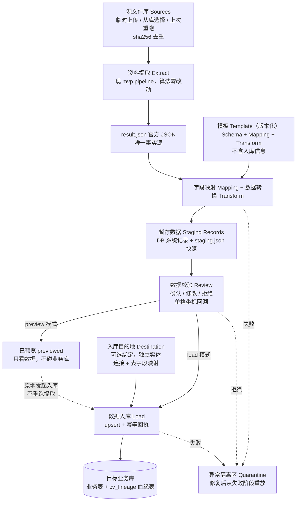
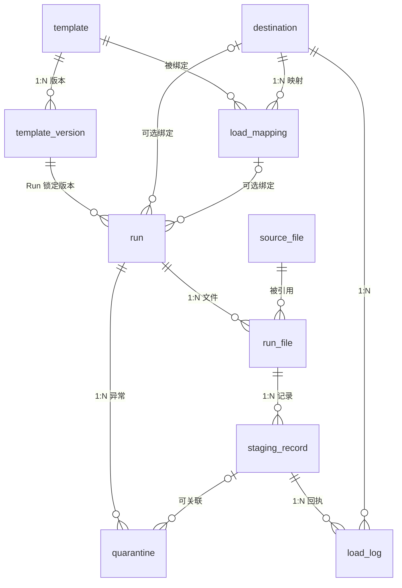
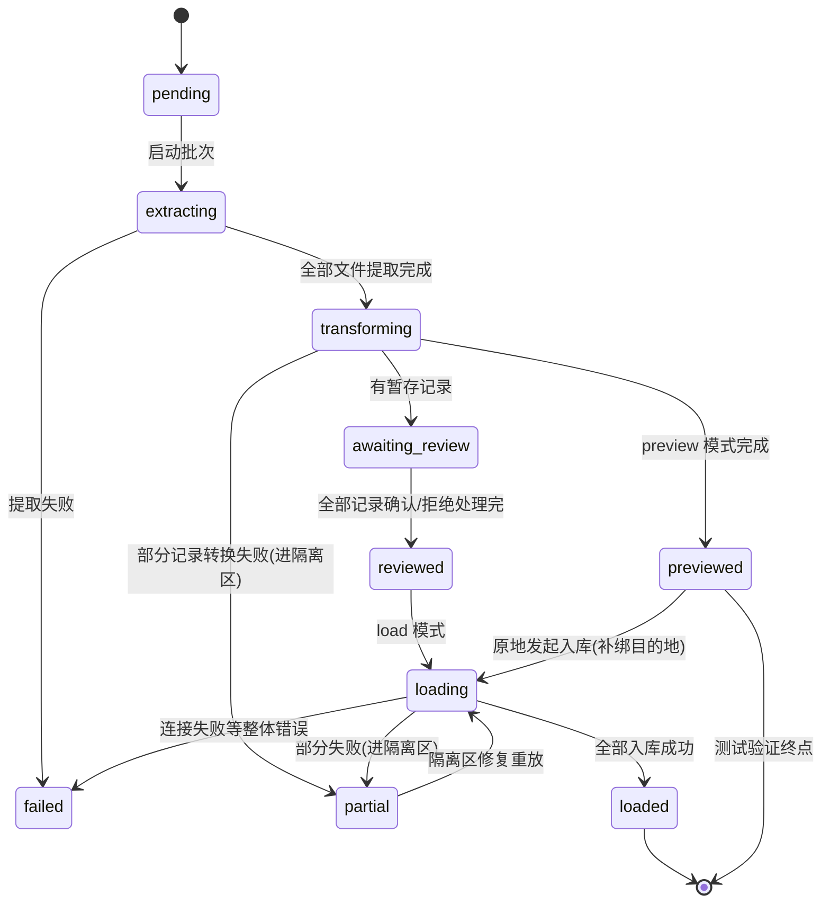
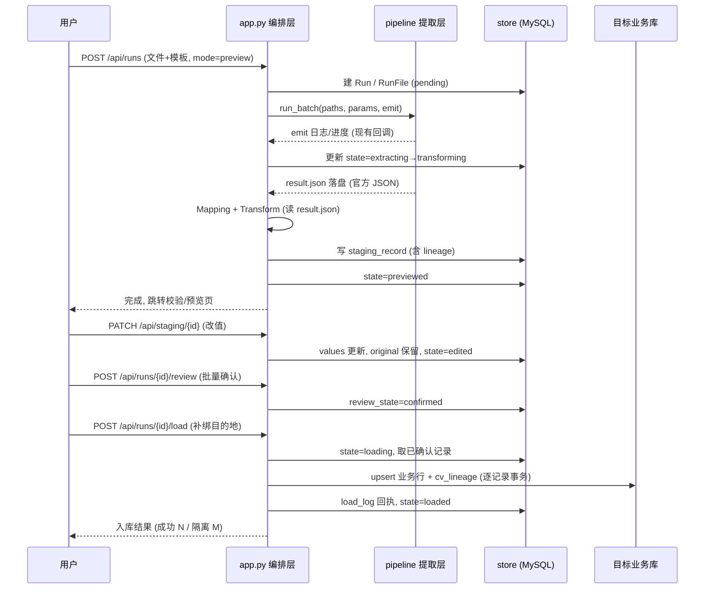
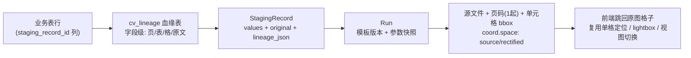
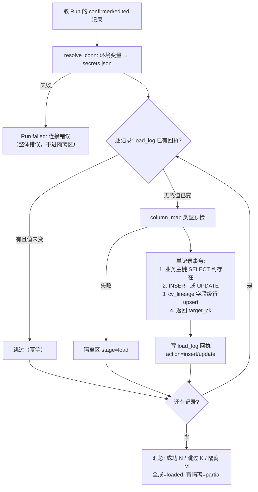
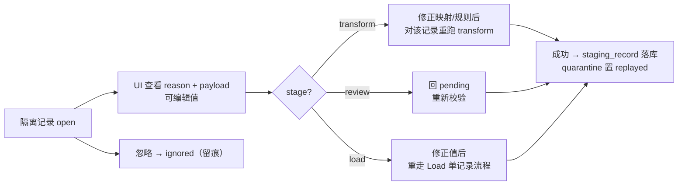

# 详细设计：文档 ETL 数据链路（Sources → Extract → Template → Staging → Review → Load）

> 状态：**详细设计稿（待批准，未动代码）**，2026-11-20。本文件是唯一设计源（取代同名早稿）。
> 范围：产品主干六步 + 人工校验 / 血缘追溯 / 异常隔离区；全链路模块设计、页面布局与交互、API 细则、分期验收。
> 选型：数据库 **MySQL**（平台状态库与目标业务库统一 MySQL、同实例分 schema；实现层驱动无关，已裁决）；
> 文件存储 **本地目录 + 相对路径**（DATA_ROOT 可整体迁移）。
> 实现方式（已讨论）：**在 mvp/ 上增量实现**，git 分支开发；提取算法层零改动，DB 只接编排层；旧功能降级隔离（§8）。
> 原则：模板与目的地解耦；Preview 一等公民；提取层「官方 JSON 为唯一事实源」不变。
> 配套图：`data-pipeline.drawio`（链路 + 对象关系，两页）；本文内嵌 mermaid 图。

---

## 1. 链路总览与命名

### 1.1 链路图



- **Preview 模式**：Run 算到 Staging 即停，页面直接看模板处理后的数据。测试默认路径：`选文件 → 选模板 → Preview`，三步闭环。
- **Load 模式**：校验确认后，同一份暂存数据直接入库，不重跑提取。
- Load 只放行「已确认 / 已修改」记录；失败 / 拒绝进隔离区，不丢弃、不阻塞整批。

### 1.2 命名总表（中英对照，取业内通用词）

| 概念 | 英文名 | 中文名 | 说明 |
|---|---|---|---|
| 源文件库 | Sources | 资料文件（页面名沿用） | 待提取文件统一管理，哈希去重 |
| 提取 | Extract | 资料提取 | 现 mvp 能力 |
| 模板 | Template | 模板 | 按文档类型复用，含版本 |
| 字段定义 | Schema | 字段定义 | 目标记录有哪些字段、什么类型 |
| 字段映射 | Mapping | 字段映射（原「数据收集」） | 从提取结果哪张表 / 哪个块 / 哪列取值 |
| 转换规则 | Transform | 数据转换 | 值级清洗：trim / 日期解析 / 金额转数值等 |
| 暂存数据 | Staging Records | 暂存数据 | Mapping + Transform 后的标准化中间记录 |
| 人工校验 | Review | 数据校验 | 对照原图核对 / 修改暂存数据 |
| 目的地 | Destination | 入库目的地 | 独立实体，可选；连接 + 入库映射 |
| 入库 | Load | 数据入库（执行动作） | 只入已校验数据 |
| 运行 | Run | 运行记录 | 一次流水线执行实例 |
| 血缘 | Lineage | 血缘追溯 | 库内记录 → 源文件页格坐标 |
| 隔离区 | Quarantine | 异常隔离区 | 失败 / 拒绝记录，可修复重放 |
| 预览 / 入库模式 | Preview / Load | 预览模式 / 入库模式 | Run 的两种模式 |

参照系：Kettle（任意步骤 Preview）、dbt（model 与 materialization 分离、`dbt show`）、
Rossum（Schema 与 Export Connector 分离）、Airbyte（Source / Destination 独立实体）、
Informatica（Mapping + Data Viewer）。

---

## 2. 对象模型

### 2.1 关系图



### 2.2 SourceFile 源文件

| 字段 | 类型 | 说明 |
|---|---|---|
| id | int PK | |
| name | str | 原始文件名（不改名） |
| sha256 | str UNIQUE | 内容哈希，**去重键**：重复上传复用已有记录 |
| kind | enum | pdf / image / text（沿用 config 扩展名分类） |
| size_bytes | int | |
| rel_path | str | 库内规范副本相对路径（§4.1） |
| tags / note | str | 标签、备注（可空） |
| created_at | datetime | UTC |

### 2.3 Template 模板 / TemplateVersion 模板版本

Template：`id, name UNIQUE（如「银行流水」）, description, current_version, created_at, updated_at`。

TemplateVersion（**修改模板 = 产生新版本，不改旧版**）：

| 字段 | 类型 | 说明 |
|---|---|---|
| id | int PK | |
| template_id | FK | |
| version | int | 从 1 递增，UNIQUE(template_id, version) |
| schema_json | JSON | `[{field, label, type: string/number/date/bool, required, note}]` |
| mapping_json | JSON | 每字段 → 来源选择器（语法见 §5.2）；**整体为空 = passthrough** |
| transform_json | JSON | 每字段 → 有序规则列表（op 表见 §5.3） |
| created_at | datetime | |

- 模板**不含任何入库信息**（解耦结论）。
- 每个 Run 锁定 template_version_id —— 血缘可复现的关键。
- 内置种子模板「原始透传」（三个 JSON 全空），P0 唯一模板。

### 2.4 Destination 入库目的地 / LoadMapping 入库映射

Destination：`id, name UNIQUE, db_type(mysql/postgresql/...), conn_ref, created_at`。
**conn_ref 是引用名，不是密码**：指向环境变量或本地 secrets 文件中的连接串（§4.6），DB 永不存明文凭据。

LoadMapping（模板 × 目的地 多对多绑定）：

| 字段 | 类型 | 说明 |
|---|---|---|
| id | int PK | |
| destination_id | FK | |
| template_id | FK | 绑定到模板（同名 schema 字段即可跨版本） |
| target_table | str | 目标业务表 |
| column_map_json | JSON | `[{field, column, col_type}]` |
| write_mode | enum | append / upsert（默认 upsert） |
| business_key_json | JSON | upsert 的业务主键字段列表 |
| UNIQUE | | (destination_id, template_id, target_table) |

一个连接配一次、N 个模板共用；换目标库不改模板。

### 2.5 Run 运行记录 / RunFile 运行文件

Run：

| 字段 | 类型 | 说明 |
|---|---|---|
| id | int PK | |
| batch_tag | str | 14 位批次戳，关联 input/output 目录（沿用现机制） |
| mode | enum | preview / load |
| template_version_id | FK | 锁定版本 |
| destination_id / load_mapping_id | FK 可空 | preview 模式为空 |
| params_json | JSON | 提取参数快照（沿用 params.describe()） |
| state | enum | §3 状态机 |
| error | str 可空 | 失败摘要 |
| created_at / updated_at | datetime | |

RunFile（一次 Run 可含多文件，逐文件状态）：
`id, run_id FK, source_file_id FK, state, output_rel_dir（output/<批次戳_名>/）, UNIQUE(run_id, source_file_id)`。

### 2.6 StagingRecord 暂存记录

| 字段 | 类型 | 说明 |
|---|---|---|
| id | int PK | |
| run_id / run_file_id | FK | |
| record_index | int | 表内行序，UNIQUE(run_file_id, record_index) |
| values_json | JSON | 当前值（已类型化；校验修改后更新这里） |
| original_json | JSON | 首次转换产出值，**修改不覆盖原值**，审计可查 |
| lineage_json | JSON | 每字段 → `{source_file_id, page(1起), table_index, cell_bbox, coord_space, raw_text, score}` |
| review_state | enum | pending / confirmed / edited / rejected |
| reviewed_at | datetime 可空 | |

- passthrough 下 values = 整行原样字符串（表头为键），lineage 仍逐格携带。
- 事实源划分见 §4.4：DB 是系统记录；`output/<批次>/staging.json` 是可再生导出快照。

### 2.7 Quarantine 异常隔离区

`id, run_id FK, staging_record_id FK 可空, stage(transform/review/load), reason, payload_json, state(open/replayed/ignored), created_at, resolved_at`。

### 2.8 LoadLog 入库回执

`id, run_id FK, staging_record_id FK, destination_id FK, target_table, target_pk, action(insert/update), loaded_at`，
UNIQUE(staging_record_id, destination_id, target_table)。幂等回执 + 业务行反查血缘入口。

---

## 3. Run 状态机与核心语义

### 3.1 状态机



- preview 模式：`transforming` 完成即 `previewed`；暂存数据可看、可校验（校验不依赖目的地）。
- `previewed / reviewed` 的 Run 可原地发起 Load（补绑 destination，mode 改 load），不重跑提取。
- 重提取 = 新 Run（新批次戳），旧暂存 / 旧血缘保留，产物不覆盖。

### 3.2 Preview → Review → Load 时序



### 3.3 语义约定

| 主题 | 约定 |
|---|---|
| 幂等 | 源文件按 sha256 去重；Load 默认 upsert（业务主键）；LoadLog 回执防重复入库 |
| 事实源 | 提取层 result.json 唯一事实源；暂存是它的投影 + 清洗，血缘随时回溯 |
| 校验边界 | Load 只放行 confirmed / edited；pending / rejected 不入业务库 |
| 错误策略 | 部分成功合法；失败进隔离区，Run 标 partial；从失败阶段重放 |
| 阶段解耦 | Mapping / Transform 只面对标准中间结构，不回头碰原始 JSON；规则可单测 |
| 模板版本 | Run 锁定版本；模板改版不影响历史 Run 可复现性 |

### 3.4 血缘追溯（Lineage）



- 本地侧：lineage_json 随暂存记录存；坐标体系沿用 `coord.space`、页码 1 起。
- 目标库侧：独立血缘表 `cv_lineage`，业务表只加一列 `staging_record_id`（列名可在 LoadMapping 配置）：

```sql
CREATE TABLE cv_lineage (
  id            BIGINT AUTO_INCREMENT PRIMARY KEY,
  target_table  VARCHAR(128) NOT NULL,
  record_pk     VARCHAR(255) NOT NULL,
  staging_record_id BIGINT NOT NULL,
  run_id        BIGINT NOT NULL,
  source_name   VARCHAR(255) NOT NULL,
  page          INT,
  table_index   INT,
  field         VARCHAR(128),
  cell_bbox     VARCHAR(128),               -- JSON [x0,y0,x1,y1]
  coord_space   VARCHAR(16),
  raw_text      TEXT,
  loaded_at     DATETIME NOT NULL DEFAULT CURRENT_TIMESTAMP,
  KEY idx_lineage_row (target_table, record_pk)
) ENGINE=InnoDB DEFAULT CHARSET=utf8mb4;
```

---

## 4. 存储设计

### 4.1 文件存储：DATA_ROOT + 相对路径

**保持本地目录，不引入对象存储。** 所有路径以 DATA_ROOT 为基准的**相对路径**存储与流转。

```
DATA_ROOT（默认 = mvp/ 根目录；环境变量 CV_MVP_DATA_ROOT 可覆盖）
├── sources/     # 新增：源文件库规范副本，<sha256前8位>_<原始文件名>
├── input/       # 现有：批次工作副本 <批次戳>_<名>，机制不变
├── output/      # 现有：批次产物（自包含）；新增 staging.json 导出快照
├── logs/        # 现有：运行日志
└── data/        # 新增：secrets.json（凭据引用文件；数据库在 MySQL 服务中，不在此目录）
```

规则：

1. **DB 与 JSON 中只存相对路径**，统一正斜杠（`sources/ab12cd34_103.pdf`、`output/<批次>/result.json`）。
2. `config.py` 新增 `DATA_ROOT` 与 `to_abs(rel)` / `to_rel(abs)`；全仓唯一换算点，别处禁止拼绝对路径。
3. 现有 `INPUT_DIR/OUTPUT_DIR/LOG_DIR` 改为 DATA_ROOT 派生；默认值不变 → **现有批次零迁移**。
4. sources/ 存规范副本（按哈希一份）；提取时仍复制到 input/<批次>（批次自包含不动）。
   职责分离：清理旧批次不影响源文件库。
5. URL 服务沿用现有挂载（/inputs、/output），路径换算对前端透明。

**服务器部署**：文件随 DATA_ROOT 整体拷到目标机（如 `/srv/cv-data`），设 `CV_MVP_DATA_ROOT=/srv/cv-data`，代码零改动；
数据库走 mysqldump 导出/导入（§4.2），两条线各自独立。

### 4.2 数据库选型：MySQL（平台 + 业务统一，已裁决）

**裁决（2026-11-20）**：工具确定会部署服务器，业务目标库本就是 MySQL —— 平台状态库直接用 MySQL，
与业务库**同实例、分 schema**（平台库 `cv_pipeline`，业务表在各自业务库），不混放。

选型理由（对比 SQLite）：

- 服务器部署是确定终态：网络访问 / 多连接并发 / 账号权限迟早要用，SQLite 的轻量优势只在纯本地阶段兑现；
- 一套 DDL 方言、一套迁移与备份体系（mysqldump），不用背 SQLite 可移植性约束，将来也没有平台库数据迁移；
- PyMySQL 为业务库反正要引入，「零依赖」优势不成立；
- 统一运维：平台库与业务库同实例分 schema，备份/监控/账号一套流程。

**代价（诚实标注）**：P0 起本地开发需一个跑着的 MySQL（8.x，utf8mb4），安装由用户自行执行（约定）；
MySQL 未起时按 §5.7 降级：提取照常跑，平台功能不可用。

**实现层数据库无关（裁决：随时可换驱动）**：

1. 所有 SQL 收敛在 `mvp/store/`（DAO）；store 与 loader **共用一个薄驱动接口**
   （连接 / 执行 / 查询 + 列类型映射 + DDL 差异），类比 JDBC 接口 + 厂商驱动；
2. 首个实现 **MySQL（PyMySQL，纯 Python，按依赖约定锁版本）**；
3. 业务 SQL 尽量标准（SELECT-then-write，不用方言 upsert）；方言差异（类型 / 分页 / DDL）沉在驱动层与迁移脚本；
4. 换 PostgreSQL 等 = 新增驱动实现 + 对应迁移脚本，业务代码零改动。

**连接与迁移**：

- 平台库连接走 conn_ref 引用制：`CV_PLATFORM_DB`（环境变量 → data/secrets.json），与业务库同一套（§4.6）；
- 迁移：编号脚本 `store/migrations/001_init.sql ...` + `schema_version` 表记录版本（无 Alembic 依赖）；
  首次调用自动建库并跑迁移；**库名跟随连接串**（默认 cv_pipeline；测试环境为 co_dev，见 data/secrets.json 的 CV_PLATFORM_DB）；
- 备份 / 部署：mysqldump 导出导入；文件随 DATA_ROOT、数据库随 dump，两条线独立。

### 4.3 表结构（MySQL DDL，001_init.sql，平台库 cv_pipeline）

MySQL 8.x / InnoDB / utf8mb4。JSON 列用原生 JSON 类型（默认值在应用层给，MySQL JSON 列不设字面量默认）；
时间 DATETIME（应用层统一 UTC 写入）。

```sql
-- 源文件库
CREATE TABLE source_file (
  id          BIGINT AUTO_INCREMENT PRIMARY KEY,
  name        VARCHAR(255) NOT NULL,
  sha256      CHAR(64)     NOT NULL,
  kind        VARCHAR(16)  NOT NULL,            -- pdf / image / text
  size_bytes  BIGINT       NOT NULL,
  rel_path    VARCHAR(512) NOT NULL,            -- 相对 DATA_ROOT
  tags        VARCHAR(512),
  note        TEXT,
  created_at  DATETIME NOT NULL DEFAULT CURRENT_TIMESTAMP,
  UNIQUE KEY uk_source_sha (sha256)
) ENGINE=InnoDB DEFAULT CHARSET=utf8mb4;

-- 模板（头）与模板版本（内容）
CREATE TABLE template (
  id              BIGINT AUTO_INCREMENT PRIMARY KEY,
  name            VARCHAR(128) NOT NULL,
  description     VARCHAR(512),
  current_version INT NOT NULL DEFAULT 1,
  created_at      DATETIME NOT NULL DEFAULT CURRENT_TIMESTAMP,
  updated_at      DATETIME NOT NULL DEFAULT CURRENT_TIMESTAMP ON UPDATE CURRENT_TIMESTAMP,
  UNIQUE KEY uk_template_name (name)
) ENGINE=InnoDB DEFAULT CHARSET=utf8mb4;

CREATE TABLE template_version (
  id             BIGINT AUTO_INCREMENT PRIMARY KEY,
  template_id    BIGINT NOT NULL,
  version        INT NOT NULL,
  schema_json    JSON,                          -- [{field,label,type,required,note}]
  mapping_json   JSON,                          -- 选择器，见 §5.2；空 = passthrough
  transform_json JSON,                          -- 规则链，见 §5.3
  created_at     DATETIME NOT NULL DEFAULT CURRENT_TIMESTAMP,
  UNIQUE KEY uk_tpl_ver (template_id, version),
  CONSTRAINT fk_tv_template FOREIGN KEY (template_id) REFERENCES template(id)
) ENGINE=InnoDB DEFAULT CHARSET=utf8mb4;

-- 入库目的地与映射（凭据只存引用名）
CREATE TABLE destination (
  id         BIGINT AUTO_INCREMENT PRIMARY KEY,
  name       VARCHAR(128) NOT NULL,
  db_type    VARCHAR(32)  NOT NULL,             -- mysql / postgresql / ...
  conn_ref   VARCHAR(128) NOT NULL,             -- 环境变量名或 secrets 文件键
  created_at DATETIME NOT NULL DEFAULT CURRENT_TIMESTAMP,
  UNIQUE KEY uk_dest_name (name)
) ENGINE=InnoDB DEFAULT CHARSET=utf8mb4;

CREATE TABLE load_mapping (
  id                BIGINT AUTO_INCREMENT PRIMARY KEY,
  destination_id    BIGINT NOT NULL,
  template_id       BIGINT NOT NULL,
  target_table      VARCHAR(128) NOT NULL,
  column_map_json   JSON NOT NULL,              -- [{field, column, col_type}]
  write_mode        VARCHAR(16) NOT NULL DEFAULT 'upsert',
  business_key_json JSON,
  UNIQUE KEY uk_dest_tpl_table (destination_id, template_id, target_table),
  CONSTRAINT fk_lm_dest FOREIGN KEY (destination_id) REFERENCES destination(id),
  CONSTRAINT fk_lm_tpl  FOREIGN KEY (template_id) REFERENCES template(id)
) ENGINE=InnoDB DEFAULT CHARSET=utf8mb4;

-- 运行与逐文件状态
CREATE TABLE run (
  id                  BIGINT AUTO_INCREMENT PRIMARY KEY,
  batch_tag           VARCHAR(32) NOT NULL,
  mode                VARCHAR(16) NOT NULL,     -- preview / load
  template_version_id BIGINT NOT NULL,
  destination_id      BIGINT,
  load_mapping_id     BIGINT,
  params_json         JSON,
  state               VARCHAR(24) NOT NULL DEFAULT 'pending',
  error               TEXT,
  created_at          DATETIME NOT NULL DEFAULT CURRENT_TIMESTAMP,
  updated_at          DATETIME NOT NULL DEFAULT CURRENT_TIMESTAMP ON UPDATE CURRENT_TIMESTAMP,
  KEY idx_run_state (state),
  CONSTRAINT fk_run_tv   FOREIGN KEY (template_version_id) REFERENCES template_version(id),
  CONSTRAINT fk_run_dest FOREIGN KEY (destination_id) REFERENCES destination(id),
  CONSTRAINT fk_run_lm   FOREIGN KEY (load_mapping_id) REFERENCES load_mapping(id)
) ENGINE=InnoDB DEFAULT CHARSET=utf8mb4;

CREATE TABLE run_file (
  id             BIGINT AUTO_INCREMENT PRIMARY KEY,
  run_id         BIGINT NOT NULL,
  source_file_id BIGINT NOT NULL,
  state          VARCHAR(24) NOT NULL DEFAULT 'pending',
  output_rel_dir VARCHAR(512) NOT NULL,
  UNIQUE KEY uk_run_file (run_id, source_file_id),
  CONSTRAINT fk_rf_run  FOREIGN KEY (run_id) REFERENCES run(id),
  CONSTRAINT fk_rf_file FOREIGN KEY (source_file_id) REFERENCES source_file(id)
) ENGINE=InnoDB DEFAULT CHARSET=utf8mb4;

-- 暂存记录（含血缘与校验状态）
CREATE TABLE staging_record (
  id            BIGINT AUTO_INCREMENT PRIMARY KEY,
  run_id        BIGINT NOT NULL,
  run_file_id   BIGINT NOT NULL,
  record_index  INT NOT NULL,
  values_json   JSON NOT NULL,
  original_json JSON NOT NULL,
  lineage_json  JSON,
  review_state  VARCHAR(16) NOT NULL DEFAULT 'pending',
  reviewed_at   DATETIME,
  UNIQUE KEY uk_staging_idx (run_file_id, record_index),
  KEY idx_staging_run (run_id, review_state),
  CONSTRAINT fk_stg_run  FOREIGN KEY (run_id) REFERENCES run(id),
  CONSTRAINT fk_stg_rf   FOREIGN KEY (run_file_id) REFERENCES run_file(id)
) ENGINE=InnoDB DEFAULT CHARSET=utf8mb4;

-- 异常隔离区
CREATE TABLE quarantine (
  id                BIGINT AUTO_INCREMENT PRIMARY KEY,
  run_id            BIGINT NOT NULL,
  staging_record_id BIGINT,
  stage             VARCHAR(16) NOT NULL,       -- transform / review / load
  reason            TEXT NOT NULL,
  payload_json      JSON NOT NULL,
  state             VARCHAR(16) NOT NULL DEFAULT 'open',
  created_at        DATETIME NOT NULL DEFAULT CURRENT_TIMESTAMP,
  resolved_at       DATETIME,
  KEY idx_q_run (run_id, state),
  CONSTRAINT fk_q_run FOREIGN KEY (run_id) REFERENCES run(id),
  CONSTRAINT fk_q_stg FOREIGN KEY (staging_record_id) REFERENCES staging_record(id)
) ENGINE=InnoDB DEFAULT CHARSET=utf8mb4;

-- 入库回执（幂等）
CREATE TABLE load_log (
  id                BIGINT AUTO_INCREMENT PRIMARY KEY,
  run_id            BIGINT NOT NULL,
  staging_record_id BIGINT NOT NULL,
  destination_id    BIGINT NOT NULL,
  target_table      VARCHAR(128) NOT NULL,
  target_pk         VARCHAR(255) NOT NULL,
  action            VARCHAR(16) NOT NULL,       -- insert / update
  loaded_at         DATETIME NOT NULL DEFAULT CURRENT_TIMESTAMP,
  UNIQUE KEY uk_load_receipt (staging_record_id, destination_id, target_table),
  CONSTRAINT fk_ll_run  FOREIGN KEY (run_id) REFERENCES run(id),
  CONSTRAINT fk_ll_stg  FOREIGN KEY (staging_record_id) REFERENCES staging_record(id),
  CONSTRAINT fk_ll_dest FOREIGN KEY (destination_id) REFERENCES destination(id)
) ENGINE=InnoDB DEFAULT CHARSET=utf8mb4;

-- 迁移版本记录
CREATE TABLE schema_version (
  version    INT PRIMARY KEY,
  applied_at DATETIME NOT NULL DEFAULT CURRENT_TIMESTAMP
) ENGINE=InnoDB DEFAULT CHARSET=utf8mb4;
```

种子数据：内置模板「原始透传」（template + template_version v1，三个 JSON 全空）。

### 4.4 文件与 DB 的事实源划分

| 数据 | 事实源 | 派生 / 快照 |
|---|---|---|
| 提取结果 | `output/<批次>/result.json`（官方 JSON，不变） | 报告 HTML、boxes.png 等 |
| 暂存数据 + 校验状态 | **DB staging_record** | `output/<批次>/staging.json` 导出快照（可再生，保批次自包含） |
| 源文件内容 | `sources/` 规范副本（不可变） | input/<批次> 工作副本 |
| 模板 / 目的地 / Run | DB | 无 |

与「官方 JSON 为源 + 薄投影」同一哲学：文件产物自包含可离线核对，DB 承担运营状态；快照永远可从 DB 再生，不双写竞争。

### 4.5 数据访问层 `mvp/store/`（新增模块）

```
mvp/store/
├── __init__.py
├── db.py          # 驱动接口 + PyMySQL 实现、连接解析（conn_ref）、迁移执行（schema_version 表）
├── migrations/001_init.sql
└── repo.py        # 每实体一组 DAO 函数
```

- 包相对导入（`from .. import config`），零 IDE 配置；懒加载：首次调用才建连接 / 跑迁移，不拖累 `import app` 0.5s。
- 业务层只调 repo，不出现 SQL 字符串。repo API 草案：

| 组 | 函数 |
|---|---|
| source | `register(name, bytes) -> (rec, dedup:bool)` / `list(q, tag)` / `get(id)` / `delete(id)`（被引用时拒绝） |
| template | `create(name, desc)` / `save_version(tid, schema, mapping, transform) -> ver` / `list()` / `get_version(vid)` |
| destination | `create / update / list / delete`（被引用时拒绝）/ `resolve_conn(id) -> 连接串`（§4.6） |
| mapping | `upsert(dest_id, tid, table, column_map, mode, keys)` / `list_by_dest` |
| run | `create(...) -> run` / `set_state(id, state, error=None)` / `get(id)` / `list(filters)` / `add_file / set_file_state` |
| staging | `bulk_insert(run_file_id, records)` / `list(run_id, state?)` / `patch(id, values)` / `set_review(ids, state)` / `export_snapshot(run_id)` |
| quarantine | `add(...)` / `list(run_id?, state?)` / `resolve(id, state)` |
| loadlog | `get(record_id, dest_id, table)` / `put(...)` |

### 4.6 凭据管理（轻量、可部署）

- `destination.conn_ref` 只存引用名，如 `CV_DEST_BANK_DB`；**平台库同机制**：`CV_PLATFORM_DB`（store/db.py 解析）。
- 解析顺序：环境变量 → `DATA_ROOT/data/secrets.json`（.gitignore 排除）。
- 单机阶段明文存本地文件（**已裁决：暂不加密**）；加密存储 / 注入式凭据将来再议。
  （cryptography 已因 MySQL 8 认证需要列入 requirements，与凭据加密无关。）

---

## 5. 模块详细设计

### 5.1 新增模块总览

```
mvp/
├── store/            # §4.5 数据访问层
├── collect.py        # Mapping 引擎：result.json → 原始记录集（§5.2）
├── transform.py      # Transform 引擎：规则链 + 类型化（§5.3）
├── loader.py         # Load 执行器：upsert + cv_lineage + 回执（§5.5）
└── extract_report/assets/    # 新页面静态资源（沿用独立 css/js/html 结构）
```

app.py 只增路由与编排胶水；pipeline/、现有 report 生成逻辑零改动。

### 5.2 Mapping 引擎（collect.py）

**输入**：result.json（官方 JSON 投影出的 structured_tables / layout）+ mapping_json。
**输出**：原始记录集 `[{values: {字段: 字符串原文}, lineage: {字段: 坐标引用}}]`。

选择器语法（mapping_json 每字段一条）：

```json
{
  "field": "交易金额",
  "table": {"index": 0},
  "column": {"name": "金额"}
}
```

| 选择器 | 取值 | 语义 |
|---|---|---|
| table | `{"index": n}` 或 `{"header_contains": "文本"}` | 第 n 张表（0 起）；或表头含指定文本的第一张表 |
| column | `{"name": "列名"}` 或 `{"index": n}` | 按表头名精确匹配（trim 后）；或列序号 |
| block（P3 预留） | `{"role": "title/figure/..."}` | 版面块取值，P1/P2 不做 |

规则：

- **一行 = 一条记录**；记录数 = 主表数据行数（表头行不算，沿用 structure.py 切分结果）。
- 多字段可来自不同表（按 table 选择器各自定位），行数不齐时缺值填空串并记 warning。
- 选择器落空（表不存在 / 列名不匹配）→ 该字段全列空 + Run 级 warning，**不静默**；全部落空 → 该文件进隔离区（stage=transform）。
- **passthrough**（mapping 为空）：每张表每行 → 一条记录，键 = 表头原文（空表头列用 `col_<n>`），lineage 逐格携带。
- 跨页拼接表沿用现有 row_pages / 每格 {page, space}，血缘页码天然正确。
- 纯函数：`collect(result: dict, mapping: dict) -> (records, warnings)`，不碰 DB / 文件，可单测。

### 5.3 Transform 引擎（transform.py）

**输入**：原始记录集 + schema_json + transform_json。**输出**：类型化暂存记录 + 失败清单。

规则 op 表（P1 首批，按列表顺序执行）：

| op | args | 语义 | 失败行为 |
|---|---|---|---|
| trim | 无 | 去首尾空白（含全角空格） | 不失败 |
| regex_replace | pattern, repl | 正则替换 | 不匹配 = 原样通过 |
| date_parse | format（如 `%Y%m%d`）, out（默认 `%Y-%m-%d`） | 解析 → 标准化日期串 | 隔离区 |
| amount | thousands=true | `1,234.56` → 1234.56；去货币符号 | 隔离区 |
| enum_map | map, default | 值映射（如 借/贷 → D/C） | 无 default 且未命中 → 隔离区 |
| cast | type | 按 schema.type 强转 | 隔离区 |

规则：

- 每条规则链末尾**隐式 cast** 到 schema.type（string/number/date/bool）；date 存 ISO 串，number 存数值。
- 空值：required 字段 → 隔离区；非 required → null 通过。
- 失败记录：原样 payload + reason（哪条 op、什么输入）进隔离区，**其余记录继续**。
- 纯函数：`transform(records, schema, rules) -> (typed, failures)`，可单测。
- 规则扩充（P3）：split / concat / lookup 等按需加 op，不动引擎骨架。

### 5.4 Review 服务（app.py 路由 + store.staging）

- `PATCH /api/staging/{id}`：只收 values 差量；按 schema.type 校验（失败 422 + 字段级错误）；
  更新 values_json，original_json 不动；review_state 置 edited（已 confirmed 的改值也回落 edited）。
- `POST /api/runs/{id}/review`：批量确认，只作用于 pending/edited；rejected 单独调用并写隔离区（stage=review）。
- 全部记录处理完（confirmed/edited/rejected）→ Run 置 reviewed（load 模式）或保持 previewed（preview 模式）。
- 修改审计：original vs values 差异在 UI 可见（§6.5），DB 不另设审计表（轻量；多用户时再加 reviewed_by）。

### 5.5 Load 执行器（loader.py）



- **可移植 upsert**：SELECT-then-INSERT/UPDATE + 事务，不用方言（ON CONFLICT / ON DUPLICATE KEY），
  换库零改动；性能足够（万级记录）。
- **数据库无关的驱动接缝（已裁决）**：loader 与 store **共用**薄驱动接口（连接 / 执行 / 查询 + 列类型映射 + 建表 DDL 差异），
  类比 JDBC 接口 + 厂商驱动。**首个实现 MySQL（PyMySQL，纯 Python，按依赖约定锁版本）**；
  接 PostgreSQL 等 = 新增一个驱动实现文件，loader / store 业务逻辑零改动。
- **事务粒度 = 单记录**：部分成功语义天然成立；cv_lineage 与业务行同事务，血缘不脱节。
- 业务表 `staging_record_id` 列：Load 前检查列存在，不存在则 `ALTER TABLE ADD COLUMN`（一次性、幂等）。
- cv_lineage 表不存在则按 §3.4 DDL 自动建（目标库侧唯一 DDL 动作）。
- 凭据不落日志；连接错误信息脱敏（只留 host/库名）。

### 5.6 隔离区与重放



- 重放只针对单记录，从失败阶段开始，不重跑提取。
- transform 类重放若因模板规则错误：提示「改模板会产生新版本，本 Run 锁定旧版」——
  单记录修值重放即可；规则级修复走「新模板版本 + 新 Run」，不就地改历史 Run 的规则（可复现性）。

### 5.7 状态聚合与降级隔离

- Run 状态由 RunFile 聚合：全部文件到终态才推进 Run；任一失败且有成功 → partial。
  emit 回调（app.py 现有包装）逐条映射 stage → run_file.state，单调不回退（沿用进度条机制）。
- **降级隔离**：upload/rerun 中「登记 source_file / 建 Run」包独立 try/except ——
  DB 故障只记 warning，提取照常跑（旧功能不被新依赖拖死）；新路由失败只影响新功能。
- store 懒加载：首次调用才建连接跑迁移；`import app` 不碰 DB。

---

## 6. 页面布局与交互设计

### 6.0 全局约定（沿用现有 UI 规范）

- **单行色带页头** + 同级短名 tab 导航：`提取 | 资料 | 模板 | 校验 | 目的地 | 运行`。
  默认落地 = 提取页（现上传页增强）。批次报告仍是独立产物页（output/index.html），从运行页跳入。
- 缩略图**内嵌文件名行**（40×40），不做独立缩略图网格；图片点击 lightbox 全屏（滚轮缩放/拖拽/1:1/适应窗口）。
- 叠加框默认隐藏，hover 显示、点击钉住；悬浮控件不占布局、不压图宽。
- 信息去重：同一状态只在一处呈现；能用一行提示的不做弹窗。
- 新页面静态资源放 extract_report/assets（独立 css/js/html），纯前端改动刷新即生效。

### 6.1 资料提取 Extract（现上传页增强，不重做）

```text
┌────────────────────────────────────────────────────────────┐
│ 色带页头: 资料提取          模式: (●) 预览  ( ) 入库        │
├────────────────────────────────────────────────────────────┤
│ [上传区: 拖拽 / 点击选择]        [从资料库选择 ▸]           │
│ 文件列表:                                                   │
│   [缩略图] 103_real_xxx.pdf   1.2MB  ✓已在库(复用)          │
│   [缩略图] scan_01.png        800KB  新登记                 │
│ [上次文件面板（现有）: 用这些文件重新提取]                  │
├────────────────────────────────────────────────────────────┤
│ 模板: [原始透传 v1 ▾]  去配置▸                              │
│ 目的地: [—— 仅入库模式显示 —— ▾]  映射: [自动匹配/手选 ▾]   │
│ [参数面板（现有，折叠）]                                    │
│ [ 开始提取 ]                                                │
│ 进度条 + 日志（现有）                                       │
│ 完成提示: [查看暂存数据 ▸]（预览）/ [查看运行 ▸]（入库）    │
└────────────────────────────────────────────────────────────┘
```

交互：

1. **模式切换**：预览 = 默认；切「入库」才显示目的地行（不显示禁用控件，去重）。
   入库模式未选目的地 → 开始按钮禁用 + 一行原因提示。
2. **临时上传**：选文件即预览（现有）；后台自动登记 source_file，sha256 命中 → 行内提示「已在库，复用记录」，不重复存副本。
3. **从资料库选择**：右侧抽屉复用资料页列表组件（搜索/标签过滤），多选确认后加入文件列表，行标「来自库」。
4. **模板下拉**：显示 `名称 v版本`；默认「原始透传」；「去配置」跳模板页并带上当前上下文。
5. **参数面板**：现有 9 项不动；参数随 Run 存快照。
6. **完成后**：预览模式 → 主按钮「查看暂存数据」跳校验页（该 Run）；入库模式 → 跳运行详情。
7. 边界：文件类型不支持 / 超大小 → 现有校验提示不变；提取失败 → 日志 + 运行页失败态，不影响其它文件。

### 6.2 资料文件 Sources

```text
┌────────────────────────────────────────────────────────────┐
│ 色带页头: 资料文件   [搜索____] [标签 ▾] [类型 ▾] [上传]    │
├────────────────────────────────────────────────────────────┤
│ [缩略图] 文件名        类型  大小   标签    上传时间  操作  │
│ [缩略图] 103_real_…pdf  PDF  1.2MB  银行    11-16   提取 ⋯ │
│ [缩略图] scan_01.png    图片  800KB  扫描    11-17   提取 ⋯ │
│ …                                        [分页 20/页]      │
└────────────────────────────────────────────────────────────┘
```

交互：

1. 列表默认上传时间倒序；搜索按文件名；标签/类型过滤可叠加。
2. 行内缩略图：图片点击 lightbox；PDF/文本角标点击新窗口预览（现有约定）。
3. **上传 = 登记**：哈希命中 → 一行提示「文件已存在」+ 高亮定位已有行，不产生新记录。
4. 操作列：`提取`（跳提取页并预选该文件）/ `预览` / `编辑标签备注` / `删除`。
5. **删除保护**：被任何 Run 引用 → 禁止删除，提示「被 N 个运行引用（血缘完整性）」；未引用 → 二次确认后删记录 + sources/ 副本，批次产物不动。
6. 空态：一行引导「上传第一个文件，或去提取页临时上传」。

### 6.3 模板管理 Templates

```text
┌────────────────────────────────────────────────────────────┐
│ 色带页头: 模板   [新建模板]                                 │
├──────────────┬─────────────────────────────────────────────┤
│ 模板列表      │ 基本信息: 名称[____] 描述[____]             │
│ ▸ 原始透传 v1 │ ── 字段定义 Schema ──────────────────────   │
│ ▸ 银行流水 v3 │  字段名   标签    类型▾   必填☐  [＋行]     │
│              │  amount  交易金额 number  ☑                 │
│              │ ── 字段映射 Mapping ─────────────────────   │
│              │  amount ← 表[0▾] 列[金额▾]  [从样例拾取 ▸]  │
│              │ ── 转换规则 Transform ───────────────────   │
│              │  amount: [trim]→[amount]→[cast:number]      │
│              │          [＋规则] [↑][↓] 删除               │
│              │ 版本历史: v3(当前) v2 v1 [查看旧版]          │
│              │ [ 保存（生成 v4） ]                         │
└──────────────┴─────────────────────────────────────────────┘
```

交互：

1. **三段编辑器**对应 Schema / Mapping / Transform；任一段为空有明确语义提示
   （全空 = 透传模式提示条「整表原样输出，无需配置」）。
2. **从样例拾取（核心可用性设计）**：点按钮 → 选一个近期提取批次（result.json）→
   弹窗渲染其表格（复用报告表格组件，含表头/数据行）→ **点击某列表头** →
   自动生成选择器 `{table:{index}, column:{name}}` 回填当前字段。不手写 JSON。
3. 规则编辑：op 下拉 + args 表单（日期格式串、正则、映射表）；有序列表用 ↑↓ 调序；
   末尾隐式 cast 以灰字展示（不可删，来自 schema.type）。
4. **保存 = 新版本**：按钮文案明示「保存（生成 vN+1）」；旧版只读可查；
   历史 Run 锁定旧版不受影响（保存时一行提示）。
5. 级联清理：删 Schema 字段 → 其 mapping/transform 条目同步删，保存前一行确认。
6. 新建模板默认复制「原始透传」骨架；名称重复 → 行内报错。
7. 边界：passthrough 模板不可删（系统种子）；被 Run 锁定的版本不可删（只能新增版本）。

### 6.4 数据校验 Review（核心新页面）

```text
┌────────────────────────────────────────────────────────────┐
│ 色带页头: 校验  [运行 ▾] [文件 ▾]  进度 12/25  [批量确认]   │
├──────────────────────────┬─────────────────────────────────┤
│ 源图区（复用 imgwrap）    │ 记录导航: [◀] 第 12 条 [▶]      │
│  视图: (原图)(矫正图)     │ 状态列表: ●●●○○…（色点=状态）   │
│  1:1 叠加, 框默认隐藏     │ ─────────────────────────────── │
│  hover 显示 / 点击钉住    │ 字段     值(可编辑)  原值  状态 │
│  [lightbox 全屏]         │ 交易日期 [2022-12-09]  …    ✓  │
│                          │ 交易金额 [1234.56 ]  1,234.56 ✎ │
│  ← 点字段行: 高亮对应格   │ 摘要     [货款      ]  …    ✓  │
│  → 点图中格: 高亮字段行   │ [确认] [拒绝]  修改自动暂存     │
├──────────────────────────┴─────────────────────────────────┤
│ 底栏: 待校验 13 · 已确认 10 · 已修改 2 · 隔离 0 [查看隔离区] │
│ （previewed Run 额外显示: [发起入库 ▸]）                    │
└────────────────────────────────────────────────────────────┘
```

交互：

1. **双向联动（核心，复用现成单格定位）**：
   - 点右侧字段行 → 左图该格加 `.hv` 高亮；跨页自动切页、`ensureView()` 切宿主视图（原图/矫正图按 coord.space）；
   - 点左图单元格 → 右侧对应字段行高亮滚动到位（lineage_json 反向索引 bbox → 字段）；
   - 叠加框默认隐藏、hover 显示、点击钉住（现有约定不变）。
2. **编辑**：值列内联输入；按 schema.type 即时校验（number/date），非法红框 + 一行原因；
   修改过的字段显示原值列（original vs values 差异可见）；离焦自动 PATCH 暂存（防丢），确认时再落 review_state。
3. **确认 / 拒绝**：单条操作；拒绝 → 隔离区（stage=review）+ 记录导航色点变红；
   **批量确认**只作用 pending/edited，弹一行确认「将确认 N 条未复核记录？」。
4. 记录导航：◀▶ 切换 + 状态色点列表直跳；键盘 ←/→ 切换（P3 可选增强）。
5. 多文件 Run：文件短名 tab 切换；跨页表沿用现有切页滚动同步防抖。
6. **preview 与 load 同一页面**：previewed Run 校验完后底栏出现「发起入库」→ 弹目的地/映射选择 → 转 load。
7. 只读保护：loaded Run 的记录只读（改值需走隔离区重放或新 Run），防库内库外不一致。
8. 空态：无待校验记录 → 一行「全部处理完」+ 下一步按钮（发起入库 / 返回运行）。

### 6.5 入库目的地 Destinations

```text
┌────────────────────────────────────────────────────────────┐
│ 色带页头: 目的地   [新建连接]                               │
├──────────────┬─────────────────────────────────────────────┤
│ 连接列表      │ 连接: 名称[____] 类型[MySQL ▾]              │
│ ▸ 银行库      │       conn_ref [CV_DEST_BANK_DB]            │
│   (MySQL)    │       [测试连接]  ✓ 连通（只回 host/库名）   │
│              │ ── 入库映射（本连接） ─────────────────────  │
│              │  模板[银行流水▾] → 目标表[bank_txn____]      │
│              │  字段      列名        列类型▾               │
│              │  amount   amount      DECIMAL               │
│              │  txn_date txn_date    DATE                  │
│              │  写入: (●) upsert ( ) append                │
│              │  业务主键: [txn_date ☑][amount ☐]…          │
│              │  [＋映射] [保存]                            │
└──────────────┴─────────────────────────────────────────────┘
```

交互：

1. **测试连接**：resolve conn_ref → 试连 → 一行结果（成功回 host/库名；失败回脱敏原因）；凭据永不回显、不落日志。
2. 映射编辑：选模板后字段列表自动来自其**当前版本 schema**；列名默认同名预填，可改；
   列类型下拉按 db_type 给常用集；upsert 时业务主键必选（≥1 字段），否则保存禁用 + 提示。
3. 「从库读取列」（P3 增强）：拉目标表实际列辅助映射；P2 手填。
4. 删除保护：被 Run / load_log 引用 → 禁删；映射被引用同理。
5. 一个连接多映射并列展示；同 (模板, 目标表) 重复 → 行内报错（UNIQUE 约束前置提示）。

### 6.6 运行记录 Runs

```text
┌────────────────────────────────────────────────────────────┐
│ 色带页头: 运行   [状态 ▾] [模式 ▾] [搜索批次/文件名]        │
├────────────────────────────────────────────────────────────┤
│ 批次戳        文件 模板@版本    模式  状态     时间   操作  │
│ 20261120…    2    银行流水@v3  预览  ●已预览  14:02  详情  │
│ 20261120…    1    原始透传@v1  入库  ●部分失败 13:40  详情  │
├────────────────────────────────────────────────────────────┤
│ 详情抽屉（点行展开）:                                       │
│  状态时间线: pending→extracting→…→previewed                 │
│  逐文件: 103.pdf ✓ [报告▸] [JSON▸] [staging▸] [日志▾]      │
│          scan.png ✗ 原因…                                   │
│  [查看暂存/校验 ▸]  [发起入库 ▸]（previewed/reviewed）      │
│  隔离区: 2 条 [查看/重放 ▸]                                 │
└────────────────────────────────────────────────────────────┘
```

交互：

1. 状态徽标色：运行中蓝 / 待校验·已预览黄 / 已入库绿 / 部分失败橙 / 失败红。
2. 运行中 Run 轮询复用现有 /api/status 机制（进度条 + 日志面板组件原样搬用）。
3. 产物链接全部走现有挂载路径；日志下载沿用 /api/logs。
4. **发起入库**：previewed/reviewed 且未绑目的地 → 弹目的地/映射选择（复用校验页同一组件）→ 转 load。
5. 隔离区子面板：reason + payload 查看、值编辑、重放 / 忽略（§5.6 流程）。
6. 重跑入口：详情内「用相同文件+模板重跑」→ 带参跳提取页（新 Run，旧产物不动）。

---

## 7. API 细则（关键端点）

沿用现 FastAPI 风格；上传沿用 base64 JSON（不需 python-multipart）。

```
GET  /api/sources?q=&tag=&kind=&page=      → {items:[{id,name,kind,size,tags,created_at,thumb_url}], total}
POST /api/sources {name, data_b64}         → {id, dedup:bool}          # 哈希命中回已有 id
DELETE /api/sources/{id}                   → 204 | 409 {reason:"被 N 个运行引用"}

GET  /api/templates                        → [{id,name,current_version,description}]
POST /api/templates {name, description}    → {id}
POST /api/templates/{id}/versions {schema, mapping, transform} → {version_id, version}
GET  /api/template-versions/{id}           → {schema, mapping, transform, version}

GET  /api/runs?state=&mode=&q=             → [{id,batch_tag,mode,state,template,files_n,created_at}]
POST /api/runs {source_file_ids:[…], template_version_id, mode,
                destination_id?, load_mapping_id?, params:{…}} → {run_id, batch_tag}
GET  /api/runs/{id}                        → {state, progress, files:[{name,state,output_rel_dir,links}], error}
POST /api/runs/{id}/load {destination_id, load_mapping_id} → {state:"loading"}
POST /api/runs/{id}/rerun                  → {run_id}                  # 同文件+模板+参数, 新批次

GET  /api/runs/{id}/staging?review_state=  → [{id,record_index,values,original,lineage,review_state}]
PATCH /api/staging/{id} {values:{…}}       → {ok} | 422 {field_errors}
POST /api/runs/{id}/review {record_ids, action:"confirm"|"reject"} → {updated_n}

GET  /api/destinations                     → [{id,name,db_type,conn_ref,mappings:[…]}]
POST /api/destinations {name,db_type,conn_ref} → {id}
POST /api/destinations/{id}/test           → {ok, detail:"host/db（脱敏）"}
POST /api/destinations/{id}/mappings {template_id,target_table,column_map,write_mode,business_key} → {id}

GET  /api/quarantine?run_id=&state=        → [{id,stage,reason,payload,state}]
POST /api/quarantine/{id}/replay {values?} → {ok, new_state}
POST /api/quarantine/{id}/ignore           → {ok}
```

---

## 8. 与现有 mvp 的映射与风险隔离

**分层边界**：DB 只接编排层（app.py + store/）。`run_batch` 本就在 app.py，pipeline 只认注入的
`emit` 回调与文件产物（11-17 解耦约定），不 import store、不写 DB ——「提取零改动」指 pipeline/
算法模块，app.py 编排层需改（登记源文件、建 Run、emit 回调里更新状态、新路由）。

| 模块 | 改动 | 对旧功能风险 |
|---|---|---|
| pipeline/ 提取算法 | 零改动 | 无 |
| extract_report/ 报告生成 | 零改动（assets 只增文件） | 无 |
| config.py | DATA_ROOT 派生 + to_abs/to_rel + 平台库 conn_ref 常量，默认路径不变 | 低（check_env + 实测验证） |
| app.py | 旧路由加登记（try/except 降级）+ 新路由 | 唯一实质风险面，两道保险见下 |
| 前端 | 新 tab / 新页面，旧页面不碰 | 低 |
| store/、sources/、collect/transform/loader | 纯新增 | 无 |

两道保险：

1. **降级隔离**：登记 / 建 Run 失败只记 warning，提取照常跑；新路由失败只影响新功能。
2. **懒加载**：store 首次调用才建连接跑迁移，`import app` 不碰 DB，0.5s 启动指标不变。

开发与回退：git 分支（如 `feat/data-pipeline`）；用户 8765 服务继续跑 main 不受影响；
助手实测另起临时端口、测完即停；回退 = 切分支。已知共享点仅 output/index.html 最近批次汇总（现状既有）。

---

## 9. 分期与验收

**P0 前置条件**：本地 MySQL 8.x 可用（安装由用户自行执行）；平台库 cv_pipeline 与迁移由 store 首次调用自动创建；
连接串经 `CV_PLATFORM_DB`（环境变量或 data/secrets.json）提供。MySQL 未起时提取功能降级可用（§5.7）。

| 期 | 内容 | 引入的表 / 模块 | 验收标准 |
|---|---|---|---|
| **P0 最小闭环** | 源文件库 + Run 模型 + Preview（passthrough） | source_file / template(+种子) / template_version / run / run_file；store/ 骨架；sources/；资料页 + 提取页增强 + 运行页(只读) | ① 上传→提取→看暂存数据三步闭环；② 哈希去重生效；③ DB 故障降级：提取照常；④ 现有 case 回归（103 25×8 / 107 5×8 / 108 23×7 / 21 双表 / CSV）零变化；⑤ import app 启动指标不退化 |
| **P1 模板与校验** | Mapping/Transform 引擎 + 模板编辑页 + Review 校验台 | staging_record；collect.py / transform.py；staging.json 快照；模板页 + 校验页 | ① 银行流水模板：样例拾取配映射 + 日期/金额清洗出类型化记录；② 双向联动：点字段亮格、点格亮字段，跨页正确；③ 改值留 original；④ 转换失败进隔离区不阻塞；⑤ 规则引擎单测覆盖全部 op |
| **P2 入库链路** | Destination 管理 + Load(upsert) + 血缘表 + 隔离区重放 | destination / load_mapping / load_log / quarantine；loader.py + MySQL 驱动（PyMySQL）；目的地页 + 运行页隔离面板 | ① 校验后一键入库，业务行 + cv_lineage 同事务；② 同记录重入幂等（回执跳过/更新）；③ 库内字段跳回原图格子；④ 部分失败 partial + 重放成功；⑤ 凭据不落日志 |
| **P3 加厚** | 规则 op 扩充、block 选择器、从库读列、批量调度、看板统计、键盘快捷键 | — | 按需立项 |

每期动手前按惯例出该期细化改动清单待批准；P0 完成即有端到端真链路。

---

## 10. 裁决记录与待确认项

已裁决（2026-11-20 用户确认）：

1. **首个目标库 = MySQL**；实现层数据库无关，换库只换驱动（§5.5 驱动接缝，PyMySQL 锁版本）。
2. **单机单用户**：staging_record 不设 reviewed_by；多用户与换库一起在将来考虑。
3. **凭据暂不加密**：维持 conn_ref 引用制（环境变量 / 本地 secrets.json 明文），加密将来再议。
4. **平台状态库 = MySQL**（2026-11-20 二次裁决，推翻早稿 SQLite 选型）：工具确定部署服务器，
   与业务库统一 MySQL、同实例分 schema（cv_pipeline）；一套 DDL/迁移/备份；实现层驱动无关随时可换（§4.2）。
   代价：P0 起本地开发需 MySQL 常驻。

待确认（默认按本稿，无异议即定）：

5. **sources/ 规范副本 = 方案 A**：资料库在 sources/ 按哈希存一份规范副本，永不随批次清理；
   提取仍复制到 input/<批次>（现机制不动）。代价是同一文件存两份，换「资料库」与「批次产物」职责分离、
   清旧批次不伤库不断血缘。备选方案 B（复用首个批次副本）省空间但清理逻辑需处处避让引用，不推荐。
6. **导航 = 顶部横向短名 tab**（提取/资料/模板/校验/目的地/运行，嵌单行色带页头）：
   紧凑、与现有 mvp 页头及报告页签风格一致，校验页左图右表吃满全宽。
   备选左侧竖向菜单栏（后台管理式）页面多时好扩展，但常驻吃 ~180px 图宽，六页量级不推荐。