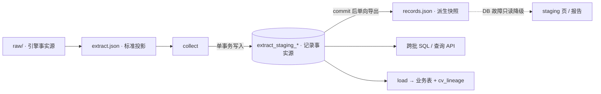

# records 事实源迁库（选项 B）设计 · 待批准

> 状态：**设计稿，未实现**。批准前不动代码。
> 触发：item2 裁决 = B。用户场景 = **跨批次 SQL 查未确认暂存记录**
> （「没办法直接从表里找提取记录」）。配套：[design-data-pipeline.md](design-data-pipeline.md)、
> [progress-handoff.md](progress-handoff.md) §二。
> 接缝现状：`store/content.py` 的 `get_records / save_records / patch_record`
> 是 records 唯一读写口（当前 = 文件原子写）；API `GET /api/runs/{batch}/staging`
> 整 doc 返回；review/PATCH 路由尚未建（P1 校验台挂起），`patch_record` 为预留语义。

---

## 0. 范围与「四层不双写」重新表述

**入库**：records 内容（values / original / review）+ lineage。
**不入库**（逐项回答 handoff 问题 3）：

| 数据 | 决定 | 理由 |
|---|---|---|
| extract.json | 维持文件 | 标准投影 / 引擎审计层，报告与 md 预生成直接读它，无跨批查询需求 |
| run.json | 维持文件 | run 快照；目录元数据已在 DB `extract_run / extract_run_file` |
| raw/ | 维持文件 | 引擎事实源，永不服务前端 |
| lineage | **入 DB** | 随记录同事务；load 阶段 `cv_lineage` 设计不动 |
| review 状态 | **入 DB** | 记录属性，PATCH 事务化 |

四层事实源新表述（取代「records.json 是 L2 事实源」）：



**不双写的新含义**：写方向只有 DB→快照 一条；快照是派生产物（可全量重建），
不是独立事实源。EAV 字段表是 values 的**查询投影**（同事务写入、可重建索引），
与 record 行的 values_json 不构成双事实源（见 §1）。

---

## 1. 表结构（003_staging_records.sql）

核心约束：**字段名随模板动态变化**（本案例 8 个中文字段，换模板即换字段集）
→ 固定列不可行。候选两形：

- **B-EAV（推荐）**：record 行存全保真 JSON + field 行存可查询投影。
  普通 SQL + 普通索引即可跨批查，符合 catalog 现有约定
  （「JSON 列 json.dumps/loads，**不依赖 MySQL JSON 函数**」）。
- B-JSON（弃）：单表 JSON + `JSON_TABLE`/函数索引。违反驱动无关约定，
  跨模板查询写法复杂，直接 SQL 可读性差。

```sql
CREATE TABLE extract_staging_record (
  id            BIGINT AUTO_INCREMENT PRIMARY KEY,
  run_file_id   BIGINT NOT NULL,                 -- 引用 extract_run_file.id
  record_index  INT    NOT NULL,                 -- 记录在文件内下标（引用键的一半）
  review_state  VARCHAR(16) NOT NULL DEFAULT 'pending',  -- pending/edited/confirmed
  review_at     DATETIME NULL,
  values_json   MEDIUMTEXT NOT NULL,             -- 全保真 body（API 重建用）
  original_json MEDIUMTEXT NOT NULL,             -- 永不覆盖
  created_at    DATETIME NOT NULL DEFAULT CURRENT_TIMESTAMP,
  UNIQUE KEY uk_rf_idx (run_file_id, record_index),   -- = quarantine/load_log 引用键
  KEY idx_review (review_state)
) ENGINE=InnoDB DEFAULT CHARSET=utf8mb4;

CREATE TABLE extract_staging_field (
  id            BIGINT AUTO_INCREMENT PRIMARY KEY,
  record_id     BIGINT NOT NULL,
  field_name    VARCHAR(128) NOT NULL,
  value_text    TEXT NOT NULL,                   -- 当前值（含 edited）
  original_text TEXT NOT NULL,
  KEY idx_field_value (field_name, value_text(191)),  -- 跨批查询主索引
  KEY idx_record (record_id),
  CONSTRAINT fk_field_rec FOREIGN KEY (record_id)
    REFERENCES extract_staging_record (id) ON DELETE CASCADE
) ENGINE=InnoDB DEFAULT CHARSET=utf8mb4;

CREATE TABLE extract_staging_lineage (
  id          BIGINT AUTO_INCREMENT PRIMARY KEY,
  record_id   BIGINT NOT NULL,
  field_name  VARCHAR(128) NOT NULL,
  region_seq  INT NOT NULL,                      -- 保序（同 cv_lineage 约定）
  page        INT NOT NULL,
  table_index INT NULL,
  table_scope VARCHAR(16) NULL,
  space       VARCHAR(16) NOT NULL,              -- source/rectified
  cell_bbox   VARCHAR(128) NULL,                 -- '[x0,y0,x1,y1]' json 字符串
  raw_text    TEXT NULL,
  UNIQUE KEY uk_rec_field_seq (record_id, field_name, region_seq),
  CONSTRAINT fk_lin_rec FOREIGN KEY (record_id)
    REFERENCES extract_staging_record (id) ON DELETE CASCADE
) ENGINE=InnoDB DEFAULT CHARSET=utf8mb4;
```

要点：

- `(run_file_id, record_index)` 唯一键 = 现有 quarantine / load_log / review API
  的引用键，**下游引用零改动**。
- 重跑提取 = 该 run_file 下 `DELETE` record（级联清 field/lineage）+ 重插，单事务。
- 写放大估算：24 记录 × 8 字段 ≈ 24 record 行 + 192 field 行 + ~192 lineage 行
  / case；本地工具量级可忽略。

用户核心需求的查询面（直接连库即可写）：

```sql
SELECT run.batch_tag, rf.name, r.record_index, f.field_name, f.value_text
FROM extract_staging_field f
JOIN extract_staging_record r  ON r.id = f.record_id
JOIN extract_run_file rf       ON rf.id = r.run_file_id
JOIN extract_run run           ON run.id = rf.run_id
WHERE f.field_name = '摘要' AND f.value_text LIKE '%报销%';
```

---

## 2. 降级契约改写（最大风险，须批准）

现状验收⑤：「停 MySQL 提取 + Preview 照常」。B 后记录事实源在 DB，
**DB  down = 新暂存写不进**。两选项：

- **D1（推荐）显式降级，不静默回落**：DB 故障时引擎层照常
  （raw / extract.json / 对照报告仍产出），records 暂存**显式失败**：
  `run_file.state = staging_failed` + 页面明确报错；旧数据经 records.json
  快照**只读**降级。绝不回落文件写（避免双事实源 split-brain）。
- D2（弃）：DB down 回落文件、恢复后补迁 → 合并冲突 + 双源，违反不双写。

代价：验收⑤改写为「停 MySQL：提取 + 报告照常，**暂存显式降级**」。
这是产品契约变化，不是纯技术细节，**需要用户明确批准**。

---

## 3. content.py 接缝实现（API / 页面零改动）

新增 `store/content_db.py`，实现同签名函数；`config.RECORDS_STORE`
（env `CV_MVP_RECORDS_STORE`，`file`|`db`）切换实现，供灰度与回滚：

- `get_records(case)`：按 run_file 查 record（order by record_index）+
  field + lineage（order by region_seq）→ **组装成现有 doc 结构**
  （schema/files/records/values/original/lineage/review 一字不差）。
  run_file 的 name/source_file_id 取自 `extract_run_file`。
- `save_records(case, doc)`：单事务 delete+insert 三表 → commit →
  **commit 后**原子导出 records.json 快照（快照可滞后，事实源唯一）。
- `patch_record(...)`：`SELECT ... FOR UPDATE` → values 差量合并、
  original 不动、review_state=edited → 同事务更新 values_json + field 行 →
  commit → 重导快照。语义与现文件版逐条对齐。
- `get/save_extract`、`get/save_run` 不动（仍文件）。

DB 不可用时 `get_records` 读快照（只读降级，D1）；写抛错由调用方记
`staging_failed`，与现有「调用方负责降级」约定一致。

---

## 4. 迁移（旧 case 回填）

- `003_staging_records.sql` 建三表，走现有迁移执行器 + schema_version 簿记。
- `migrate_records_to_db.py`（一次性、**幂等**）：扫 `output/*/records.json` →
  以 `(batch_tag=目录前缀, 文件名)` 自然键幂等登记 run/run_file（复用 catalog
  登记入口；旧 case 的 run_file_id=null 由此补齐）→ 三表写入（uk 冲突跳过）→
  重导快照回填 run_file_id。可重复跑、可中断续跑。
- 回滚：`CV_MVP_RECORDS_STORE=file` 即回文件实现；快照始终在盘，零丢失。

---

## 5. 查询 API 与页面（交付「从表里找」）

- 新增 `GET /api/staging/query?field=&q=&batch=&state=` → §1 SQL 参数化执行，
  只读；DB down 返回 503 + 降级提示（不静默查快照，快照无索引查询能力）。
- staging 页加「跨批搜索」入口（P1 校验台复用同 API）。
- 直接 SQL 连库查 = 用户原始诉求，表结构即文档。

---

## 6. 风险与验证策略

| 风险 | 应对 |
|---|---|
| 降级契约变化（⑤改写） | §2 D1，须批准 |
| 平台 DB 10.0.6.161 本机不可达 | **先本地 Docker MySQL 8 开发验收**（本机有 Docker），连通后再切平台库；conn_ref 制天然支持换 DSN |
| 事务边界 | PyMySQL 手动 commit；三表同事务；快照 commit 后导出 |
| EAV 与 values_json 漂移 | 同事务写 + 迁移脚本可全量重建 field/lineage（投影可重建=非双源） |
| 旧 case schema 旧字样（cvdoc/1） | 回填时按现 schema 重写快照，顺带刷新 |
| 回滚 | 配置开关回 file；快照在盘 |

验收清单（本地 Docker MySQL）：
1. 迁移幂等：连跑两遍行数不变；旧 case 全量回填且 staging API 返回与文件版逐字段一致
2. 重跑提取：三表级联替换、快照同步
3. patch_record：edited 状态、original 不变、field 行同步、并发 FOR UPDATE
4. 跨批查询：§1 SQL 与查询 API 命中 edited 后的值
5. 降级 D1：停 DB → 提取 + 报告照常、暂存显式 staging_failed、旧数据快照只读
6. 回滚：开关回 file 全链路照常

工作量估：SQL ~60 行 / content_db ~220 行 / 迁移脚本 ~120 行 /
API+页面 ~120 行 / 验收脚本 ~150 行。

---

## 7. 批准项（逐项确认）

1. 表结构 B-EAV（§1）
2. 降级契约 D1 + 验收⑤改写（§2）
3. records.json 降为派生快照、extract/run/raw 维持文件（§0）
4. 验证先本地 Docker MySQL，后平台库（§6）

批准后实施顺序：003 SQL → content_db + 开关 → 迁移脚本 → 查询 API/页面 → 验收。