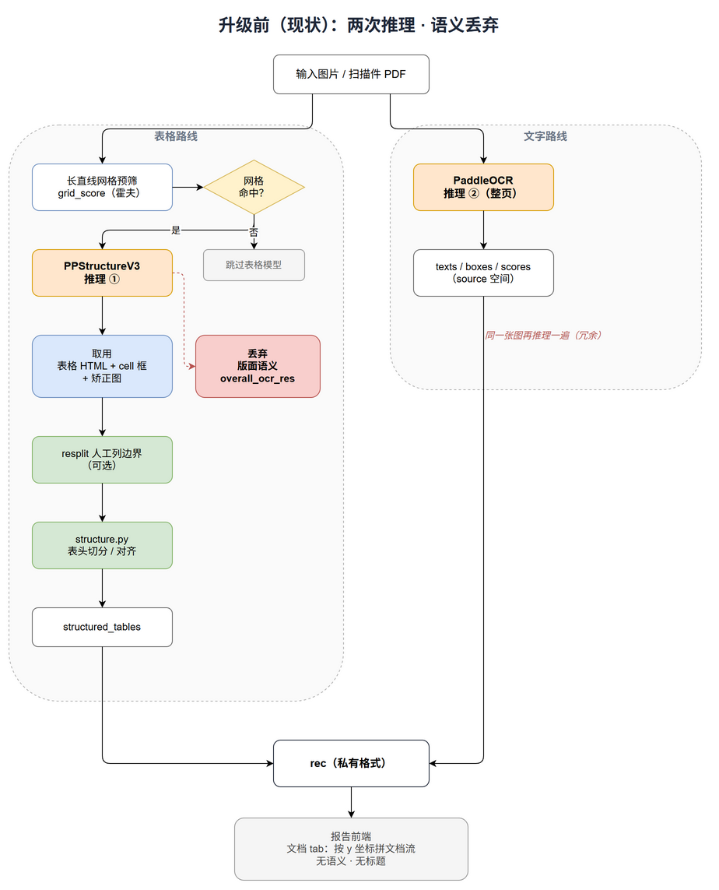
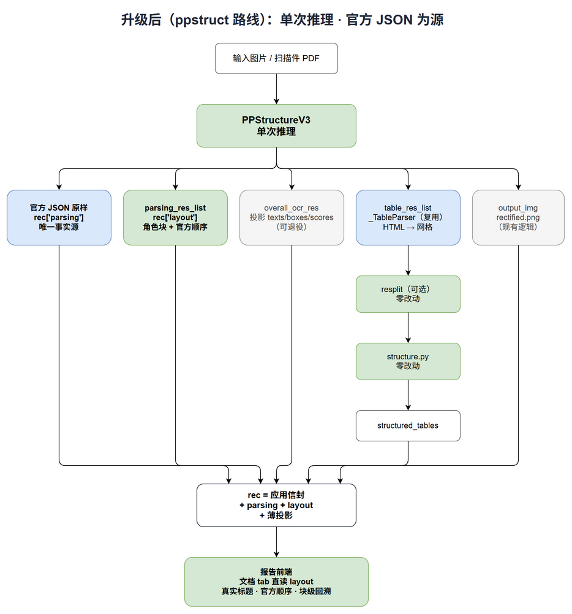

# mvp 引擎升级方案对比：升级前 vs 升级后

> 配套流程图：[`engine-upgrade.drawio`](./engine-upgrade.drawio)（两页，可在 draw.io 继续编辑）
> 导出图：[升级前](./engine-upgrade-before.drawio.png) · [升级后](./engine-upgrade-after.drawio.png)

---

## 0. 先纠正一个前提（重要）

讨论初期我们以为「旧方案 = OCR + 表格模型，升级 = 引入 PP-StructureV3」。
**读代码后发现这个前提是错的**：PP-StructureV3 **现在就已经在用**，只是只取了它的表格输出。

证据：

- [`mvp/pipeline/engines.py:32`](../pipeline/engines.py#L32) `structure()` 构造的就是 `PPStructureV3(...)`，按 `use_unwarp` 缓存两个槽位。
- [`mvp/pipeline/table_model.py:178`](../pipeline/table_model.py#L178) 表格路线调用的正是 `engines.structure(use_unwarp).predict(...)`。
- 但 [`table_model.py`](../pipeline/table_model.py) 只从结果里取 **表格 HTML + `cell_box_list` + 矫正图**，把 `parsing_res_list`（版面语义）和 `overall_ocr_res`（整页 OCR）**直接丢弃**。
- 整页文字另走一条独立推理：[`mvp/pipeline/ocr.py:43`](../pipeline/ocr.py#L43) `recognize()` 用 [`engines.py:17`](../pipeline/engines.py#L17) 的独立 `PaddleOCR` 单例再跑一遍。

所以**升级的真实含义**不是「换引擎」，而是：

1. **把已经在跑的 PP-StructureV3 用全**——不再丢弃它的版面语义与整页 OCR；
2. **把两次推理合并成一次**——整页文字直接取 PP-StructureV3 内部的 `overall_ocr_res`，不再单独跑 PaddleOCR；
3. **以官方 JSON 为唯一事实源**，不自己制定私有标准；现有 `rec` 字段降级为「薄投影」，验证后可彻底清理。

---

## 1. 升级前（现状）：两次推理 · 语义丢弃

两条并行推理路径，同一张图被推理两遍：

| 路径 | 引擎 | 取用什么 | 丢弃什么 |
|---|---|---|---|
| 表格路线 | PP-StructureV3 推理①（先过长直线网格预筛 `grid_score`） | 表格 HTML、`cell_box_list`、矫正图 | `parsing_res_list`（版面语义）、`overall_ocr_res` |
| 文字路线 | 独立 PaddleOCR 推理②（整页） | `texts / boxes / scores`（source 空间） | —（但它本可由推理①顺带产出） |

下游：表格走 `resplit`（人工列边界，可选）→ `structure.py`（表头切分/对齐）→ `structured_tables`；
两路汇进**私有格式 `rec`** → `result.json` → 报告前端。
文档 tab 只能**按 y 坐标把文字行拼成文档流**——没有语义、没有真实标题。

**痛点**：冗余推理（②可省）、语义被丢（文档 tab 无标题/无角色）、私有格式（与官方不一致）。

---

## 2. 升级后（ppstruct 路线）：单次推理 · 官方 JSON 为源

一次 PP-StructureV3 推理，扇出五路、全部利用：

| 输出 | 去向 | 性质 |
|---|---|---|
| 官方 JSON 原样 | `rec['parsing']` | **唯一事实源**（蓝） |
| `parsing_res_list` | `rec['layout']`：角色块 + 官方阅读顺序 | **新增语义**（绿） |
| `overall_ocr_res` | 投影 `texts/boxes/scores` | 薄投影，**可退役**（灰） |
| `table_res_list` | `_TableParser`（复用）→ `resplit` → `structure.py` → `structured_tables` | 领域资产，**零改动**（绿） |
| `doc_preprocessor output_img` | `rectified.png` | 现有逻辑（灰） |

汇成 `rec = 应用信封 + parsing + layout + 薄投影` → `result.json` → 报告前端。
文档 tab **直读 `layout`**：真实标题、官方阅读顺序、块级坐标回溯。

**收益**：省掉一次整页推理；文档 tab 从「y 排序拼行」升级为「语义块流」；格式与官方对齐。

---

## 3. 逐维度对比

| 维度 | 升级前 | 升级后 |
|---|---|---|
| 推理次数 | 2 次（PPStructureV3① + PaddleOCR②） | 1 次（PPStructureV3） |
| 版面语义 | 丢弃 `parsing_res_list` | 保留为 `rec['layout']` |
| 整页文字来源 | 独立 PaddleOCR | PPStructureV3 内部 `overall_ocr_res` |
| 事实源 | 私有 `rec` | 官方 JSON `rec['parsing']` |
| 文档 tab | 按 y 拼行，无标题 | 直读 layout，真实标题/官方顺序 |
| 网格预筛 `grid_score` | 有（启发式门槛） | 新路线移除（语义由模型给） |
| `resplit` / `structure.py` | 在用 | **零改动保留** |
| PDF 文本层 / CSV 路线 | 在用 | **不变** |
| 私有投影字段 | 主体 | 薄投影，验证后清理 |

---

## 4. 保留 vs 清理

**保留（领域资产，与引擎无关）**：
- `resplit.py` 人工列边界重切（仍用独立 OCR 单例做子格 crop 重 OCR，仅 `unwarp=off`）。
- `structure.py` 表头切分 / 网格对齐 / CSV 导出。
- PDF 文本层路线（pdfplumber）、CSV 路线。
- `_TableParser`、`_save_rectified`、坐标空间约定（`coord.space`）。

**清理（验证通过后，不留兼容 shim）**：
- 独立整页 `PaddleOCR` 推理②（`ocr.recognize` 的整页调用）。
- `grid_score` 长直线预筛门槛（新路线）。
- `rec` 里与官方重复的私有投影字段。
- 文档 tab 的「按 y 拼行」旧逻辑（改直读 layout）。

> 历史 case 的 `result.json` 是旧格式，升级后需**重跑**才能享受新文档 tab。

---

## 5. 三个决策点

1. **坐标空间**：PP-StructureV3 内部 OCR 跑在矫正图上。`unwarp=on` 时文字框在 rectified 空间，
   文档 tab 的文字行回溯需带 `data-space` 并支持原图/矫正图双视图切换（表格已有此机制，可复用）。
   `unwarp=off` 时矫正图与原图逐像素一致，坐标即 source，无需切换。
2. **resplit 不变**：它只治结构不治识别，子格 crop 重 OCR 仍走独立 OCR 单例，与主推理合并无关。
3. **网格预筛移除**：新路线不再用 `grid_score` 决定是否加载模型——语义由版面模型直接给出。

---

## 6. 验证清单（先验证、后清理）

- [ ] 单次推理产出 `parsing / layout / 投影 / tables / rectified` 五路齐全。
- [ ] `unwarp=off`：文字框与表格框同处 source 空间，回溯 1:1 精准。
- [ ] `unwarp=on`：文字行回溯自动切矫正图视图，框对齐。
- [ ] 文档 tab 标题/段落/表格顺序与官方阅读顺序一致。
- [ ] `resplit`、`structure.py`、CSV、PDF 文本层路线回归无退化。
- [ ] 108 这类黏连列表格重切结果与升级前一致。
- [ ] 全部通过后，删除投影字段与旧推理②、旧 y 拼行逻辑，不留 shim。