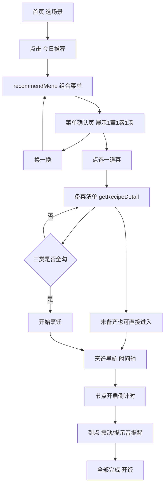

# 《吃点好的》微信小程序产品需求与技术架构文档 (PRD)

## 文档信息

| 项    | 内容                                          |
|:-----|:--------------------------------------------|
| 文档状态 | 迭代中（MVP 已落地）                                |
| 当前版本 | v1.1                                        |
| 适用产品 | 好好吃饭 · 微信小程序                                |
| 技术形态 | 微信原生小程序 + 微信云开发（CloudBase）+ 通义千问（DashScope） |

**修订记录**

| 版本   | 说明                                                                                                      |
|:-----|:--------------------------------------------------------------------------------------------------------|
| v1.0 | 初版：产品愿景、痛点、核心功能模块、技术架构、落地前清单                                                                            |
| v1.1 | 补充目标用户与场景、MVP 范围与迭代路线、详细功能需求与验收标准、页面交互流程、AI 能力设计、非功能性需求、数据指标、风险应对、术语表；技术架构与实际落地实现对齐（混合推荐、Mock 模式、云函数清单） |

---

## 一、产品愿景与定位

- **产品名称**：吃点好的（暂定，可替换为“开饭清单”/“好好吃饭·备菜助手”）
- **产品Slogan**：不用想，照着做，新手也能高效搞定一日三餐
- **核心定位**：AI驱动的家庭饮食决策与烹饪效率管理工具
- **核心价值**：解决新手做饭“决策难、统筹差、管理乱”三大痛点，将做饭从费脑家务变成高效通关游戏

### 1.1 目标用户画像

| 用户类型     | 特征               | 核心诉求          |
|:---------|:-----------------|:--------------|
| 厨房新手     | 刚独立生活/新婚，会一点但不熟练 | 有人“手把手”带，别翻车  |
| 双职工家庭掌勺人 | 下班晚、时间紧，要快速出餐    | 快手决策 + 并行统筹省时 |
| 家庭主厨（进阶） | 有一定厨艺，追求效率与不浪费   | 库存管理、临期不浪费    |
| 宝妈/照顾者   | 需兼顾营养搭配与忌口       | 荤素汤均衡、过敏源规避   |

### 1.2 典型使用场景

- 场景A（决策）：下班路上打开小程序，选「快手菜」，一键得到今晚 1 荤 1 素 1 汤。
- 场景B（备菜）：到家后进入备菜清单，把主料/调料/工具一次性备齐再开火，不再炒到一半找葱。
- 场景C（统筹）：多道菜并行时，跟着时间轴推进，关键节点倒计时到点提醒，避免糊锅/过火。
- 场景D（管理，V2）：拍冰箱照片秒入库，临期食材被优先推荐，减少浪费。

## 二、核心痛点与解决方案

| 新手痛点           | 传统菜谱APP解法    | 本产品降维解法                  |
|:---------------|:-------------|:-------------------------|
| 决策瘫痪：不知吃啥、不懂时令 | 海量菜谱让用户自己搜   | AI一键生成菜单，结合库存+时令+偏好直接给答案 |
| 手忙脚乱：炒到一半发现没切葱 | 只给食材列表，不指导准备 | 烹饪前强制TodoList，备齐再开火      |
| 效率极低：线性做菜耗时2小时 | 步骤线性排列       | 多线程统筹算法，规划最优时间轴缩短总时长     |
| 库存黑洞：食材过期、重复购买 | 无管理或纯手动录入    | AI拍照秒入库 + 做菜自动扣减 + 临期预警  |

## 三、MVP 范围与迭代路线图

产品采用「小步快跑、先验证核心亮点」的策略分期落地。

### 3.1 V1（MVP · 极简核心闭环）— 已落地

聚焦差异化亮点，验证「不用想，照着做」是否真的让用户不慌。

- AI 一键推荐菜单（1 荤 1 素 1 汤）
- 烹饪前备菜 Checklist（建议备齐再开火，不强制阻断）
- 多线程时间轴烹饪导航（节点倒计时 + 到点震动/提示音提醒）
- 轻量手动库存：录入/编辑/删除食材、临期与过期状态、做菜后自动扣减
- 清库存优先推荐：推荐时优先消耗现有/临期食材
- 菜谱收藏：把常做的单个菜谱收藏到「我的收藏」，点一下直接开做（favorites）
- 本地 Mock 模式：无需云服务即可离线完整体验闭环（库存本地持久化）

明确不做（留待 V2+）：AI 拍照入库、订阅消息临期推送、家庭共享。

### 3.2 V2（AI 入库与个性化）

- AI 拍照入库（视觉大模型识别种类/数量/保质期）
- 智能临期预警推送（依赖订阅消息模板）
- 偏好忌口设置页，推荐与步骤自动适配
- 时令优先推荐（模式B）

### 3.3 V3（家庭协同与增长）

- 家庭组：库存共享、操作记录可见、成员邀请
- 多菜统筹总时间轴（跨菜谱合并编排）
- 数据看板、常做菜谱复购提醒、成长激励体系

## 四、核心功能模块与需求明细

> 标注说明：【V1】已落地 / 【V2】【V3】规划中

### 4.1 智能决策引擎

- 【V1】**一键推荐**：点击“今日推荐”，生成 1 荤 1 素 1 汤组合
- 【V1】**场景筛选器**：⚡快手菜(<15min) / 🍳简单菜(零失败) / 🍲周末大菜(硬菜)
- 【V1】**换一换**：对当前推荐结果不满意可一键重新组合
- 【V1】**清库存优先开关**：开启后推荐优先消耗现有/临期食材（临期权重更高）
- 【V1】**库存联动可视化**：菜单卡片标注每道菜用到的库存/临期食材；备菜清单主料标注「库存/需买」并汇总需购数量
- 【V1】**菜谱收藏**：把常做的单个菜谱收藏到「我的收藏」，点一下直接进备菜开做、可取消收藏
- 【V2】**时令优先（模式B）**：基于当月时令蔬果生成菜谱

**用户故事**：作为下班回家的新手，我希望点一下就得到今晚菜单，以便不用纠结吃什么。

**验收标准**：

1. 选择任一场景点击「今日推荐」，3 秒内返回一套含荤/素/汤的菜单。
2. AI 不可用（未配 Key、超时、返回非法）时，仍能返回一套合规菜单（兜底）。
3. 「换一换」每次可得到不同组合（候选充足时）。

### 4.2 新手高效烹饪导航（核心亮点）

- 【V1】**烹饪前 Checklist**：
    - 分三类：【主料/配料】【调料】【工具】
    - 建议全部备齐再开火；未备齐也可进入烹饪步骤（仅二次确认，不强制阻断）
    - 实时展示备齐进度（已勾/总数）
- 【V1】**多线程统筹步骤**：
    - 时间轴/并行任务展示，打破线性菜谱
    - 示例：`[00:00]炖汤40min → [05:00]切配菜 → [15:00]调料汁 → [35:00]炒青菜 → [40:00]汤出锅`
    - 关键节点内置悬浮倒计时，到点震动/提示音提醒
    - 烹饪期间屏幕常亮；支持一键「全部完成」
- 【V3】**多菜总时间轴**：跨菜谱合并编排，统一倒计时与提醒

**用户故事**：作为新手，我希望开火前清单告诉我备齐了什么、还差什么，烹饪时跟着时间轴走，以免手忙脚乱。

**验收标准**：

1. 未全部勾选时仍可进入烹饪步骤查看，仅弹出二次确认提醒（不强制阻断）；全部勾选后直接进入。
2. 含 `timer` 的时间轴节点可启动独立倒计时，多个节点可同时计时。
3. 倒计时归零触发震动 + 提示音 + 文案提醒，并自动标记该节点完成。
4. 离开烹饪页时所有定时器被清理，无残留、无内存泄漏。

### 4.3 冰箱与库存管理

- 【V1】**手动录入/编辑/删除**：录入食材名称+分类+数量+单位+保质期（保质期可选）
- 【V1】**临期/过期状态**：距过期 ≤2 天为临期，已过期单独分组标红
- 【V1】**做菜自动扣减**：点击“全部完成”后，根据菜谱 BOM 自动扣减库存（同名食材匹配，扣至 0 则移除）
- 【V2】**AI拍照入库**：识别种类+数量+保质期，默认拍照时间为购买时间，支持手动修改
- 【V2】**智能临期预警**：临期前1-2天订阅消息推送提醒

### 4.4 家庭共享与个性化

- 【V2】**偏好忌口**：设置过敏源、口味、排除食材，AI推荐与步骤自动适配
- 【V3】**家庭组**：邀请家人加入，库存共享，操作记录可见

## 五、页面结构与交互流程

### 5.1 页面清单（V1）

| 页面   | 路径                  | 职责             |
|:-----|:--------------------|:---------------|
| 首页   | `pages/index/index` | 场景筛选 + 今日推荐入口  |
| 菜单确认 | `pages/menu/menu`   | 展示推荐菜单（标注用到的库存/临期食材）、换一换、选菜  |
| 备菜清单 | `pages/prep/prep`   | 三类清单勾选、主料标注库存/需买并汇总、建议备齐再开火（不强制阻断），提供「只看烹饪步骤」预览入口 |
| 烹饪导航 | `pages/cook/cook`   | 时间轴、节点倒计时、到点提醒 |
| 我的库存 | `pages/inventory/inventory` | 食材分组列表、新增/编辑/删除、临期角标 |
| 我的收藏 | `pages/favorites/favorites` | 收藏菜谱列表、点击直接开做、取消收藏 |

### 5.2 核心流程



## 六、AI 能力设计

### 6.1 混合推荐模式（预置菜谱库 + AI 组合）

MVP 不采用「每次纯 AI 生成菜谱」，而是：

- 预置 17 道经典家常菜（`recipes` 种子数据），`timelineSteps`/`checklist` 人工编排，保证质量与响应速度。
- AI 仅负责「按场景 + 时令，从候选池中组合出 1 荤 1 素 1 汤」，返回菜名，由服务端匹配为菜谱 ID。
- 优点：秒级响应、成本可控、时间轴质量稳定，最契合 MVP 快速验证。

### 6.2 推荐逻辑（recommendMenu）

1. 按场景标签 `tags` 过滤候选池。
2. 时令过滤：`season` 命中当前月份或为空（全年）；命中过少则放宽。
3. 偏好过滤（V2）：剔除命中过敏源/排除食材的菜谱。
4. 清库存优先（开关开启时）：按菜谱 `ingredientsNeeded` 与现有库存的名称重叠度打分（命中临期 +2、命中普通 +1），按得分降序排序后作为候选；并在 Prompt 中附上现有/临期食材清单。
5. 组装 Prompt 调用大模型，要求从候选菜名中各选一道，返回结构化 JSON。
6. 名称匹配为菜谱；类型缺失时用兜底补齐（清库存模式下兜底取得分最高项）。
7. 返回结果为每道菜附上 `useStockText`（命中的库存食材名）与 `useExpiringText`（其中临期的），供菜单卡片展示；无论是否开启清库存优先都会标注。

### 6.3 兜底策略（高可用）

未配置 API Key、调用超时、返回非法或缺类型时，自动从候选池随机组合一套合规菜单，保证「今日推荐」永远可用。返回字段 `source`
标识来源：`ai` / `fallback` / `mock`。

### 6.4 模型接入与可替换性

- 默认接入通义千问（DashScope OpenAI 兼容模式），默认模型 `qwen-turbo`。
- 接入层抽象在 `cloudfunctions/recommendMenu/ai.js` 的 `chatJSON`，切换腾讯混元等只需替换该实现，业务代码不变。

## 七、技术架构

### 7.1 技术栈

- **前端**：微信原生小程序 (WXML/WXSS/JS)
- **后端**：微信云开发 (CloudBase) Serverless
    - 云数据库：NoSQL文档库
    - 云存储：食材图片（V2）
    - 云函数：业务逻辑 + 定时任务（V2 临期预警）
- **AI能力**：
    - 菜谱统筹/组合推荐：通义千问（默认）/ 腾讯云混元LLM（可替换）
    - 图像识别（V2）：通义千问VL / 腾讯云混元视觉版

### 7.2 工程结构

```
60-mvp/
├── project.config.json          # 项目配置（miniprogramRoot / cloudfunctionRoot）
├── miniprogram/                 # 小程序前端
│   ├── app.js / app.json / app.wxss / sitemap.json
│   ├── config.js                # 全局开关（USE_MOCK 本地离线模式）
│   ├── mock/                    # 本地 Mock（离线体验用，库存本地持久化）
│   ├── utils/                   # request / timer / format
│   ├── components/              # recipe-card / checklist-item / timeline-step / float-timer
│   └── pages/                   # index / menu / prep / cook / inventory
└── cloudfunctions/              # login / seed / recommendMenu / getRecipeDetail / inventory
```

### 7.3 云函数清单（V1）

| 云函数               | 职责                         | 关键入参                        |
|:------------------|:---------------------------|:----------------------------|
| `login`           | 静默登录，初始化 `users` 记录        | 无                           |
| `seed`            | 幂等写入种子菜谱到 `recipes`（自动建集合） | `mode: upsert/clear`        |
| `recommendMenu`   | AI 组合推荐 + 清库存优先 + 兜底               | `scene, month, preferences, preferInventory, inventory` |
| `getRecipeDetail` | 获取菜谱详情（清单与时间轴）             | `id` 或 `ids`                |
| `inventory`       | 库存增删改查 + 做菜扣减（action 分发） | `action: list/save/delete/deduct` |
| `favorites`       | 菜谱收藏：收藏/列出/取消（action 分发） | `action: list/add/remove` |

### 7.4 核心数据库集合设计

```json
// 1. 菜谱统筹表 (recipes) —— V1 已使用
{
  "_id": "recipe_tomato_egg",
  "name": "番茄炒蛋",
  "type": "meat",
  // meat 荤 / vegetable 素 / soup 汤
  "tags": [
    "quick",
    "easy"
  ],
  // 场景标签 quick/easy/feast
  "season": [],
  // 时令月份数组，[] 表示全年
  "estimatedTime": 12,
  "servings": 2,
  "ingredientsNeeded": [
    {
      "name": "番茄",
      "qty": 2,
      "unit": "个"
    },
    {
      "name": "鸡蛋",
      "qty": 3,
      "unit": "个"
    }
  ],
  "checklist": {
    "mainIngredients": [
      "番茄 2个",
      "鸡蛋 3个",
      "小葱 1根"
    ],
    "seasonings": [
      "盐",
      "糖",
      "食用油"
    ],
    "tools": [
      "炒锅",
      "锅铲",
      "碗"
    ]
  },
  "timelineSteps": [
    {
      "time": "00:00",
      "action": "番茄切块，鸡蛋打散",
      "type": "prep"
    },
    {
      "time": "03:00",
      "action": "热锅凉油，下蛋液炒熟盛出",
      "type": "cook",
      "timer": 2
    },
    {
      "time": "06:00",
      "action": "原锅下番茄翻炒出汁",
      "type": "cook",
      "timer": 3
    }
  ],
  "tip": "蛋液炒到刚凝固就盛出，回锅时才嫩。"
}

// 2. 用户表 (users) —— V1 已使用（登录时自动创建）
{
  "_id": "openid_xxx",
  "openid": "openid_xxx",
  "familyId": "",
  "preferences": {
    "allergies": [
      "海鲜"
    ],
    "taste": [
      "清淡"
    ],
    "excludeIngredients": [
      "香菜"
    ]
  }
}

// 3. 食材库存表 (ingredients) —— V1 已使用（轻量手动库存，按 openid 隔离）
{
  "_id": "auto",
  "openid": "openid_xxx",
  "name": "番茄",
  "category": "vegetable",   // vegetable/meat/seafood/fruit/other
  "quantity": 3,
  "unit": "个",
  "expiryDate": "2026-10-16", // 可选，空表示无保质期
  "createdAt": "serverDate",
  "updatedAt": "serverDate"
  // 读取时服务端附加计算字段：_status(expired/expiring/normal)、_daysLeft
  // 临期阈值：距过期 ≤2 天；imageUrl/familyId 为 V2 拍照入库/家庭共享预留
}

// 4. 菜谱收藏表 (favorites) —— V1 已使用（收藏单个菜谱，按 openid + recipeId 去重）
{
  "_id": "auto",
  "openid": "openid_xxx",
  "recipeId": "recipe_xxx",        // 收藏的菜谱 ID（去重键）
  "name": "番茄炒蛋",              // 以下均为冗余摘要，供收藏列表展示
  "type": "meat",
  "estimatedTime": 12,
  "servings": 2,
  "tip": "小贴士",
  "createdAt": "serverDate"        // 排序用
}
```

### 7.5 本地 Mock 模式（离线体验）

- 由 `miniprogram/config.js` 的 `USE_MOCK` 开关控制，默认开启。
- 开启时不调用云函数，使用前端内置假数据（`miniprogram/mock/`），可在开发者工具测试号中离线跑通全流程。
- 库存数据在 Mock 下通过 `wx.setStorageSync` 本地持久化（key: `mock_inventory`），首次运行自动写入几条演示食材，重编不丢失。
- 收藏菜谱在 Mock 下同样本地持久化（key: `mock_favorites`），`favorites` 的 list/add/remove 离线完整可用。
- 关闭后走真实云开发；页面、组件、utils、云函数代码均无需改动，切换成本为一行配置。

## 八、非功能性需求

| 维度   | 要求                                    |
|:-----|:--------------------------------------|
| 性能   | 「今日推荐」P95 ≤ 3s；页面首屏渲染 ≤ 1s；倒计时误差 ≤ 1s |
| 可用性  | AI 异常时 100% 走兜底，核心功能不中断               |
| 兼容性  | 微信基础库 ≥ 2.2.3；适配 iOS/Android 主流机型与安全区 |
| 安全   | API Key 存云函数环境变量，不下发前端、不硬编码           |
| 隐私合规 | 遵循小程序隐私协议；V2 拍照/库存数据明确告知与授权           |
| 可维护性 | 环境切换低侵入（单一开关）；AI 接入层可替换；云函数幂等         |

## 九、数据指标与埋点

- **北极星指标**：完成一次「推荐 → 备菜 → 烹饪完成」闭环的用户占比。
- **关键漏斗**：今日推荐点击 → 进入备菜清单 → 解锁开始烹饪 → 标记全部完成。
- **辅助指标**：换一换次数、单场景使用分布、平均烹饪时长、提醒触达后的操作延迟。
- **留存**：次日/7 日复用率；家庭组（V3）活跃成员数。

## 十、风险与应对

| 风险           | 影响    | 应对                         |
|:-------------|:------|:---------------------------|
| 名称/商标被占用     | 无法上架  | 提前查重与商标预检，准备备选名            |
| AI 生成不稳定/超时  | 推荐体验差 | 混合模式 + 全链路兜底，超时可配          |
| 大模型调用成本      | 成本上升  | 优先 `qwen-turbo`、限流与缓存、兜底随机 |
| 种子菜谱覆盖不足     | 组合单一  | 持续扩充菜谱库，按场景/时令均衡           |
| 倒计时提醒不可靠     | 糊锅/过火 | 屏幕常亮 + 震动 + 提示音多重提醒        |
| Mock 与真实数据漂移 | 行为不一致 | 两份种子数据同步维护，结构对齐            |

## 十一、落地前必做清单

1. **名称查重**：在微信公众平台后台搜索目标名称，确认未被占用；若被占用，立即切换备选名
2. **商标预检**：在国家知识产权局商标局官网查询第9类（APP/小程序）和第42类（技术服务）是否可注册
3. **云开发开通**：注册小程序后第一时间开通云开发环境，选择“按量付费”模式
4. **AI接口申请**：提前申请多模态大模型API Key（腾讯云/阿里云均有免费额度），避免开发时卡住
5. **订阅消息模板（V2）**：在小程序后台申请“食材临期提醒”“今日菜单推荐”两个订阅消息模板，这是过期提醒功能的合规前提
6. **数据初始化**：部署云函数后执行一次 `seed`，写入种子菜谱；上线前将 `config.js` 的 `USE_MOCK` 置为 `false`

## 十二、术语表

| 术语      | 含义                                    |
|:--------|:--------------------------------------|
| MVP     | 最小可行产品，此处指 V1 极简核心闭环                  |
| 场景标签    | `quick` 快手 / `easy` 简单 / `feast` 周末大菜 |
| 菜谱类型    | `meat` 荤 / `vegetable` 素 / `soup` 汤   |
| 时间轴节点   | `timelineSteps` 中的一步，含时间、动作、类型、可选倒计时  |
| 兜底      | AI 不可用时返回随机合规菜单的降级策略                  |
| Mock 模式 | 不连云、用前端内置假数据的离线运行模式                   |
